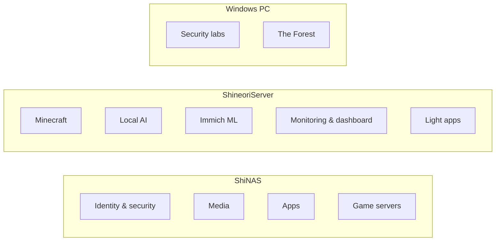

# 🏠 Hasaam's Homelab

Documentation for everything I self-host: a NAS appliance (**ShiNAS**), a repurposed laptop (**ShineoriServer**), and lab VMs on my Windows PC.

## ⭐ Featured write-ups

Full write-ups with architecture, security decisions, troubleshooting and lessons learned:

| Write-up | Highlights |
|---|---|
| 🌐 [Cloudflare Tunnel](services/cloudflared.md) | Zero open ports, a **security audit of my own setup** (5 findings, all fixed), Zero Trust gate on the NAS admin panel |
| 🔐 [Authentik SSO](services/authentik.md) | Self-hosted identity provider, passwordless passkeys, OIDC into my apps |
| 🛡️ [auditd + Discord alerts](services/security-monitoring.md) | Kernel-level audit rules mapped to attacker goals, real-time alerting through an auditd plugin I wrote |
| 🔑 [Vaultwarden](services/vaultwarden.md) | Self-hosted password manager with a zero-knowledge design; found and closed open public sign-ups, now invite-only |
| 🚚 [Moving services off the NAS](infrastructure/migration.md) | Diagnosed a RAM-starved NAS and moved 6 services to a second server, including Docker volume migrations, a broken host VPN, a dead image registry and a damaged image |
| 📸 [Immich](services/immich.md) | Multi-container photo platform: ML face recognition, vector smart search, SSO through Authentik |

## Services

**Status legend**

| | Status | Meaning |
|---|---|---|
| 🟢 | Running | Live and in daily use |
| 🟡 | In progress | Being built or still being configured |
| 🔵 | Planned | Researched and on the roadmap, not built yet |
| ⚫ | Retired | Shut down, kept here for the write-up and lessons learned |
| ⏸️ | On demand | Installed and working, but only started when I need it |

### Security & identity

| Service | Host | Status | What it does |
|---|---|---|---|
| [Authentik](services/authentik.md) | ShiNAS | 🟢 | Single sign-on and identity provider for the lab |
| [Vaultwarden](services/vaultwarden.md) | ShiNAS | 🟢 | Self-hosted Bitwarden server for passwords, TOTP and passkeys |
| [auditd + Discord alerts](services/security-monitoring.md) | ShiNAS | 🟢 | Host-level audit logging with real-time Discord webhook alerts |

### Networking & monitoring

| Service | Host | Status | What it does |
|---|---|---|---|
| [Cloudflare Tunnel](services/cloudflared.md) | ShiNAS | 🟢 | Publishes selected services to the internet with no open ports |
| [Tailscale](services/tailscale.md) | ShiNAS | 🟢 | Private remote access to the NAS and friend file sharing, nothing public |
| [Omada Controller](services/omada-controller.md) | ShineoriServer | ⏸️ | Manages TP-Link Omada network gear |
| [Homarr](services/homarr.md) | ShineoriServer | 🟢 | Dashboard / home screen for every service |
| [Diun](services/diun.md) | ShiNAS + ShineoriServer | 🟢 | Watches every container image and pings Discord when a new stable version ships |
| [Uptime Kuma](services/uptime-kuma.md) | ShineoriServer | 🟢 | Uptime monitoring and alerts for every service |

### Media

| Service | Host | Status | What it does |
|---|---|---|---|
| [Jellyfin](services/jellyfin.md) | ShiNAS | 🟢 | Media server for movies and shows |
| [Immich](services/immich.md) | ShiNAS | 🟢 | Self-hosted Google Photos replacement |
| [*arr stack](services/arr-stack.md) | ShiNAS | 🟢 | Prowlarr + arr apps + qBittorrent routed through gluetun/ProtonVPN |
| [qBittorrent (standalone)](services/qbittorrent-mam.md) | ShiNAS | ⏸️ | Separate qBittorrent instance with tracker-specific rules |
| [Audiobookshelf](services/audiobookshelf.md) | ShiNAS | 🟢 | Audiobook and podcast server |

### Apps

| Service | Host | Status | What it does |
|---|---|---|---|
| [Dawarich](services/dawarich.md) | ShineoriServer | 🟢 | Self-hosted location history (Google Timeline replacement) |
| [Flowcase](services/flowcase.md) | ShiNAS | ⏸️ | Browser-based isolated workspaces (Kasm-style), routed through ProtonVPN |
| [Ghiro](services/ghiro.md) | ShineoriServer | ⏸️ | Image forensics web app |
| [Paperless-ngx](services/paperless.md) | ShineoriServer | 🟢 | Scans, OCRs and organizes documents so they're searchable |
| [Karakeep](services/karakeep.md) | ShineoriServer | 🟢 | Self-hosted bookmark and read-it-later manager |

### Game servers

| Service | Host | Status | What it does |
|---|---|---|---|
| [Terraria (tModLoader)](services/terraria.md) | ShiNAS | ⚫ | Modded Terraria server for friends, public via playit.gg |
| [Minecraft + playit](services/minecraft.md) | ShineoriServer | 🟢 | Fabric Minecraft server for Java + Bedrock (Geyser), playit.gg tunnels, BlueMap web map, daily backups |
| [The Forest dedicated server](services/the-forest.md) | Windows PC | ⚫ | Vanilla The Forest dedicated server reached over Tailscale |

### AI

| Service | Host | Status | What it does |
|---|---|---|---|
| [Ollama + Open WebUI + SearXNG](services/ollama-stack.md) | ShineoriServer | 🟢 | Local LLM stack with private web search |
| [Nimble + Decision Bridge](services/nimble.md) | ShineoriServer + Windows PC | 🟢 | Local decision model that gives Claude typed yes/no, choice and score answers |
| [Hermes Agent](services/hermes-agent.md) | ShineoriServer | ⚫ | Local AI agent that reads release notes and posts update verdicts in Discord, behind layered guardrails |

### Security labs

| Service | Host | Status | What it does |
|---|---|---|---|
| [Pentesting lab](services/pentest-lab.md) | Windows PC | 🟢 | Attacker/target lab for practicing offensive security legally |
| [OPNsense router lab](services/opnsense-lab.md) | Windows PC | 🟢 | Virtual OPNsense router in VMware Workstation Pro, rehearsal for a NUC router |
| [EVE-NG](services/eve-ng.md) | Windows PC | 🟡 | Network emulation lab (Community Edition) |

### Web

| Service | Host | Status | What it does |
|---|---|---|---|
| [Terminal resume site](services/resume-site.md) | ShiNAS | 🟢 | Interactive terminal-style resume served from NGINX in Docker |

## Infrastructure
- [Hardware](infrastructure/hardware.md)
- [Network & remote access](infrastructure/network.md)
- [Single sign-on](infrastructure/sso.md)
- [Backups](infrastructure/backups.md)
- [Minecraft world backups](infrastructure/minecraft-backups.md)
- [Alerting & email](infrastructure/alerting.md)
