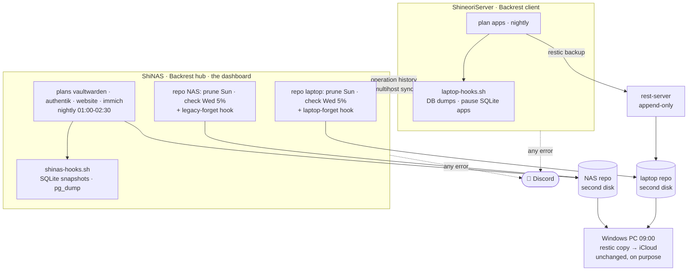

# Backrest (backup dashboard + scheduler)

> One web dashboard that runs, schedules, prunes, checks and restores **every restic backup in the lab**, across both servers

| | |
|---|---|
| **Host** | ShiNAS (hub) + ShineoriServer (client), synced with Backrest's multihost feature |
| **Category** | Backups |
| **Status** | 🟢 running (2026-11-10). Old cron scripts run in parallel for a week as a safety net, then retire. |
| **Version** | Backrest 1.14.1 (bundles restic 0.19.1, the same version as every other copy) |
| **Install** | Native binary as a root systemd service (official `install.sh --root`), **not** Docker |
| **Access** | NAS: LAN + Tailscale only. Laptop: localhost, published to my tailnet with `tailscale serve`. Never on Cloudflare. |
| **Hook scripts** | [`scripts/shinas-hooks.sh`](https://github.com/shineori/homelab/blob/main/scripts/shinas-hooks.sh), [`scripts/laptop-hooks.sh`](https://github.com/shineori/homelab/blob/main/scripts/laptop-hooks.sh) |
| **Main backup docs** | [Backups](backups.md) (what's backed up, restore runbooks, the off-site copy) |

## Why I run it

My [backups](backups.md) worked, but they lived in three cron scripts on two machines. Checking them meant SSH, log files and `restic snapshots` by hand, and my weekly checkup kept turning into CLI archaeology. Restoring one file meant remembering the right environment variables.

[Backrest](https://github.com/garethgeorge/backrest) is a web UI and scheduler built on top of restic. It reads my **existing** repositories (no migration, no re-upload), and it can run my own commands before and after each backup. I wanted:

- **One place** to see whether every backup ran last night, on both servers
- **Point-and-click restores** and file downloads, so the monthly restore drill takes minutes
- **Scheduling, retention, prune and check** owned by one tool instead of three scripts

## Architecture

| Piece | What it does |
|---|---|
| **Plans** | One per app on the NAS, so each keeps its own history and retention (7 daily, 4 weekly, 12 monthly). One `apps` plan on the laptop. |
| **Hooks** | Before each backup (`SNAPSHOT_START`, fatal on error) a hook makes the consistent copy: SQLite online-backup + integrity check, `pg_dump` + `pg_restore --list`, or `mariadb-dump`. After it (`SNAPSHOT_END`, success or failure) a hook deletes the plaintext staging copy or restarts the paused apps. |
| **Multihost sync** | The laptop pushes its operation history to the NAS, so the NAS dashboard shows both servers. Permission: **Read Operations only**. |
| **Discord hook** | Any failed operation on either server posts to my backups channel |

## Security decisions

| Decision | Why |
|---|---|
| **Native install, not Docker** | The hooks need to run `docker exec` and read app data on the host. In a container that means mounting the Docker socket, which is root on the host. I'd already removed the socket from other containers, so I wasn't adding it back. |
| **Passwords stay in root-only files** | Each repo points at its existing `chmod 600` password file with `RESTIC_PASSWORD_FILE`, so the password isn't copied into Backrest's config |
| **The laptop's repo stays append-only** | The laptop's Backrest has prune, check and forget **disabled**. Retention runs on the NAS, directly on the files, where the laptop has no say. A compromised laptop still can't delete its own backups. |
| **"Read Operations" sync, not "Shared Repos"** | Shared repos would push the NAS's repo config (a local path) to the laptop, which reaches the repo through the rest-server URL instead. Read Operations is the least access that gives me one dashboard. |
| **Never on Cloudflare** | Backrest can restore, download and delete snapshots. That's admin access to all my data, so it's LAN + Tailscale only, behind its own login. |
| **The hook scripts are root-only** (`chmod 700`) | Backrest runs them as root, so nobody else can edit them |
| **The off-site copy stays independent** | The Windows PC copy still runs from Task Scheduler. If Backrest breaks, copy 3 keeps working. |

## Setup notes

1. **Install** on both servers with the official script, reviewed first: `install.sh --root --allow-remote-access` on the NAS, `install.sh --root` on the laptop (localhost only), then `tailscale serve --bg 9898` on the laptop
2. **Instance IDs** `shinas` and `shineoriserver`, set on first launch. They can't be changed later, and they match the hostnames on my existing snapshots.
3. **Hooks** installed to `/usr/local/lib/backrest-hooks/` (root, `700`). They're the prep steps from my old scripts, split into `pre` and `post` commands.
4. **Config** written by a one-shot script with `jq` instead of ~20 UI forms: it backs up `config.json`, adds the repos and plans (each repo's GUID read from `restic cat config`), restarts Backrest, and **rolls back automatically** if it doesn't come up. Dry-run tested against a fake config first.
5. **Schedules** sit away from the old cron times during the parallel week: NAS plans 01:00 to 01:20 plus Immich at 02:30 (after Immich's own 02:00 database dump), laptop 03:15 UTC, prune Sundays 06:00, check Wednesdays 06:00 (5% of data re-read).
6. **Pairing**: generate a token on the hub, add the hub as a Known Host on the client. (See the troubleshooting log for why I ended up authorizing the client by key instead.)
7. **Parallel week**, then retire the old cron lines (keep the scripts a month as a fallback)

**Old snapshots**: Backrest tags its snapshots `plan:<id>` and only applies retention to its own. A `legacy-forget` hook expires the old script-tagged snapshots after a year, and the laptop's `forget` groups by host only, so its old and new snapshots share one retention policy.

## Troubleshooting log

| Problem | Root cause | Fix |
|---|---|---|
| The laptop showed the NAS as **Disconnected** right after pairing | A race in the experimental multihost feature: the client deleted its one-time pairing secret the moment it connected, then reconnected before the hub had saved it as an authorized client. Log: `pairing failed: unknown peer and no pairing secret provided` | Added the laptop on the hub as an **Authorized Client by its public key ID** (from the client's log). No token, no race. Connected within a minute. |
| A backup step for a small website wasn't running | It was written and tested on 2026-11-07, staged in my home folder, and never installed. **The second time this exact thing happened** (Authentik, 2026-10-30). | It's now a Backrest plan with its own pre-hook, and its first snapshot showed up green on the dashboard within minutes |
| `scp` to the NAS: *Permission denied* | The NAS vendor's SFTP server remaps home-folder paths (same as before) | Piped the file over SSH: `Get-Content -Raw file \| ssh nas "cat > path"` |
| My first schedule put Immich at 01:30 | That's before Immich's own 02:00 database dump, so every snapshot would have carried the previous night's dump. The old script ran at 03:30 for exactly this reason. | Moved the Immich plan to 02:30 |
| The terminal printed `???` instead of ✅ | The SSH session's font/locale couldn't draw the emoji | Cosmetic only. The script had worked. |
| My first guess at a Tailscale port binding used the wrong IP | Copied another device's Tailscale address | Checked with `tailscale ip -4` on the NAS. Then dropped Docker entirely: the native install binds `0.0.0.0`, which also avoids a container failing to start when Tailscale comes up after Docker at boot. |

## What I'd harden next

- [ ] **Forced-failure test on the laptop**: break a dump on purpose and confirm the Discord alert fires *and* the paused apps come back up
- [ ] **Restore drill through the UI**: restore a Vaultwarden snapshot into a scratch folder and compare item counts, like the original test
- [ ] **Dead-man's switch**: Backrest's dashboard now flags *overdue* backups, but nothing pings me if Backrest itself stops. An Uptime Kuma push monitor (Healthchecks-style hook) would cover that.
- [ ] **Single sign-on**: put the UI behind Authentik instead of a separate Backrest login
- [ ] Retire the old scripts after a clean month, and remove the `legacy-forget` hook once the old snapshots have aged out (Nov 2027)
- [ ] Watch multihost sync: it's marked experimental, so I read release notes before each Backrest update

## What I learned

- **Check the snapshots, not the plan.** Two separate times a backup step was "done" but never installed. A dashboard that shows every plan's last run makes that kind of gap impossible to miss.
- **A GUI doesn't have to mean clicking.** Backrest's config is one JSON file with strict validation, so a scripted `jq` edit with a backup and automatic rollback was safer and repeatable.
- **Containers aren't always the right answer.** When a tool's whole job is to reach into the host (`docker exec`, app data), running it natively is cleaner and more secure than mounting the Docker socket.
- **Experimental features fail in interesting ways.** Reading the client's log turned "it says disconnected" into an exact cause in one step, and the protocol's design (key IDs) offered a clean workaround.
- **Keep a seatbelt during migrations.** Running the old scripts alongside Backrest for a week costs a few extra snapshots, and buys a guaranteed backup every night while the new system proves itself.
