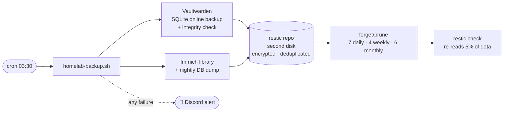

# Backups

> Nightly, encrypted, deduplicated, self-verifying backups of the data I can't replace, **with a tested restore**

| | |
|---|---|
| **Tool** | [restic](https://restic.net) 0.19.1 (single binary, checksum-verified on install) |
| **Schedule** | Nightly at 03:30 (an hour after Immich's own 02:00 database dump) |
| **Destination** | Encrypted restic repository on the NAS's **second physical disk** |
| **Script** | [`scripts/homelab-backup.sh`](https://github.com/shineori/homelab/blob/main/scripts/homelab-backup.sh) |
| **Status** | 🟡 Copy 2 of 3 done. Off-device and off-site copies are next. |

## Why

While documenting the lab, I discovered **there were no backups at all**. I had planned an rsync job but never set it up. My password vault (every login, 2FA code and passkey, for me *and* the friends I'd invited) and my photo library each existed in exactly one place. Every security fix I'd made that day protected against attackers. Backups protect against what happens to *everyone*: dead disks, bad updates and mistyped commands.

## What gets backed up

| Data | How | Why this way |
|---|---|---|
| **Vaultwarden** database | A consistent snapshot with SQLite's online-backup API, then `PRAGMA integrity_check` | The database is in WAL mode and constantly being written. Copying the file directly can produce a corrupt backup that *looks* fine. |
| Vaultwarden `rsa_key*` | Copied | Signs login tokens. Without it, a restored vault can't issue logins. |
| Vaultwarden attachments / sends | Copied | User files |
| **Immich** library (originals, profiles) | Backed up directly | Irreplaceable photos |
| Immich database | Immich's **own nightly `pg_dump`** (in `library/backups/`) | Copying a live Postgres data folder is unsafe. A logical dump is. |
| *Excluded:* Immich thumbnails + transcoded video | | Regenerable, and would only bloat the backups |

## How it works



| Design choice | Why |
|---|---|
| **Encrypted** (restic repository password) | A stolen or discarded disk is useless without it. The password is stored in my vault *and* on paper, because if the vault is what I need to restore, I can't look the password up in it. |
| **Deduplicated** | Nightly runs only store what changed. The first run was 2.3 GiB, and later runs add a few MiB. |
| **Retention: 7 daily, 4 weekly, 6 monthly** | I can go back in time, for example to before a bad update corrupted something |
| **Verifies itself nightly** | `restic check --read-data-subset=5%` proves the stored data is still readable, not just present |
| **Fails loudly** | An `ERR` trap sends a Discord alert. Silent backup failure is how people lose data. |
| **No secrets in arguments** | The Discord webhook reaches `curl` through stdin, never the command line (a lesson from my [auditd script](../services/security-monitoring.md)) |
| **Plaintext staging is deleted** | The temporary vault snapshot is removed after backup, and also on failure (via the trap) |
| **Overlap lock** (`flock`) | A slow run can never collide with the next one |
| **Installed from GitHub with checksum verification** | Docker Hub's anonymous pull limit blocked the container image, so I installed the official binary and verified it against the release's `SHA256SUMS` |

## The restore test ✅

> A backup you've never restored is a hope, not a backup.

On the first night, I restored from the backup into a scratch folder and compared it against the live data:

```
restored DB integrity:  ok
users    backup=  4   live=  4
ciphers  backup=548   live=548     (every vault item accounted for)
rsa_key identical:      YES
immich DB dump restorable: YES     (gzip integrity verified)
```

Then I deleted the scratch copy, since it contained a plaintext vault database.

## The failure-alert test ✅

An alert I've never seen fire is no better than an untested backup. So I ran a throwaway copy of the script pointed at a repository that doesn't exist:

```
Fatal: repository does not exist        ← deliberate failure
exit code: 1                            ← failure detected
staging folder: 0 files                 ← plaintext vault snapshot cleaned up anyway
📱 Discord #backups: "❌ ShiNAS backup FAILED (line …)"   ← failure reported
```

One test proved all three: failures are **detected**, **reported**, and **cleaned up after**. Alerts go to a dedicated `#backups` channel with its own webhook, stored root-only and passed to `curl` over stdin.

## How to restore 📖

*A runbook for future me, written while everything still works.*

### How the password works

restic encrypts everything **before** it's written to disk. The repository password unlocks the repository's key, which decrypts the data. Without it, the repository is unreadable, by anyone, including me. There's no recovery option.

```
password ──▶ unlocks the repository key ──▶ decrypts the backups
```

| Where the password lives | Used when |
|---|---|
| `/root/.restic-password` (root-only file on the NAS) | **Automatically**, every night. I never type it. |
| 🔐 My vault + 📝 a paper copy | **Disaster only:** the NAS was reinstalled, the file is gone, or the backup disk moved to another machine |

### Setup for every command below (on the NAS)

```bash
export RESTIC_REPOSITORY=/volume2/backups/restic
export RESTIC_PASSWORD_FILE=/root/.restic-password   # skip this line to be prompted for the password instead
sudo -E restic snapshots                              # the timeline of every backup
```

### Scenario A: get back a single file or an older version 🙂

```bash
sudo -E restic restore latest --tag vaultwarden --target /tmp/restore   # or a snapshot ID instead of "latest"
# ...copy what you need out of /tmp/restore, then:
sudo rm -rf /tmp/restore
```

Or **browse backups like normal folders**:

```bash
sudo mkdir -p /mnt/restic && sudo -E restic mount /mnt/restic
# in another terminal: ls /mnt/restic/snapshots/     (Ctrl+C in the first terminal to unmount)
```

### Scenario B: restore Vaultwarden completely 🔑

```bash
sudo -E restic restore latest --tag vaultwarden --target /tmp/restore
cd ~/docker/vaultwarden && sudo docker compose stop          # nothing writes during the swap
sudo cp -a vw-data vw-data.before-restore                    # safety copy of the current state
sudo cp -a /tmp/restore/volume2/backups/staging/vaultwarden/. vw-data/
sudo docker compose start && sudo rm -rf /tmp/restore
```

The backup includes the database, `rsa_key*` (without it, existing logins break) and attachments. Check by logging in and confirming your item count.

### Scenario C: restore Immich 📸

1. Restore the library: `sudo -E restic restore latest --tag immich --target /tmp/restore`, then copy `.../immich/library/` back into place with the stack stopped
2. The database comes back from the newest dump in `library/backups/*.sql.gz`, following **Immich's official restore procedure for the installed version** (it loads the dump into a fresh, empty database container). Thumbnails regenerate on their own afterwards.

### Scenario D: total disaster 💥 (NAS dead or reinstalled)

1. Get the backup disk mounted on a working Linux machine (or a reinstalled NAS)
2. Install restic from GitHub and **verify it** with `sha256sum -c` against the release's `SHA256SUMS`
3. `restic -r /path/to/backups/restic snapshots`, and **type the password from paper / the vault** at the prompt
4. Continue with Scenarios B and C

> ⚠️ If the NAS *and* its disks are lost (fire, theft, ransomware), this repository is gone too. That's why off-device and off-site copies are next on the roadmap.

## Troubleshooting log

| Problem | Root cause | Fix |
|---|---|---|
| `toomanyrequests` pulling the restic image | Docker Hub's anonymous pull limit, after a night of image pulls | Installed the official binary from GitHub instead, verified with `sha256sum -c` |
| The script got scrambled when pasted into the terminal | A long multi-line paste was mangled by the terminal | Delivered the file over the network share instead, and confirmed it with a matching SHA-256 on both ends |
| The restore test couldn't find the restored Immich dump | My test made the folder root-only, but the `*.sql.gz` wildcard was expanded by my *user* shell before `sudo` ran | Ran the whole check inside `sudo sh -c '...'`. The backup itself was fine. |

## Roadmap to full 3-2-1

- [x] **Copy 1:** live data on the NAS
- [x] **Copy 2:** encrypted restic repository on a **separate physical disk** (survives a dead drive or a bad command)
- [ ] **Copy 3, separate device:** replicate the repository to my second server, so the backups survive the whole NAS dying
- [ ] **Off-site:** encrypted copy to cloud storage, so the backups survive fire, theft or ransomware on the home network
- [ ] **Back up ShineoriServer too:** Dawarich, Karakeep, Uptime Kuma and Homarr now live on the laptop, which this nightly run doesn't cover yet ([migration notes](migration.md))
- [ ] **Dead-man's switch:** an Uptime Kuma push monitor that alerts if a night's backup *doesn't run at all* (the Discord trap only catches runs that start and then fail)
- [ ] Quarterly restore drill
