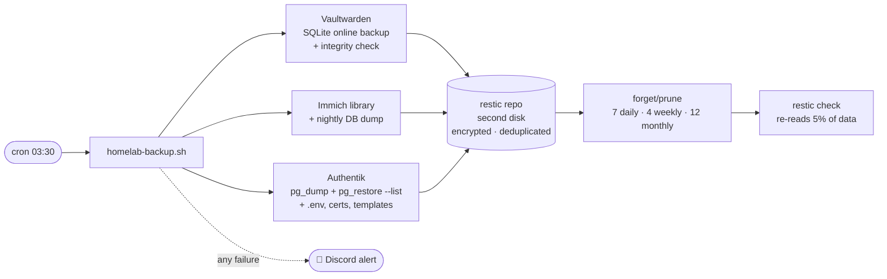
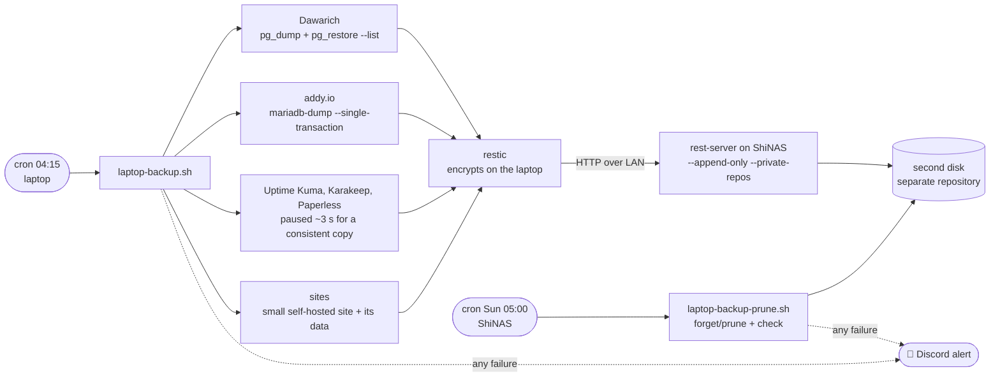
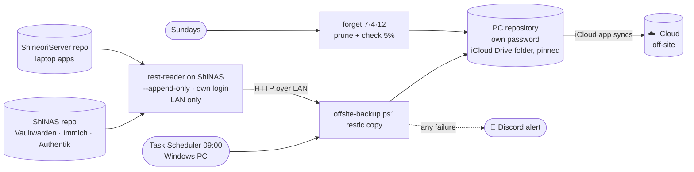

# Backups

> Nightly, encrypted, deduplicated, self-verifying backups of the data I can't replace, **with a tested restore**

| | |
|---|---|
| **Tool** | [restic](https://restic.net) 0.19.1 (single binary, checksum-verified on install) |
| **Schedule** | Nightly at 03:30 (an hour after Immich's own 02:00 database dump) |
| **Destination** | Encrypted restic repository on the NAS's **second physical disk** |
| **Script** | [`scripts/homelab-backup.sh`](https://github.com/shineori/homelab/blob/main/scripts/homelab-backup.sh) |
| **Also covers** | ShineoriServer's apps, through an append-only backup server ([details below](#shineoriserver-backups-append-only)) |
| **Copy 3 + off-site** | My Windows PC pulls both repositories every morning into its own repository inside iCloud Drive ([details below](#copy-3-off-site-windows-pc-icloud)) |
| **Retention** | 7 daily, 4 weekly, 12 monthly (one year of history), on every copy |
| **Status** | 🟢 3-2-1 done (2026-10-30). A dedicated cloud provider is a later upgrade. |

## Why

While documenting the lab, I discovered **there were no backups at all**. I had planned an rsync job but never set it up. My password vault (every login, 2FA code and passkey, for me *and* the friends I'd invited) and my photo library each existed in exactly one place. Every security fix I'd made that day protected against attackers. Backups protect against what happens to *everyone*: dead disks, bad updates and mistyped commands.

## What gets backed up

| Data | How | Why this way |
|---|---|---|
| **Vaultwarden** database | A consistent snapshot with SQLite's online-backup API, then `PRAGMA integrity_check` | The database is in WAL mode and constantly being written. Copying the file directly can produce a corrupt backup that *looks* fine. |
| Vaultwarden `rsa_key*` | Copied | Signs login tokens. Without it, a restored vault can't issue logins. |
| Vaultwarden attachments / sends | Copied | User files |
| **Immich** library (originals, profiles) | Backed up directly | Irreplaceable photos |
| Immich database | Immich's **own nightly `pg_dump`** (in `library/backups/`) | Copying a live Postgres data folder is unsafe. A logical dump is. |
| *Excluded:* Immich thumbnails + transcoded video | | Regenerable, and would only bloat the backups |
| **Authentik** database (added 2026-10-30) | `pg_dump -Fc` while it runs, then `pg_restore --list` to prove the dump is readable | My single sign-on sits in front of several apps. Losing it means rebuilding every login flow and passkey. A dump is consistent; a copied Postgres folder is not. |
| Authentik `.env`, `compose.yml`, `data`, `certs`, `custom-templates` | Copied into a root-only staging folder | `.env` holds the secret key. Without it, a restored database can't decrypt its own stored secrets. |

## How it works



| Design choice | Why |
|---|---|
| **Encrypted** (restic repository password) | A stolen or discarded disk is useless without it. The password is stored in my vault *and* on paper, because if the vault is what I need to restore, I can't look the password up in it. |
| **Deduplicated** | Nightly runs only store what changed. The first run was 2.3 GiB, and later runs add a few MiB. |
| **Retention: 7 daily, 4 weekly, 12 monthly** | I can go back in time, for example to before a bad update corrupted something. Raised from 6 to 12 monthly on 2026-10-30 for a full year of history. Thanks to deduplication, the extra months cost very little space. |
| **Verifies itself nightly** | `restic check --read-data-subset=5%` proves the stored data can still be read back |
| **Fails loudly** | An `ERR` trap sends a Discord alert. Silent backup failure is how people lose data. |
| **No secrets in arguments** | The Discord webhook reaches `curl` through stdin, never the command line (a lesson from my [auditd script](../services/security-monitoring.md)) |
| **Plaintext staging is deleted** | The temporary vault snapshot is removed after backup, and also on failure (via the trap) |
| **Overlap lock** (`flock`) | A slow run can never collide with the next one |
| **Installed from GitHub with checksum verification** | Docker Hub's anonymous pull limit blocked the container image, so I installed the official binary and verified it against the release's `SHA256SUMS` |

## The restore test ✅

> A backup you've never restored is a hope, not a backup.

On the first night, I restored from the backup into a scratch folder and compared it against the live data:

```
restored DB integrity:  ok
users    backup=  4   live=  4
ciphers  backup=548   live=548     (every vault item accounted for)
rsa_key identical:      YES
immich DB dump restorable: YES     (gzip integrity verified)
```

Then I deleted the scratch copy, since it contained a plaintext vault database.

## The failure-alert test ✅

An alert I've never seen fire is no better than an untested backup. So I ran a throwaway copy of the script pointed at a repository that doesn't exist:

```
Fatal: repository does not exist        ← deliberate failure
exit code: 1                            ← failure detected
staging folder: 0 files                 ← plaintext vault snapshot cleaned up anyway
📱 Discord #backups: "❌ ShiNAS backup FAILED (line …)"   ← failure reported
```

One test proved all three: failures are **detected**, **reported**, and **cleaned up after**. Alerts go to a dedicated `#backups` channel with its own webhook, stored root-only and passed to `curl` over stdin.

## How to restore 📖

*A runbook for future me, written while everything still works.*

### How the password works

restic encrypts everything **before** it's written to disk. The repository password unlocks the repository's key, which decrypts the data. Without it, the repository is unreadable, by anyone, including me. There's no recovery option.

```
password ──▶ unlocks the repository key ──▶ decrypts the backups
```

| Where the password lives | Used when |
|---|---|
| `/root/.restic-password` (root-only file on the NAS) | **Automatically**, every night. I never type it. |
| 🔐 My vault + 📝 a paper copy | **Disaster only:** the NAS was reinstalled, the file is gone, or the backup disk moved to another machine |

### Setup for every command below (on the NAS)

```bash
export RESTIC_REPOSITORY=/volume2/backups/restic
export RESTIC_PASSWORD_FILE=/root/.restic-password   # skip this line to be prompted for the password instead
sudo -E restic snapshots                              # the timeline of every backup
```

### Scenario A: get back a single file or an older version 🙂

```bash
sudo -E restic restore latest --tag vaultwarden --target /tmp/restore   # or a snapshot ID instead of "latest"
# ...copy what you need out of /tmp/restore, then:
sudo rm -rf /tmp/restore
```

Or **browse backups like normal folders**:

```bash
sudo mkdir -p /mnt/restic && sudo -E restic mount /mnt/restic
# in another terminal: ls /mnt/restic/snapshots/     (Ctrl+C in the first terminal to unmount)
```

### Scenario B: restore Vaultwarden completely 🔑

```bash
sudo -E restic restore latest --tag vaultwarden --target /tmp/restore
cd ~/docker/vaultwarden && sudo docker compose stop          # nothing writes during the swap
sudo cp -a vw-data vw-data.before-restore                    # safety copy of the current state
sudo cp -a /tmp/restore/volume2/backups/staging/vaultwarden/. vw-data/
sudo docker compose start && sudo rm -rf /tmp/restore
```

The backup includes the database, `rsa_key*` (without it, existing logins break) and attachments. Check by logging in and confirming your item count.

### Scenario C: restore Immich 📸

1. Restore the library: `sudo -E restic restore latest --tag immich --target /tmp/restore`, then copy `.../immich/library/` back into place with the stack stopped
2. The database comes back from the newest dump in `library/backups/*.sql.gz`, following **Immich's official restore procedure for the installed version** (it loads the dump into a fresh, empty database container). Thumbnails regenerate on their own afterwards.

### Scenario C2: restore Authentik 🔑

```bash
sudo -E restic restore latest --tag authentik --target /tmp/restore
S=/tmp/restore/volume2/backups/staging/authentik
cd ~/docker/authentik && sudo docker compose stop server worker      # keep only the database running
sudo cp -a $S/.env $S/compose.yml .                                  # .env holds the secret key: it must match the database
sudo sh -c "docker exec -i authentik-postgresql-1 pg_restore -U authentik -d authentik --clean --if-exists < $S/authentik.dump"
sudo docker compose up -d && sudo rm -rf /tmp/restore
```

`data`, `certs` and `custom-templates` come back the same way as `.env`. I've only proven the dump is readable (`pg_restore --list` shows all 230 tables); a full reload into a scratch container is on the drill list below.

### Scenario D: total disaster 💥 (NAS dead or reinstalled)

1. Get the backup disk mounted on a working Linux machine (or a reinstalled NAS)
2. Install restic from GitHub and **verify it** with `sha256sum -c` against the release's `SHA256SUMS`
3. `restic -r /path/to/backups/restic snapshots`, and **type the password from paper / the vault** at the prompt
4. Continue with Scenarios B, C and C2

> ⚠️ If the NAS *and* its disks are lost (fire, theft, ransomware), this repository is gone too. That's what [copy 3 on my PC and its off-site copy in iCloud](#copy-3-off-site-windows-pc-icloud) are for. Scenario E below restores from them.

## ShineoriServer backups (append-only)

After [moving six services](migration.md) to my laptop server, their data sat outside the nightly backup. The laptop now backs up to the NAS, designed so that **the laptop can add backups but can never delete them**.



| | |
|---|---|
| **What** | Dawarich (database dump + its files), Karakeep (`data` volume), Uptime Kuma, Paperless (documents, database and search index), addy.io (database dump + its folder: config, app key and DKIM key; added 2026-10-30), `~/docker/sites` (a small Node site and its JSON data file; added 2026-10-30), plus each app's compose file and `.env`. Homarr was included until it was retired on 2026-10-28. |
| **Not included** | Karakeep's search index (rebuildable), AI models (re-downloadable), the Minecraft world (it has [its own daily backup](minecraft-backups.md); I briefly added it here too, then took it back out the same day because one Minecraft backup process is plenty) |
| **Schedule** | Laptop nightly at 04:15, after the NAS's own 03:30 run so they don't compete for the disk. NAS cleanup Sundays at 05:00. |
| **Scripts** | [`laptop-backup.sh`](https://github.com/shineori/homelab/blob/main/scripts/laptop-backup.sh) on the laptop, [`laptop-backup-prune.sh`](https://github.com/shineori/homelab/blob/main/scripts/laptop-backup-prune.sh) on the NAS |
| **Backup server** | [`stacks/restic-server/`](https://github.com/shineori/homelab/tree/main/stacks/restic-server), bound to the NAS's LAN IP |
| **Size** | First run: 340 MiB of data, 167 MiB stored after compression |

| Design decision | Why |
|---|---|
| **Append-only backup server** | The laptop's login can only *add* data. If the laptop were ever compromised, by ransomware for example, the attacker couldn't delete or overwrite its backups. Cleanup runs on the NAS, directly on the files, where the laptop has no say. |
| **Encrypted on the laptop** | The NAS only ever receives encrypted data |
| **`--private-repos`** | The laptop's login can only reach its own repository |
| **A separate repository** | The NAS's backups and the laptop's can't affect each other |
| **`pg_dump` for Dawarich, a short pause for the SQLite apps** | Both give a consistent copy. PostgreSQL can dump while it runs. For the small SQLite apps, stopping them for about 3 seconds is simpler and more reliable than locating every database file. An `EXIT` trap restarts them even if the backup fails. |
| **Secrets in root-only files** | The server login lives in a `chmod 600` repository file and the encryption key in a `chmod 600` password file. Both were typed with `read -s`, so neither appeared on screen or in shell history. The key is also in my password manager. |

### Proven ✅

| Test | Result |
|---|---|
| Restore | Restored the Dawarich dump from the NAS and read it with `pg_restore --list`: database `dawarich_development`, **578** entries |
| **Delete from the laptop** | `restic forget <snapshot>` was refused by the NAS with **`403 Forbidden`** 🔒 |
| Cleanup + verification on the NAS | Retention applied, and `restic check` re-read 5% of the data: **no errors were found** |
| Key in my password manager | Its SHA-256 fingerprint matches the key the backups actually use, checked without displaying the key |

### Restoring a ShineoriServer app

On the laptop:

```bash
R="sudo RESTIC_REPOSITORY_FILE=/root/.restic-repo RESTIC_PASSWORD_FILE=/root/.restic-password restic"
$R snapshots
$R restore latest --target /tmp/restore --include /home/shineori/docker/uptime-kuma    # one app's folder
```

If the laptop is gone, run restic **on the NAS** against `/volume2/backups/restic-laptop/shineoriserver`, using the encryption key from my password manager. The Dawarich database comes back from `var/backups/homelab-staging/dawarich.dump` with `pg_restore` into a fresh Dawarich (listing it is tested; a full database reload is on the drill list below).

## Copy 3 + off-site: Windows PC + iCloud

Until 2026-10-30, every backup lived on one NAS in one house. A dead NAS, a fire or ransomware on the network could take the live data *and* the backups together. I wanted a third copy on a different device and one off-site, without paying for anything yet. My Windows PC is on all the time, and I already pay for iCloud storage, so the PC became copy 3 and its iCloud Drive folder became the off-site copy.



| | |
|---|---|
| **What** | Both repositories: the NAS's own and the laptop's (about 21 GB together) |
| **Schedule** | Daily at 09:00, after both nightly runs. If the PC was off, Task Scheduler runs it as soon as it can. |
| **Script** | [`scripts/offsite-backup.ps1`](https://github.com/shineori/homelab/blob/main/scripts/offsite-backup.ps1) (PowerShell, run by the "Homelab Offsite Backup" scheduled task) |
| **Backup server** | `rest-reader`, a second container in [`stacks/restic-server/`](https://github.com/shineori/homelab/tree/main/stacks/restic-server) |
| **Where it lands** | `iCloudDrive\Backups\restic-offsite` on the PC, pinned to "Always keep on this device", synced to iCloud by the iCloud app |
| **Keys** | `C:\Backups\keys`, locked to my Windows user and SYSTEM, never inside iCloud. All repository passwords are also in my password manager. |
| **First run** | Copied both repositories (about 21 GB) over the LAN in a few minutes |

| Design decision | Why |
|---|---|
| **The PC pulls; the NAS never pushes** | The PC starts every copy, so nothing on the NAS needs a login to my PC, and a run missed while the PC was off just happens later |
| **A second rest-server, `rest-reader`, append-only with its own login** | The PC can read both repositories but can't delete or overwrite anything on the NAS. The existing server uses `--private-repos`, so a new user couldn't see the NAS's own repository there, and a separate container left the laptop's working setup untouched. |
| **`restic copy` into its own repository with its own password, not a file sync** | A file sync would faithfully mirror corruption or ransomware damage. A separate repository keeps its own history, and its key is separate from the NAS's. |
| **Same retention as the NAS, applied only on Sundays** | `restic copy` copies any snapshot the destination doesn't have. Forgetting old snapshots every day made the next run pull back the ones the NAS hadn't pruned yet. Running cleanup weekly, like the NAS, stops that churn. |
| **iCloud through the PC's synced folder, not rclone** | rclone's iCloud backend would need my full Apple ID password stored on a server (app-specific passwords aren't accepted), a 2FA re-login about once a month, and Advanced Data Protection turned off. The iCloud app on the PC needs none of that. |
| **Folder pinned to "Always keep on this device"** | Otherwise iCloud can replace files with cloud-only placeholders, and the weekly check would have to download them all back |
| **Keys, cache and logs stay outside iCloud** | Apple only ever stores encrypted restic chunks, no filenames and no keys |
| **Stops if the iCloud folder is missing** | If iCloud is signed out, the script fails loudly instead of quietly backing up somewhere that never syncs |

**Options I passed on (for now):**

| Option | Why not |
|---|---|
| Google Drive, free 15 GB | Too small for everything, and a full Google account stops receiving Gmail |
| My school's Google Drive | The account goes away after graduation, IT can cap storage at any time, and school accounts often block apps like rclone |
| Backblaze B2 | Honestly the best long-term pick (restic supports it natively, and it costs cents a month at this size). It's the planned upgrade once I can justify paying for it. |

### Proven ✅

| Test | Result |
|---|---|
| Reader login | Both repositories answer `200` with the PC's login and `401` without it |
| First copy | Both repositories copied, log ends in `== offsite backup OK` |
| As a scheduled task | Ran under my normal (non-admin) user with result `0` |
| New data flows through | Authentik's first snapshot reached the PC copy the same morning it was taken on the NAS |

### Scenario E: restore from the PC copy 🖥️

In PowerShell on the PC (or any machine with the iCloud folder and the PC repository password):

```powershell
$R = Get-ChildItem "$env:LOCALAPPDATA\Microsoft\WinGet\Packages\restic.restic_*\restic_*.exe" | Sort LastWriteTime -Desc | Select -First 1 -Expand FullName
$env:RESTIC_REPOSITORY    = "$env:USERPROFILE\iCloudDrive\Backups\restic-offsite"
$env:RESTIC_PASSWORD_FILE = 'C:\Backups\keys\offsite.pass'   # or leave this out and type the password from my vault
& $R snapshots --group-by host,tags
& $R restore latest --tag vaultwarden --target C:\Temp\restore
```

Then copy the restored files to a rebuilt server and follow Scenarios B, C and C2. If the PC is gone too, sign in to iCloud on any computer, let the folder download, install restic and point it at that folder.

## Troubleshooting log

| Problem | Root cause | Fix |
|---|---|---|
| `toomanyrequests` pulling the restic image | Docker Hub's anonymous pull limit, after a night of image pulls | Installed the official binary from GitHub instead, verified with `sha256sum -c` |
| The script got scrambled when pasted into the terminal | A long multi-line paste was mangled by the terminal | Delivered the file over the network share instead, and confirmed it with a matching SHA-256 on both ends |
| The restore test couldn't find the restored Immich dump | My test made the folder root-only, but the `*.sql.gz` wildcard was expanded by my *user* shell before `sudo` ran | Ran the whole check inside `sudo sh -c '...'`. The backup itself was fine. |
| The NAS cleanup failed: *wrong password or no key found* | The key I typed on the NAS didn't match the laptop's (a paste slip) | Compared SHA-256 fingerprints of both files without showing either key, then copied the laptop's working file over SSH instead of retyping it. Also checked that my password manager's copy matched. |
| A restore check said *Permission denied* even with `sudo` | In `sudo cmd < file`, the `<` is handled by my own shell, not by root | `sudo sh -c 'cmd < file'`, so root opens the file |
| Laptop backup failed: `No such container: homarr` (2026-10-28) | I had removed Homarr from both servers, but the script still tried to pause it | Took Homarr out of the pause list and the backup paths. The `EXIT` trap worked as designed: the other paused apps were started again even though the run failed. |
| **Authentik wasn't actually being backed up** (found 2026-10-30) | On 2026-10-28 I built and tested the Authentik addition, staged it in `/tmp`, and never installed it. Two days of "done" with zero snapshots. | Found it by listing the real snapshot tags in the PC copy. Rebuilt it on top of the current script, staged it in my home folder instead of `/tmp`, installed it, ran it, and confirmed the `authentik` snapshot on the NAS and the PC. Lesson: check the snapshots, not the plan. |
| `sudo script >> /var/log/....log` gave *Permission denied* and the backup never ran | Same trap as above: the `>>` redirect is opened by my own shell before `sudo` starts | `sudo bash -c 'script >> /var/log/....log 2>&1'` |
| Copying a file to the NAS with `scp` failed: *dest open ... No such file or directory* | The NAS vendor replaces the normal SFTP server with its own, which remaps home-folder paths | Piped the file over plain SSH instead (`type file \| ssh nas "cat > path"`), the same trick my [Minecraft backup](minecraft-backups.md) uses |
| PowerShell 5.1 stopped the PC script on restic's first progress line | Windows PowerShell treats anything a program writes to stderr as an error, and the script runs with `ErrorActionPreference = 'Stop'` | Set `ErrorActionPreference` to `Continue` inside the function that runs restic, and check `$LASTEXITCODE` instead |
| The Discord alert emoji came out garbled on the PC | PowerShell 5.1 reads a UTF-8 file without a BOM as the old Windows code page | Saved the script as UTF-8 with a BOM, and built the emoji from its code point |
| `restic` not found from the scheduled task | winget installed restic but didn't create its usual command shortcut | The script finds the newest `restic_*.exe` in winget's package folder, which also survives restic upgrades |
| *Access is denied* registering the task to run while signed out | That mode (S4U) needs an elevated prompt | Registered it to run while I'm signed in. The PC never sleeps, and a missed run catches up later. |
| The PC re-copied 6 old snapshots on its second run | Its daily cleanup forgot snapshots the NAS still had (the NAS prunes weekly), so `restic copy` saw them as missing | Moved the PC's forget/prune/check to Sundays only |

## Roadmap to full 3-2-1

- [x] **Copy 1:** live data on the NAS
- [x] **Copy 2:** encrypted restic repository on a **separate physical disk** (survives a dead drive or a bad command)
- [x] **Copy 3, separate device** ✅ *Done 2026-10-30:* my Windows PC pulls both repositories daily into its own repository ([above](#copy-3-off-site-windows-pc-icloud))
- [x] **Off-site** ✅ *Done 2026-10-30:* that PC repository lives in iCloud Drive, so it survives fire, theft or ransomware on the home network
- [ ] **A dedicated cloud provider** (Backblaze B2): an off-site copy that doesn't depend on my PC or my iCloud storage
- [x] **Back up Authentik** ✅ *Done 2026-10-30:* database dump plus `.env`, certs and templates, verified readable
- [x] **One year of history** ✅ *Done 2026-10-30:* retention raised to 12 monthly on every copy
- [x] **Back up ShineoriServer too** ✅ *Done:* nightly, encrypted, append-only backups to the NAS, with a tested restore ([above](#shineoriserver-backups-append-only))
- [ ] **Dead-man's switch:** an Uptime Kuma push monitor that alerts if a night's backup *doesn't run at all* (the Discord trap only catches runs that start and then fail)
- [x] **Add Paperless** ✅ *Done 2026-10-28:* it moved to ShineoriServer, so it joined the laptop's nightly append-only backup. Paperless uses SQLite, so it's paused for a few seconds like the other small apps, and its whole folder (`data/`, `media/`, compose file) is backed up.
- [ ] Quarterly restore drill, including a full reload of the Dawarich and Authentik databases into test containers, and a restore from the PC copy
