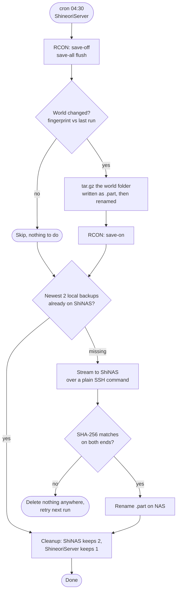

# Minecraft world backups

> Daily world snapshots that **skip quiet days**: the newest copy stays on the game server, and every copy goes to the NAS (verified) right away, where the newest 2 are kept

| | |
|---|---|
| **Host** | ShineoriServer (runs the backup, keeps 1), ShiNAS (keeps 2: newest + one rollback) |
| **Category** | Backups |
| **Status** | 🟢 running |
| **Schedule** | Daily at 04:30 (root cron on ShineoriServer) |
| **Script** | [`scripts/mc-backup.sh`](https://github.com/shineori/homelab/blob/main/scripts/mc-backup.sh) |
| **Size** | About 450 MB per snapshot (compressed `.tar.gz`) |

## Why I run it

The [Minecraft server](../services/minecraft.md) world wasn't in my nightly [restic backups](backups.md), and I'd already had to start the world over once after server problems. A world is weeks of my friends' building, so I wanted:

- A copy for **every day something actually happened**, without filling the disk with identical copies on days nobody played
- The newest copy close by on the game server, for fast restores
- A copy of the newest backup **off the game server right away**, plus one rollback, on the NAS

**2026-10-30 slim-down:** the first version kept 5 copies on the game server and archived every older one to the NAS forever. That was more than a small friends' world needs, it grew by about 450 MB per rotation with no cleanup, and the newest 5 copies only ever lived on the laptop. Now it's 1 on the laptop and 2 on the NAS, and the newest backup is always on both machines.

## Architecture



| Piece | Job |
|---|---|
| **`mc-backup.sh`** | One bash script, run by root's crontab on ShineoriServer |
| **RCON** (`rcon-cli` inside the container) | Pauses autosave and flushes everything in memory to disk, so the copy is consistent |
| **Fingerprint** | A SHA-256 of every world file's path, size and modified time. If it matches the last backup's, nothing changed |
| **Local store** | `~/backups/minecraft` on ShineoriServer, the newest snapshot plus `backup.log` |
| **NAS copy** | `~/backups/minecraft` on ShiNAS, the newest 2 snapshots (same as the laptop + one rollback) |
| **Catch-up** | Each run makes sure the newest 2 local backups exist on the NAS, so a night the NAS was unreachable fixes itself on the next run |
| **Dedicated SSH key** | A root-only, passphrase-less key used only for this job |

## Security decisions

| Decision | Why |
|---|---|
| **Delete only after a verified copy** | Cleanup on either machine only runs after the newest backups' NAS copies match by SHA-256. If the NAS is unreachable or a transfer fails, nothing is deleted anywhere |
| **Not encrypted, and not in restic or the off-site copy** | It's a game world, not personal data. I decided two machines is enough for it ([main backups](backups.md) cover what I can't lose) |
| **Upload as `.part`, rename after verifying** | A half-finished upload can never look like a real backup on the NAS |
| **Dedicated SSH key for the job** | It's separate from my personal key, so I can revoke it without touching my own access |
| **`BatchMode=yes` on every SSH call** | The script fails instead of hanging on a password or host-key prompt at 4:30 AM |
| **Autosave always turned back on** | A `trap` runs `save-on` even if the script crashes halfway, so the server never keeps running with saving disabled |
| **`flock` overlap lock** | A slow run can never collide with the next one |
| **No NAS address in this repo** | The published script uses a `<nas-lan-ip>` placeholder |
| **Relies on the server's existing protections** | RCON stays inside the container (the port isn't published), and the server pauses when empty, which also keeps quiet days from looking "changed" |

## Setup notes

1. Copy the script to `/usr/local/bin/mc-backup.sh` and `chmod +x` it. Check the config block at the top: the data folder, the world folder name (it matches `level-name` in `server.properties`, not "world"), and the NAS path
2. Give root its own key to the NAS:
    ```bash
    sudo ssh-keygen -t ed25519 -f /root/.ssh/nas_backup -N ""
    sudo ssh-copy-id -i /root/.ssh/nas_backup.pub shineori@<nas>
    sudo ssh -i /root/.ssh/nas_backup shineori@<nas> "echo it works"   # also saves the host key for root
    ```
3. On the NAS, make sure `~/backups/minecraft` is owned by my user, not root: `sudo chown -R shineori: ~/backups`
4. Test run, then run it again right away. The second run should log `No changes since last backup, skipping.`
5. Schedule it: `sudo crontab -e`, then add `30 4 * * * /usr/local/bin/mc-backup.sh`
6. Check the handoff: after a run, `ls -lh ~/backups/minecraft` should show 1 world on the game server and up to 2 on the NAS, and the log should say `Copied to ShiNAS and verified` after play days

**Restoring:** stop the container, move the broken world folder aside, then `tar -xzf world_<date>.tar.gz -C ~/docker/minecraft/mc-data` and start the container again. The rollback copy comes from the NAS first.

## Troubleshooting log

| Date | Problem | Root cause | Fix |
|---|---|---|---|
| 2026-10 | First draft would have backed up the wrong folder | Assumed the world was `data/world`, but the data folder is `mc-data` and the world is named after `level-name` | Checked `server.properties` and `ls mc-data`, then fixed both paths |
| 2026-10 | A backup was made every run, even with nobody online | `save-all` rewrites `level.dat` on every save, which changed the fingerprint | Ignore `level.dat` and `level.dat_old` in the fingerprint (they're still in the backup) |
| 2026-10 | Still backing up with nobody online. I suspected Chunky | Listed files newer than the last backup with `find -newer`: **zero** terrain files changed, but 64 files in `entities/` did. The server re-saves entity data on its own | Ignore `*/entities/*` in the fingerprint. Real play still trips it through `players/`, terrain, `data/` and `poi/` |
| 2026-10 | rsync to the NAS: `connection unexpectedly closed (0 bytes received)` | The NAS vendor replaces rsync with a wrapper that tries to become root and only accepts its own shared-folder paths (`invalid path`). Running rsync by hand with `-v` showed the real error | Stopped using rsync for the transfer |
| 2026-10 | scp: `No such file or directory` for a folder that clearly existed | Modern scp uses SFTP, and the NAS's SFTP server is also replaced and maps paths differently from the real shell | Stream the file through a plain SSH command (`ssh ... "cat > file.part" < file`), which sees the real filesystem |
| 2026-10 | `Permission denied` writing the `.part` file | The archive folder on the NAS was owned by root, but the job logs in as my user | `sudo chown -R shineori: ~/backups`, confirmed with a `touch` test |
| 2026-10-30 | The NAS archive only grew, and the newest 5 copies never left the laptop | The first design only moved a backup to the NAS when it rotated out locally | Rewrote the rotation: copy the newest backups to the NAS every run, then keep 1 locally and 2 on the NAS. Cleanup is skipped entirely if any copy fails |

## What I'd harden next

- [ ] Discord alert on failure (an `ERR` trap like my [restic backups](backups.md)), so a broken night doesn't go unnoticed
- [ ] Uptime Kuma push monitor as a dead-man's switch, in case the job stops running entirely
- [ ] Restrict the NAS key in `authorized_keys` so it can only run the few commands this job needs
- [ ] Do a real restore drill into a test container, not just the copy test
- [x] A size limit on the NAS archive ✅ *Done 2026-10-30:* the NAS keeps only the newest 2
- [ ] Include the server config and mods folder, not just the world, so a full rebuild needs only the backup

## What I learned

- **Debug from evidence, not guesses:** `find -newer` turned "it must be Chunky" into a file list that pointed somewhere else completely
- **"Changed" is harder to define than it sounds:** a game server touches files on its own, so I had to decide which files mean a *player* did something
- **Appliance NAS tools aren't stock Linux:** its rsync and SFTP are replaced with vendor versions, while a plain SSH shell still behaves normally
- **Test the failure path on purpose:** fake old backups proved the NAS handoff in minutes instead of a week, and the failed attempts proved the script keeps local copies when something breaks
- **Run the same command by hand with more output:** `rsync -v` showed the real error that the script's log was hiding
- **Ownership matters on both ends:** SSH working doesn't mean the remote user can write to the folder
- **Match the backup to what's at stake:** a game world doesn't need the same 3-2-1 treatment as my password vault. Fewer copies, kept current, beat a pile of old ones
