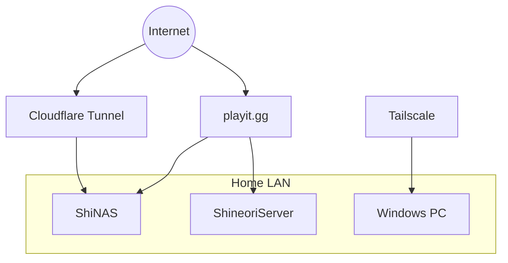

# Network

## Remote access strategy

| Method | Used for | Why |
|---|---|---|
| Cloudflare Tunnel | Web apps (see [Cloudflare Tunnel](../services/cloudflared.md)); NAS admin panel gated by Cloudflare Access + Authentik | No open ports, home IP hidden, HTTPS for free |
| playit.gg | Game servers (Terraria, Minecraft) | Raw TCP/UDP game traffic |
| Tailscale | The Forest server | Private, friends-only |
| LAN only | Flowcase | Doesn't need to be on the internet |

## Conventions
- Containers run as PUID 1000 / PGID 100
- All stacks consolidated under `~/docker/<service>`
- TODO: VLANs, Omada setup, IP plan (redact real IPs if repo is public)
