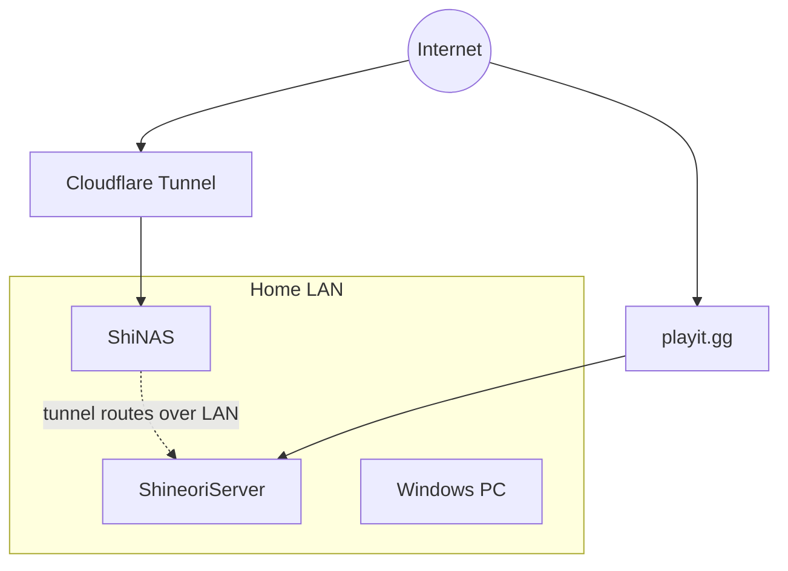

# Network

## Remote access strategy

| Method | Used for | Why |
|---|---|---|
| Cloudflare Tunnel | Web apps on **both** servers: `cloudflared` runs on ShiNAS and reaches ShineoriServer's apps over the LAN (see [Cloudflare Tunnel](../services/cloudflared.md)); NAS admin panel gated by Cloudflare Access + Authentik | No open ports, home IP hidden, HTTPS for free |
| playit.gg | Minecraft (Terraria used it too, now retired) | Raw TCP/UDP game traffic |
| LAN only | Flowcase, Homarr, Uptime Kuma, Ghiro, Paperless, the *arr stack | Don't need to be on the internet |
| Backups | ShineoriServer → append-only restic server on ShiNAS | See [Backups](backups.md) |

## Conventions
- Containers run as PUID 1000 / PGID 100
- All stacks consolidated under `~/docker/<service>`
- Servers use fixed addresses that the tunnel routes and monitors depend on (real IPs are kept out of this public repo)
- Planned: VLANs to separate servers, personal devices and IoT, practiced first in the [OPNsense lab](../services/opnsense-lab.md)
