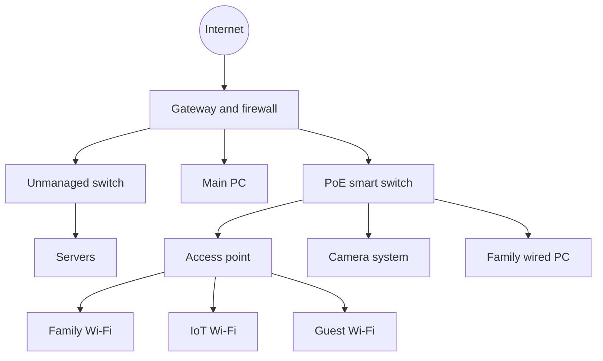

# Splitting my home network into VLANs

> What I changed in November 2026, why, and what I learned. This is the public version, so real addresses, names and device models are left out.

| | |
|---|---|
| **Goal** | Keep guests, smart devices and family devices away from my servers |
| **Result** | Four separate networks, with my servers' addresses unchanged |
| **Status** | Working, with follow-up tests listed below |

I'm still learning networking, so this page explains the reasoning as well as the settings. I wrote it to understand my own setup later.

## Why I did it

My whole house shared one flat network. A guest device or a compromised smart device could try to connect straight to my NAS and servers. My network controller also had a certificate nothing trusted and no scheduled backups.

## Final layout

| Network | VLAN | Who belongs here | Can start connections to |
|---|---|---|---|
| Default | 1 | Servers, my main PC, network gear management | Everything |
| IoT | 20 | Printer, camera system, smart devices | Internet only |
| Guest | 30 | Visitors | Internet only |
| Family | 40 | Phones, tablets, a family PC | Internet, IoT, and a few allowed server ports |

## What I changed

| Date | Change | Why |
|---|---|---|
| Nov 2 | Trusted certificate for the controller, renewed automatically | Browsers distrusted the self-signed one, and a DNS challenge doesn't expose the controller to the internet |
| Nov 2 | Deleted two old DNS and tunnel API tokens | They still worked, but nothing had used them in about a year |
| Nov 2 | Daily controller backups | No scheduled backup existed |
| Nov 2 | Turned off vendor cloud access | I sign in locally and use my own VPN when I'm away |
| Nov 2 | Created IoT and Guest VLANs with firewall rules | Those devices are the ones I trust least |
| Nov 5 | Added the controller's backups to my nightly backup | So a copy lives off that machine |
| Nov 5 | Created the Family VLAN and moved family Wi-Fi to it | Separates everyday devices from servers |
| Nov 5 | Allowed Family to reach two specific server ports | One phone plugin page and one sync service still need them |
| Nov 5 | Moved Docker's networks to a `10.x` range | Docker's automatic ranges overlapped my new VLANs |
| Nov 5 | Set up VLANs on the PoE switch | So the camera system and family PC could leave the server network |
| Nov 5 | Gave the PoE switch a static management address | With DHCP, it landed on the Family network after a restart |
| Nov 5 | Added a single-address Tailscale route | The controller's real name and certificate now work away from home |
| Nov 5 | Kept the controller running full time | Its daily backups only happen while it's running, and it's locked down enough now that I'm comfortable leaving it on |
| Nov 5 | Allowed one family PC to reach file sharing on the NAS | It uses a shared network drive there. The rule covers only that PC's reserved address and one port |

## Security decisions

| Decision | Why |
|---|---|
| **Move Wi-Fi, not the servers** | A scan found at least 15 services tied to server addresses, plus storage mounts, backups, tunnels and a port forward. Wi-Fi devices just pick up new addresses by themselves. |
| **Default-deny from Family to my servers** | Phones only need two ports, and one family PC needs file sharing on the NAS, so only those are open |
| **Change Docker, not the home network** | I wanted the home network to stay reliable and predictable, and a short container outage was fine |
| **One Tailscale route, no full subnet router** | Only one server is advertised, so my devices still don't get a path to the whole LAN |
| **No extra firewall hole for AirPrint** | I always print from my PC, so phone printer discovery wasn't worth opening IoT further |
| **Leave a spare port on the management network** | If a VLAN mistake locks me out, I can plug in directly |

## Setup notes

The order mattered more than I expected:

1. Map the real cabling first. The controller can't see through switches, so its topology view can be wrong.
2. List everything that depends on an address before moving it. That list changed my whole plan.
3. Check server routes before picking a subnet: `ip route get <address>` shows where replies will really go.
4. Create the new network and its firewall rules before moving any devices onto it.
5. On the smart switch, add tagged VLANs on the uplink and AP ports before removing anything.
6. Move one device, test it, and save the switch's config.

The Docker move used [`docker-net-migrate.sh`](https://github.com/shineori/homelab/blob/main/scripts/docker-net-migrate.sh). It has a dry-run mode, keeps rollback files, and recreates only the affected stacks. It needs `default-address-pools` in Docker's `daemon.json`, which it adds for you.

## Troubleshooting log

| Date | Problem | Root cause | Fix |
|---|---|---|---|
| 2026-11-05 | A phone couldn't reach a server even with a firewall exception | Docker's automatic `/20` networks overlapped the new VLANs, so the server sent replies into a Docker bridge | Gave Docker a `10.x` address pool and recreated the affected networks |
| 2026-11-05 | A phone sync still failed after I allowed the plugin page | The plugin also syncs to a second service on another server, which I hadn't allowed | Added that port to the allow rule |
| 2026-11-05 | The smart switch's admin page moved to the Family network | It used DHCP, and Family answered first after a restart | Set a static management address |
| 2026-11-05 | Switch settings might not have survived a power cut | The reboot page has a Save Config box, unticked by default | Rebooted with the box ticked, then checked the settings again |
| 2026-11-05 | Phones couldn't find the printer across VLANs | Not fully solved. The printer answers direct queries, but discovery through the gateway's rule got no answer | Left off by choice, since printing from my PC works |

## What I'd harden next

- [ ] Retest the firewall blocks from each network, now that Docker's overlap is gone
- [ ] Confirm the nightly backup includes the controller's backup files
- [ ] Move the remaining smart devices off the Family network
- [ ] Check whether the gateway's admin page can be reached from Family, and block it if so
- [ ] Add a certificate-expiry alert, so a failed renewal gets noticed
- [ ] Do a test restore of a controller backup
- [ ] Limit the NAS share to the accounts that need it, since the firewall only controls who can connect

## What I learned

- **A firewall rule isn't the whole path.** A request can be allowed through and still fail because the reply goes the wrong way.
- **Docker takes more address space than you'd think.** Its automatic networks can quietly claim big private ranges on a server.
- **Moving the smaller thing is often the better design.** Listing the dependencies first changed which side I moved.
- **Controllers only know what they can see.** A topology view can draw devices as directly attached when an unmanaged switch sits in between.
- **Applied isn't always saved.** Some gear needs an extra step, so test settings across a restart.
- **A passed test can pass for the wrong reason.** One of my early block tests may have failed because of the Docker overlap, not the firewall, so it needs repeating.
