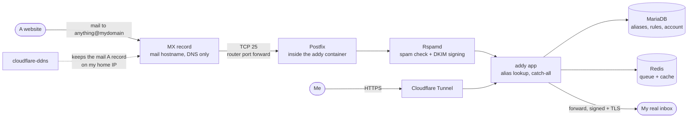

# addy.io

> Self-hosted anonymous email forwarding: a different address for every site, all landing in one real inbox

| | |
|---|---|
| **Host** | ShineoriServer |
| **Category** | Security & identity |
| **Status** | 🟢 running |
| **Exposed?** | Port 25 open to the internet (inbound mail). Web UI only through the Cloudflare Tunnel. |
| **Version** | 1.7.3 (pinned) |

Compose file: [`stacks/addy/`](https://github.com/shineori/homelab/tree/main/stacks/addy)

## Why I run it

Every site I sign up for used to get my real email address. When one of them leaks or sells it, the spam and phishing never stop, and I can't tell who leaked it.

addy.io gives every site its own address on my own domain (something like `shopname@mydomain`). Mail to any of them is forwarded to my real inbox. If one starts getting spam, I turn that one alias off and nothing else changes. I also know exactly which site leaked it.

I used SimpleLogin before. I moved to addy.io because it's open source and I can run all of it myself, so the list of every service I use doesn't sit on someone else's server. Catch-all mode means I can make up an address on the spot at a signup form, and the alias is created the first time mail arrives.

## Architecture

| Container | Job |
|---|---|
| `addy` | The app, plus Postfix (mail in and out), Rspamd (spam filtering and DKIM signing) and Nginx (web UI) |
| `addy-db` | MariaDB 11.4: the account, every alias, rules and blocklist |
| `addy-redis` | Queue and cache |
| `addy-ddns` | Updates the mail hostname's A record whenever my home IP changes |

**DNS for the alias domain** (all DNS only, never proxied, because Cloudflare's proxy doesn't carry mail):

| Record | Purpose |
|---|---|
| `MX` on the root domain + my username subdomain | Tells the world where to deliver mail |
| `A` for the mail hostname | Points at my home IP (kept current by the DDNS container) |
| `TXT` SPF `v=spf1 mx -all` | Only my mail server may send as my domain |
| `TXT` DKIM `default._domainkey` | Public key that proves forwarded mail really came from me |
| `TXT` DMARC `p=reject; adkim=s; aspf=s` | Receivers must reject anything that fails SPF/DKIM alignment |

## Security decisions

| Decision | Why |
|---|---|
| **Registration off, one admin account** | It's a personal service. Nobody else can sign up and send mail through my server. |
| **Web UI bound to the LAN IP, published only through the tunnel** | Port 8025 is never opened on the router. Only port 25 is, because mail servers have to reach it directly. |
| **Rspamd dashboard not published at all** | It has nothing I need remotely, so it isn't exposed |
| **DMARC `p=reject` with strict alignment** | My inbox has a filter that keeps alias mail out of spam. Without `reject`, someone could forge my domain and ride that filter straight into my inbox. Now forged mail is refused before it gets there. |
| **SPF `-all` (hard fail)** | Only the MX host may send as my domain |
| **Secrets generated on the server** | The DB password, app key, secret and Rspamd password were created with `openssl` on the server itself and never passed through chat or my PC. `.env` and `addy.env` are `chmod 600`. |
| **Cloudflare API token scoped to one zone, DNS edit only** | The DDNS container can't touch my other domain or anything else in the account |
| **DDNS container hardened** | Runs as a normal user, read-only filesystem, all capabilities dropped, `no-new-privileges` |
| **Greylisting off** | Greylisting delays the first email from every new sender. That would delay 2FA codes, which is the worst possible email to slow down. |
| **Important accounts stay on my real address** | My email provider, bank, password manager and domain registrar don't use aliases. If this server ever died, I'd lose convenience, not access to the accounts that recover everything else. |
| **Pinned image** | Upgrades on my schedule, announced by [Diun](diun.md) |

## Setup notes

1. **Check the ISP first.** Outbound: `nc -vz -w5 gmail-smtp-in.l.google.com 25`. Inbound: start a throwaway listener on port 25 and test it from an outside port checker. Both worked on my home connection.
2. **Why not a free cloud VM?** I checked the student options. Azure for Students, Google Cloud and Oracle's free tier all block outbound port 25, so none of them can deliver mail directly.
3. Generate secrets on the server (`openssl rand -base64 32` for `APP_KEY` and `ANONADDY_SECRET`, plus the DB and Rspamd passwords), then `chmod 600` both env files.
4. Router: forward **TCP 25 only** to the server.
5. Generate the DKIM key: `docker compose run --rm --no-deps --entrypoint '' addy gen-dkim`. The key has to end up at `data/dkim/<domain>.private` (see the troubleshooting log).
6. Cloudflare: delete any old MX/SPF records, then add MX, SPF, DKIM and DMARC (start DMARC at `p=none`). Add the web UI as a tunnel route.
7. `docker compose up -d`, then create the account from the CLI:
   `docker compose exec addy anonaddy anonaddy:create-user "<username>" "<real inbox>"`. Turn on 2FA right away.
8. Test from another account, then open the message in Gmail → **Show original** and check that SPF, DKIM and DMARC all say PASS. Only then move DMARC to `p=reject`.
9. Add it to the nightly backup, Uptime Kuma (TCP 25 + the login page) and Diun.

**Backups:** every night a `mariadb-dump --single-transaction` of the database goes into the [ShineoriServer backup](../infrastructure/backups.md#shineoriserver-backups-append-only), along with the whole stack folder (config, `APP_KEY`, DKIM key). The raw `db/` and `redis/` folders are skipped, because copying a live database's files can give a broken copy. The dump replaces them. Forwarded emails themselves are never stored, so they aren't in the backup: they live in my inbox.

## Troubleshooting log

| Date | Problem | Root cause | Fix |
|---|---|---|---|
| 2026-10-30 | `gen-dkim` wrote `null.private` / `null.txt` | The one-off `docker compose run` container didn't see `ANONADDY_DOMAIN` when naming the files | Renamed both to `<domain>.private` / `<domain>.txt`. Rspamd only signs if the key is at exactly that path. |
| 2026-10-30 | DB container crash-looped: `mysqld: command not found`, so addy never started | My compose file used `mysqld`, but MariaDB 11 renamed the server binary to `mariadbd` | Changed the `command:` to `mariadbd`; the DB came up healthy on the next start |
| 2026-10-30 | My own test from the server to my public IP on port 25 said `Connection refused` | Nothing was listening yet, and testing your public IP from inside the LAN only proves the router loops traffic back (hairpin NAT) | Started a throwaway listener and tested from an outside port checker: open. "Refused" means something answered; a block usually looks like a timeout. |
| 2026-10-30 | Account email and first forward landed in Gmail spam | My home IP is on the Spamhaus PBL (a list of residential ranges that shouldn't send mail directly), and its reverse DNS is my ISP's generic name, which I can't change on a home plan. SPF/DKIM/DMARC all passed. | Gmail filter on my domain: label it and never send it to spam. Then moved DMARC to `p=reject` so the filter can't be abused by forged mail. |
| 2026-10-30 | The UI said "Update available" for 1.7.4, but there was nothing to pull | The app releases first; the Docker image is packaged separately and lags a few days | Waiting for Diun to announce the image. The running 1.7.3 build already has the PHP security fixes. |

## What I'd harden next

- [ ] **Update to 1.7.4** once the Docker image ships (2FA and API hardening, safer one-click block links)
- [ ] **Inbound TLS for Postfix** with a Let's Encrypt certificate (DNS challenge through Cloudflare), so senders can encrypt mail on the way *in*. Outbound to my inbox is already encrypted.
- [ ] **A small VPS as an outbound relay** with a clean IP and proper reverse DNS, if my inbox provider ever starts *rejecting* mail instead of only marking it as spam
- [ ] **Monitoring from outside the house:** Uptime Kuma runs on the same laptop, so it can't alert me if the whole laptop goes down
- [ ] **A test restore** of the database dump into a scratch MariaDB container, to prove the backup actually brings my alias list back

## What I learned

- **How email delivery really works:** MX tells senders where to deliver, SPF says which servers may send, DKIM signs each message, and DMARC tells receivers what to do when the checks fail and whether the domains line up
- **"Passing" isn't the same as "trusted":** all three checks passed and Gmail still sent it to spam, purely because of where the mail came from (a residential IP)
- **Read the error, then test from the right place:** "refused" vs "timeout" told me whether a port was blocked, and testing my public IP from inside my own network proved nothing
- **Cloud free tiers block port 25** to stop spam, so a home connection that allows it is actually the easier option for a personal mail server
- **Back up the dump, not the live files,** and remember the app key: without `APP_KEY`, parts of a restored database can't be decrypted
- **Plan the failure case:** keeping my most important accounts off aliases means this server can never lock me out of my own life
