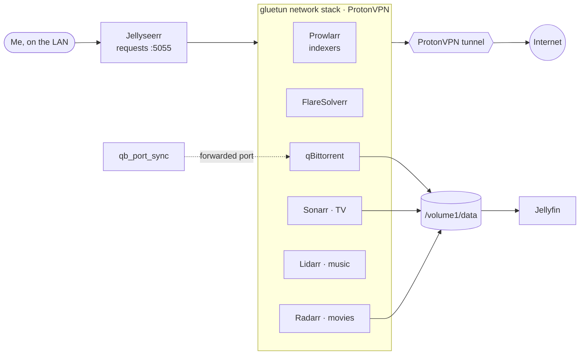

# *arr stack

> Prowlarr + arr apps + qBittorrent routed through gluetun/ProtonVPN

| | |
|---|---|
| **Host** | ShiNAS |
| **Category** | Media |
| **Status** | 🟢 running |
| **Exposed?** | LAN only; torrent traffic leaves through ProtonVPN (gluetun) |

Compose file: [`stacks/arr-stack/`](https://github.com/shineori/homelab/tree/main/stacks/arr-stack)

## Why I run it

It automates my media library: I request a show or movie, and the stack finds it, downloads it and files it where [Jellyfin](jellyfin.md) picks it up. The important part is that **all download traffic goes through a VPN**, with a kill switch so it can never leak out over my home IP.

## Architecture

Almost every app shares **one network stack: gluetun's.** They have no network of their own, so if the VPN drops, they simply can't reach the internet.

| Container | Job |
|---|---|
| **gluetun** | The VPN client. Owns the network stack every other app uses. Its firewall only opens the ports listed in `FIREWALL_INPUT_PORTS`. |
| **Prowlarr** + **FlareSolverr** | Manage the indexers (search sources); FlareSolverr gets past their bot-check pages |
| **Sonarr / Radarr / Lidarr** | Watch for TV, movies and music, send downloads to qBittorrent, then rename and file the results |
| **qBittorrent** | The download client |
| **qb_port_sync** | A small `curl` loop: gluetun gets a forwarded port from ProtonVPN, and this pushes it into qBittorrent's settings whenever it changes |
| **Jellyseerr** | The request page. It sits **outside** the VPN because it only talks to Jellyfin and the arr apps, not to the internet. |

**One shared `/volume1/data` mount** for qBittorrent and the arr apps means a finished download can be moved or hard-linked into the library instantly, instead of being copied.

## Security decisions

| Decision | Why |
|---|---|
| **`network_mode: "service:gluetun"`** | Built-in kill switch: VPN down means no traffic at all, never a fallback to my home IP |
| **ProtonVPN port forwarding + automatic sync** | Incoming peers can connect, without me opening any port on the router |
| **LAN only** | None of these apps are published through the tunnel |
| **Credentials in a git-ignored `.env`** | VPN and qBittorrent passwords; the repo only has a blanked `.env.example` |
| **Pinned images** | Every app pinned to a version (gluetun by digest) and announced by [Diun](diun.md) |

## Setup notes

1. Fill `.env`: `TZ`, `PUID`/`PGID`, the ProtonVPN OpenVPN username (with `+pmp` for port forwarding) and password, and the qBittorrent Web UI login
2. Every app that uses `network_mode: service:gluetun` publishes its port **on gluetun**, and that port must also be in `FIREWALL_INPUT_PORTS`
3. `docker compose up -d`, then check gluetun's logs for the VPN connection and the forwarded port
4. In the arr apps, the download client and each other are at `gluetun:<port>`, because they all share that container's network
5. Jellyseerr connects to Jellyfin and to Sonarr/Radarr

## Troubleshooting log

| Date | Problem | Root cause | Fix |
|---|---|---|---|
| — | qBittorrent could refuse to start after an unclean shutdown | A stale `lockfile` left in its config folder | The container's entrypoint deletes the lockfile before starting |
| — | The forwarded port changes whenever the VPN reconnects, breaking incoming connections | ProtonVPN assigns a new port each session | Added the `qb_port_sync` sidecar, which updates qBittorrent automatically |
| 2026-10-11 | Every arr app went down at the same moment | The whole NAS was overloaded by Immich, not a problem in this stack ([diagnosis](immich.md#troubleshooting-log)) | Fixed the overload and moved RAM-heavy apps to my second server; the stack is back up |

## What I'd harden next

- [ ] Remove a leftover port (`6969`) still published and allowed through gluetun's firewall for an app that's no longer in the stack
- [ ] Pin the `curlimages/curl` image used by `qb_port_sync`
- [ ] Put the qBittorrent password in a file instead of an environment variable

## What I learned

- **Sharing a network namespace** is a simple, reliable kill switch: no VPN, no network
- **VPN port forwarding** and why a dynamic port needs automation
- **Hard links and atomic moves** only work when the download and library folders are on the same mount
- **Small sidecar containers** can glue two apps together without changing either one
