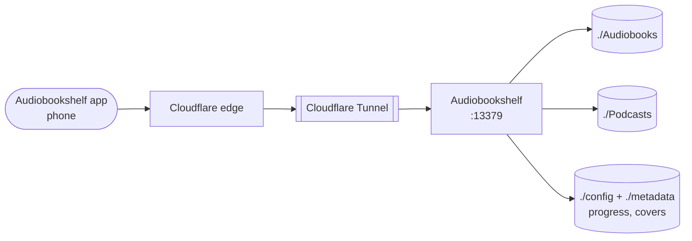

# Audiobookshelf

> Audiobook and podcast server

| | |
|---|---|
| **Host** | ShiNAS |
| **Category** | Media |
| **Status** | 🟢 running |
| **Exposed?** | Cloudflare Tunnel (no open ports), app login |
| **Port** | 13379 |
| **Version** | 2.37.1 (pinned) |

Compose file: [`stacks/audiobookshelf/`](https://github.com/shineori/homelab/tree/main/stacks/audiobookshelf)

## Why I run it

Audiobooks and podcasts get the same treatment as my movies: one self-hosted library, streamed to my phone, that remembers where I stopped in every book across devices.

## Architecture

| Folder | Holds |
|---|---|
| `./Audiobooks`, `./Podcasts` | The media itself |
| `./config` | Users, settings and **listening progress** |
| `./metadata` | Covers and cached book details |

## Security decisions

| Decision | Why |
|---|---|
| **Published through the Cloudflare Tunnel** | Listening away from home with no open router ports |
| **Not behind Cloudflare Access** | The mobile app talks to the API directly and can't do a browser login challenge |
| **Pinned image** | Upgrades on my schedule, announced by [Diun](diun.md) |

## Setup notes

1. `docker compose up -d`, then create the admin account at `http://<LAN_IP>:13379`
2. Add a library for each media folder
3. Tunnel route to `http://<LAN_IP>:13379`, then point the phone app at the public URL
4. Port **13379** on the host maps to 80 inside the container

## Troubleshooting log

| Date | Problem | Root cause | Fix |
|---|---|---|---|
| — | Nothing logged yet | | |

## What I'd harden next

- [ ] Back up `./config` (listening progress is the part I'd actually miss)
- [ ] Log in through [Authentik](authentik.md), if the mobile app supports it

## What I learned

- **Port mapping:** the host port and the container's port don't have to match (`13379:80`)
- **Know which data matters:** the media can be re-added, but progress and settings live in one small folder
