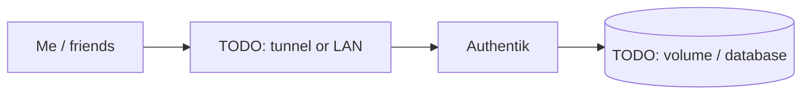

# Authentik

> Single sign-on and identity provider for the lab

| | |
|---|---|
| **Host** | ShiNAS |
| **Category** | Security & identity |
| **Status** | 🟢 running <!-- 🟡 in progress / 🔵 planned / ⚫ retired --> |
| **Exposed?** | TODO: LAN only / Cloudflare Tunnel / playit / Tailscale |

Compose file: [`stacks/authentik/`](https://github.com/shineori/homelab/tree/main/stacks/authentik)

## Why I run it

TODO: one or two sentences. What problem does this solve for you?

## Architecture

## Setup notes

- Version 2026.8.3
- HTTPS moved to 9453 because the NAS's built-in web server (nginx) already uses 9443 (HTTP stays 9000)
- Published through the Cloudflare Tunnel
- Passwordless passkey login enabled, recovery key kept as break-glass
- SSO wired into Immich and Dawarich (Dawarich needs a custom email-verified scope mapping)
- Outbound mail via a dedicated Gmail SMTP sender with an app password

TODO: the steps you'd need to rebuild this from scratch.

## Troubleshooting log

| Date | Problem | Root cause | Fix |
|---|---|---|---|
| TODO | | | |

## What I learned

TODO: the skill this proves (great for interviews).
