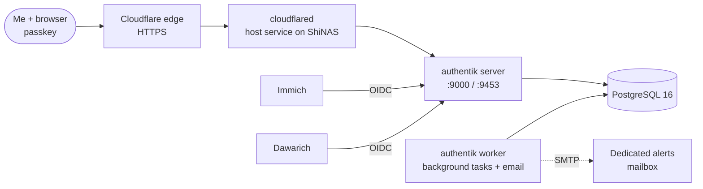

# Authentik

> Single sign-on and identity provider for the lab, with passwordless passkey login

| | |
|---|---|
| **Host** | ShiNAS |
| **Category** | Security & identity |
| **Status** | 🟢 running |
| **Exposed?** | Cloudflare Tunnel (no open ports) |
| **Version** | 2026.8.3 (pinned) |

Compose file: [`stacks/authentik/`](https://github.com/shineori/homelab/tree/main/stacks/authentik)

## Why I run it

Password fatigue. As the lab grew, every app came with its own login page, its own account and its own password to manage. That meant more passwords to rotate and more front doors to secure. Authentik replaced that with **one identity**: a single account, unlocked with a passkey, that my apps trust through OpenID Connect (OIDC). It's the same pattern companies use with Okta or Entra ID, just running on my own hardware.

## Architecture

**How a login works:** I open Immich or Dawarich and click "Login with Authentik". The app redirects me to Authentik, I approve with a passkey (no password), and Authentik sends me back with a signed OIDC token that says who I am. The app never sees a password at all.

| Container | Job |
|---|---|
| `server` | Web UI, login flows, OIDC endpoints |
| `worker` | Background jobs: sending email, cleanup, outpost management |
| `postgresql` | Users, flows, policies, sessions |

## Security decisions

| Decision | Why |
|---|---|
| **Passkeys, no passwords** | Phishing-resistant. A fake login page can't steal a passkey the way it can steal a password. |
| **Published through a Cloudflare Tunnel** | Zero inbound ports on my router. The tunnel dials *out*, so there's nothing to port-scan. |
| **Renamed the default admin account** | The default admin username is public knowledge. Renaming it removes half of what an attacker needs. |
| **Recovery key kept as break-glass** | If I ever lose my passkeys, I can generate a one-time recovery link from the server terminal instead of being locked out of my own SSO. |
| **SSO is *optional* in each app** | Apps keep a local login fallback, so an Authentik outage can't lock me out of everything at once. |
| **Dedicated mailbox for outbound email** | Authentik sends mail through a homelab-only account with an app password, not my personal email. |
| **Version pinned** | Upgrades happen when I choose, after reading the release notes, not by surprise on a restart. |
| **Secrets in `.env`, never in git** | The repo only has a blanked `.env.example`. gitleaks scans every push. |

## Setup notes

1. **Generate secrets**: `openssl rand -base64 60 | tr -d '\n'` for both `AUTHENTIK_SECRET_KEY` and `PG_PASS`, saved to `.env` (and to Vaultwarden).
2. **Fix the port conflict**: set `COMPOSE_PORT_HTTPS=9453` in `.env` (see troubleshooting below). HTTP stays on 9000.
3. **Start it**: `docker compose up -d`, then wait for `postgresql` to report healthy.
4. **Initial setup**: browse to `/if/flow/initial-setup/` to create the first admin.
5. **Harden the admin**: rename the default admin, enroll a passkey, switch the login flow to passwordless.
6. **Create a break-glass recovery link** when needed:
   `docker compose run --rm server create_recovery_key 10 <admin-username>`
7. **Add email**: fill in the SMTP block in `.env` and send a test email from the admin UI.
8. **Publish**: add a public hostname in the Cloudflare Tunnel config that points to the server's HTTP port.
9. **Connect apps**: for each app, create an OAuth2/OpenID provider + application in Authentik, then paste the client ID, client secret and issuer URL into the app.

## Troubleshooting log

| Problem | Root cause | Fix |
|---|---|---|
| Authentik's HTTPS port wouldn't bind on ShiNAS | the NAS's built-in web server (nginx) already listens on **9443**, Authentik's default HTTPS port | Moved Authentik's HTTPS to **9453** with `COMPOSE_PORT_HTTPS` in `.env`. HTTP stays on 9000. |
| Dawarich SSO didn't work with Authentik's default scopes | Dawarich is strict about the email claim it receives over OIDC | Built a **custom email scope mapping** that marks the email as verified, and assigned it to the Dawarich provider |

## What I'd harden next

- [ ] **The worker mounts `/var/run/docker.sock` and runs as root.** That's the upstream default, so Authentik can deploy outposts as containers. But access to the Docker socket is effectively root on the host. I only run the built-in embedded outpost, with no providers attached, so nothing needs that socket. Next step: remove the mount and the `user: root` line.
- [ ] Add Homarr to SSO (planned)
- [ ] Automated `pg_dump` backups of the Authentik database
- [ ] Authorization policies so each app only accepts the users it should

## What I learned

- **How OIDC actually works**: redirects, client IDs and secrets, issuer URLs, scopes and claims. The Dawarich fix taught me that a "scope" is just a bundle of claims, and that I can write my own when an app expects something the defaults don't provide.
- **Passwordless authentication** with WebAuthn passkeys, plus planning for the failure case (break-glass recovery).
- **Debugging port conflicts** on an appliance OS that reserves ports for its own services.
- **Thinking in tradeoffs**: optional SSO keeps things available, the docker socket mount trades security for convenience, and a pinned version trades freshness for stability.
