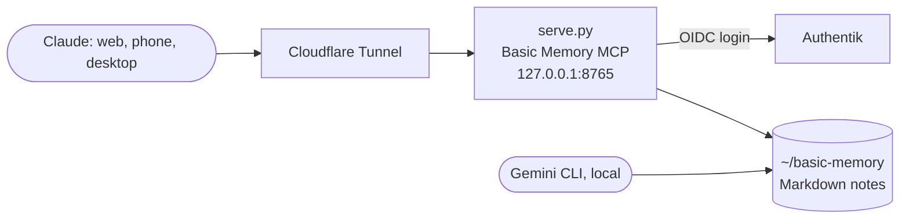

# Basic Memory (shared AI memory)

> A Markdown knowledge base that my AI assistants share, served as a remote MCP server behind Authentik

| | |
|---|---|
| **Host** | ShineoriServer (native, systemd user service, not Docker) |
| **Category** | AI |
| **Status** | 🟢 running <!-- 🟡 in progress / 🔵 planned / ⚫ retired --> |
| **Exposed?** | Through the ShineoriServer Cloudflare Tunnel, behind Authentik login |
| **Port** | 8765 (loopback only) |

Files: [`stacks/basic-memory/`](https://github.com/shineori/homelab/tree/main/stacks/basic-memory) (`serve.py`, the systemd unit and an env template)

## Why I run it

I use more than one AI assistant (Claude and Gemini CLI), and each one forgot everything between sessions. Basic Memory keeps notes as plain Markdown files that both assistants can read and write, so decisions, project notes and homelab changes live in one place I own. Publishing it lets Claude on my phone and the web reach the same notes, not just my desktop.

## Architecture

| Piece | Job |
|---|---|
| **`serve.py`** | Runs Basic Memory's MCP server over streamable HTTP, with FastMCP's OIDC proxy in front |
| **Authentik** | The identity provider: you sign in with my Authentik account before any tool call works |
| **systemd user service** | Starts it on boot and restarts it on failure. Secrets come from an env file outside the repo. |
| **`~/basic-memory`** | The notes themselves, as folders of Markdown (homelab, projects, school and more) |

## Security decisions

| Decision | Why |
|---|---|
| **Bound to `127.0.0.1` only** | The only way in from outside is the tunnel; nothing on the LAN can reach it directly |
| **Authentik OIDC in front** | My notes are personal, so every client has to log in through my identity provider |
| **Only Claude's callback URLs may register** | Random apps can't register themselves as clients and phish a login |
| **Host and origin protection on** | Blocks DNS-rebinding style requests from a browser |
| **Secrets in `~/.config/basic-memory-remote/env`** | Client secret and JWT signing key never touch this repo |
| **Native service instead of Docker** | Basic Memory is installed as a `uv` tool, and running it directly kept the setup simple |

## Setup notes

1. Install Basic Memory: `uv tool install basic-memory`
2. In Authentik, create an OAuth2/OIDC provider + application with the slug `basic-memory`, and note the client ID and secret
3. Copy `serve.py` to `~/basic-memory-remote/` and fill `env.example` into `~/.config/basic-memory-remote/env` (`chmod 600`)
4. Copy the unit to `~/.config/systemd/user/`, then `systemctl --user enable --now basic-memory-remote`
5. Run `loginctl enable-linger` so the user service runs without me logged in
6. Add a tunnel route to `127.0.0.1:8765`, then add the `/mcp` URL as a connector in Claude

## Troubleshooting log

| Date | Problem | Root cause | Fix |
|---|---|---|---|
| *none recorded yet* | | | |

## What I'd harden next

- [ ] Add `~/basic-memory` to the nightly ShineoriServer backup (the notes are the valuable part)
- [ ] Keep the notes folder in a private git repo too, for history
- [ ] Add an Uptime Kuma check on the tunnel URL

## What I learned

- **MCP over HTTP** lets one memory server back several AI clients on different devices
- **OIDC proxying:** the app doesn't store any passwords; Authentik handles logins and the app just checks tokens
- **Redirect URI allow lists** are what stop a malicious client from stealing a login
- **systemd user services** plus lingering are a clean way to run a personal service without root
