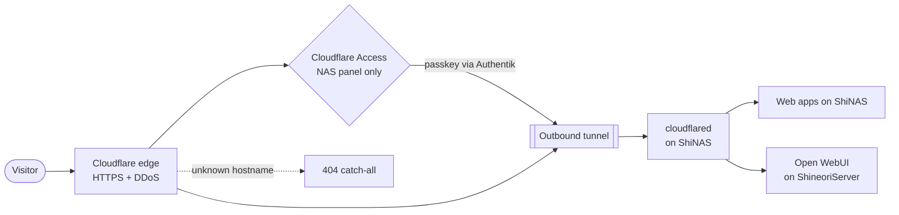
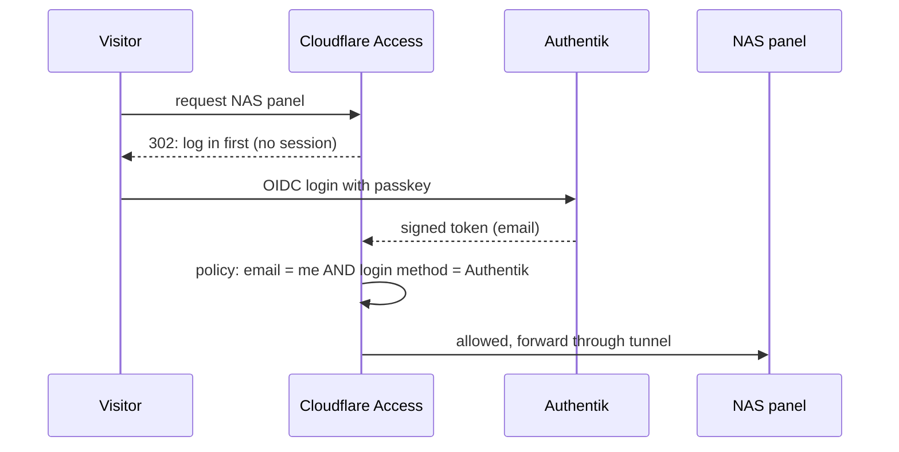

# Cloudflare Tunnel

> The lab's front door: publishes web apps to the internet with zero open ports, with a Zero Trust gate in front of the admin panel

| | |
|---|---|
| **Host** | ShiNAS (runs as a host service, not in Docker) |
| **Category** | Networking & monitoring |
| **Status** | 🟢 running |
| **Mode** | Remotely managed (token): routes live in the Cloudflare dashboard |
| **Version** | Kept current through the package manager, with auto-update disabled |

## Why I run it

Opening ports on my home router would put every service, and my home IP address, directly on the internet. A Cloudflare Tunnel flips that around. A small agent (`cloudflared`) on the NAS dials **out** to Cloudflare, and visitors reach my apps through Cloudflare's network. So I get:

- **Zero inbound ports.** There's nothing on my router for scanners to find.
- **My home IP stays hidden.** DNS points at Cloudflare, not at my house.
- **Free HTTPS and DDoS protection** at Cloudflare's edge.
- **A place to enforce identity** (Cloudflare Access) *before* traffic ever reaches my network.

## Architecture

### What's published

| App | Runs on | Protection in front of the app |
|---|---|---|
| NAS admin panel | ShiNAS | 🔐 **Cloudflare Access → Authentik passkey**, then the NAS login |
| Authentik (the SSO itself) | ShiNAS | Passkey login (deliberately *not* behind Access, or logins would loop) |
| Vaultwarden | ShiNAS | App login (its clients need direct API access) |
| Immich, Dawarich | ShiNAS | App login, with optional Authentik SSO |
| Jellyfin, Audiobookshelf, Karakeep | ShiNAS | App login |
| Open WebUI | ShineoriServer | App login (usually spun down) |
| *Any other hostname* | n/a | **Catch-all rule returns 404**, so nothing unlisted is reachable |

### Right tool for each job

| Traffic | Path | Why |
|---|---|---|
| Web apps | **Cloudflare Tunnel** | Web traffic is what tunnel routes are built for |
| Game servers (Minecraft) | **playit.gg** | Games speak raw TCP/UDP, which tunnel web routes can't carry |
| Flowcase | **LAN only** | Doesn't need to be on the internet, so it isn't |
| The Forest server | **Tailscale** | Private, friends-only VPN |

## Security audit

When I documented this tunnel, I reviewed every route and DNS record instead of trusting what I *thought* was configured. It turned up five problems:

| Severity | Finding | Risk | Fix | Status |
|---|---|---|---|---|
| 🔴 High | **The NAS admin panel was public.** Anyone could reach its login page. | NAS admin panels are a top ransomware target. One firmware bug or weak password could expose every file. | Put **Cloudflare Access** in front, using my own **Authentik** as the identity provider. Strangers are redirected to a login *before* any traffic reaches the NAS. | ✅ Fixed |
| 🟠 Medium | **A DNS record pointed straight at my home IP.** It was left over from an old setup for the Minecraft server. | It skipped Cloudflare entirely and published my home address, a DDoS and scanning target. | Deleted the record. Friends use playit.gg, which never reveals my IP. | ✅ Fixed |
| 🟡 Low | **A route still pointed at an app I'd removed.** | Harmless while nothing listens there, but anything I later ran on that port would become public by accident. | Deleted the route and its DNS record. | ✅ Fixed |
| 🟡 Low | **A route for game traffic that could never work.** | Clutter that hides what's really exposed. | Deleted. | ✅ Fixed |
| 🟡 Low | **A forgotten dynamic-DNS container** on the Minecraft server, configured to publish my home IP on another hostname | It had been failing silently for a long time (Cloudflare rejected its API token), but if anyone ever fixed the token, it would start leaking my IP again | Suspected it of re-creating the deleted record, but checking its config and logs proved it wasn't the cause. Removed it anyway, along with its credential. | ✅ Fixed |

### How the Access gate works

Design choices:

- **Default deny.** Nothing gets through unless a policy explicitly allows it.
- **Two independent locks in one policy:** *my email* **AND** *logged in through Authentik*. If the app's identity-provider setting were ever changed by mistake, the policy alone would still reject any other login method.
- **Least privilege in Authentik:** the OIDC app only allows the *authorization code* and *refresh token* grants. The *password* grant is off, so nothing can trade a password for a token and skip my passkey.
- **Bound to one user:** only my account is bound to the Cloudflare Access application in Authentik.
- **Fail closed:** if the binding check errors, access is denied.
- **Lockout plan:** if Authentik or the tunnel is down, I can still reach the panel on my home network.

Verified from outside with no cookies: a request to the NAS panel gets a `302` redirect to the Cloudflare Access login, with `auth_status: NONE`.

## Setup notes

1. **Create the tunnel** in Cloudflare Zero Trust → Networks → Tunnels. Choose the `cloudflared` connector and copy the install command (it contains the token).
2. **Install on the host:** `cloudflared service install <token>` creates a systemd service that starts on boot.
3. **Keep it updated** through the package manager (auto-update is off, so updates happen on my schedule).
4. **Add routes** under *Published application routes*: hostname → `http://localhost:<port>` (or a LAN address for apps on other machines).
5. **Keep the catch-all at `http_status:404`.**
6. **Check it:** `systemctl status cloudflared`, plus *Live logs* in the dashboard.

## Troubleshooting log

| Problem | Root cause | Fix |
|---|---|---|
| Testing the new identity provider showed *"Unable to find the requested identity provider"* | I tested immediately after saving, and the new config hadn't reached Cloudflare's edge yet | Waited a minute and ran Test again from the identity-provider list. *"Your connection works!"* |
| After I deleted the home-IP record, it still resolved | The first delete didn't take. I suspected a DDNS updater was re-creating it and found one on another host, but its logs showed it managed a *different* hostname and had never succeeded | Deleted the record again and verified it against Cloudflare's **authoritative nameservers**, not a cached resolver. Removed the dormant updater anyway. |
| Couldn't find a `cloudflared` folder with the other Docker stacks | The tunnel runs as a **host service**, not a container. A cloudflared compose file in another stack's folder was an unused install leftover. | Documented the real setup: a systemd service in token mode |

## What I'd harden next

- [ ] **Move the tunnel token out of the systemd unit file.** The installer puts it on the `ExecStart` line of a world-readable file, where it's also visible in `ps`. Fix: `EnvironmentFile=` pointing at a root-only (`chmod 600`) file containing `TUNNEL_TOKEN=...`. It's the same secrets-in-arguments pattern I found in my [auditd alert script](security-monitoring.md).
- [ ] Protect Vaultwarden's `/admin` page with an Access policy scoped to that path (the main vault has to stay open for its apps).
- [ ] Turn on Cloudflare Access for other admin-style apps where clients don't need direct API access.
- [ ] Re-audit routes and DNS records regularly. Today's findings were all **drift**: leftovers from setups that changed.

## What I learned

- **Zero Trust in practice:** identity checked at the edge, default deny, and policies written as explicit conditions
- **Federating identity:** connecting Cloudflare Access to my own Authentik over OpenID Connect (client IDs, redirect URIs, signing keys, JWKS)
- **Configuration drift is a real attack surface.** None of the findings came from one big mistake. Old setups left things behind, and only an actual audit found them.
- **DNS reveals more than you think.** One leftover record exposed what the whole tunnel was built to hide.
- **Verify, don't assume.** Checking the authoritative nameservers (not a cache) told me whether the fix had really worked. Reading the DDNS container's logs proved my first theory wrong. Broken services can still be liabilities, so I removed it regardless.
- **Matching tools to protocols:** HTTP through the tunnel, raw game traffic through playit.gg, private access over Tailscale or the LAN
