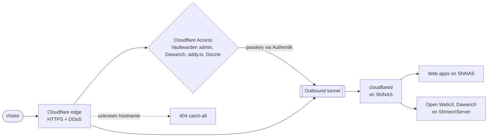
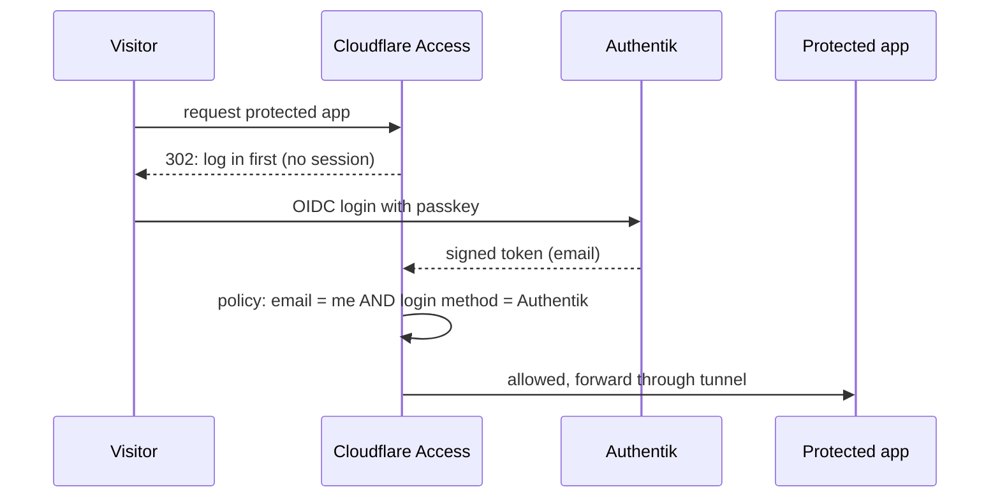

# Cloudflare Tunnel

> The lab's front door: publishes web apps to the internet with zero open ports, with Zero Trust gates in front of sensitive web apps

| | |
|---|---|
| **Host** | ShiNAS (runs as a host service, not in Docker); a second, separate tunnel runs on ShineoriServer (see below) |
| **Category** | Networking & monitoring |
| **Status** | 🟢 running |
| **Mode** | Remotely managed (token): routes live in the Cloudflare dashboard |
| **Version** | Kept current through the package manager, with auto-update disabled |

## Why I run it

Opening ports on my home router would put every service, and my home IP address, directly on the internet. A Cloudflare Tunnel flips that around. A small agent (`cloudflared`) on the NAS dials **out** to Cloudflare, and visitors reach my apps through Cloudflare's network. So I get:

- **Zero inbound ports.** There's nothing on my router for scanners to find.
- **My home IP stays hidden.** DNS points at Cloudflare, not at my house.
- **Free HTTPS and DDoS protection** at Cloudflare's edge.
- **A place to enforce identity** (Cloudflare Access) *before* traffic ever reaches my network.

## Architecture

### Two tunnels, one per domain

I own two domains, and each one has its **own tunnel on its own machine**:

| Tunnel | Runs on | Publishes |
|---|---|---|
| Tunnel 1 (this page) | ShiNAS | Everything on my main domain, including apps that live on ShineoriServer, reached over the LAN |
| Tunnel 2 | ShineoriServer | My second domain |

Keeping them separate means each tunnel has its own token and its own routes, and a problem with one machine or one tunnel never takes down the other domain.

### What's published

| App | Runs on | Protection in front of the app |
|---|---|---|
| Authentik (the SSO itself) | ShiNAS | Passkey login (deliberately *not* behind Access, or logins would loop) |
| Vaultwarden | ShiNAS | App login (its clients need direct API access). Its `/admin` path sits behind Cloudflare Access and Authentik |
| Immich | ShiNAS | App login, with optional Authentik SSO |
| Dawarich | ShineoriServer | Cloudflare Access on the website, API key on `/api`, then app login with optional Authentik SSO |
| Audiobookshelf | ShiNAS | App login. Stays public so I can share audiobooks with friends |
| [Dozzle](dozzle.md) | ShineoriServer | Cloudflare Access and Authentik, then the Dozzle login (added 2026-11-05) |
| Open WebUI | ShineoriServer | App login (usually spun down) |
| [addy.io](addy.md) web UI (tunnel 2) | ShineoriServer | 🔐 **Cloudflare Access → Authentik passkey**, then the addy login (added 2026-10-30). Its `/api` path has a separate Bypass rule, because the browser extension and app use API tokens. |
| *Any other hostname* | n/a | **Catch-all rule returns 404**, so nothing unlisted is reachable |

### Right tool for each job

| Traffic | Path | Why |
|---|---|---|
| Web apps | **Cloudflare Tunnel** | Web traffic is what tunnel routes are built for |
| Game servers (Minecraft) | **playit.gg** | Games speak raw TCP/UDP, which tunnel web routes can't carry |
| Private admin and personal apps | **[Tailscale](tailscale.md)** | The NAS panel, SearXNG, Uptime Kuma, Karakeep and Jellyfin only serve me, so they don't need a public address |
| Flowcase | **LAN only** | Doesn't need to be on the internet, so it isn't |
| The Forest server | **Tailscale** | Private, friends-only VPN |

## Security audit

When I documented this tunnel, I reviewed every route and DNS record instead of trusting what I *thought* was configured. It turned up five problems:

| Severity | Finding | Risk | Fix | Status |
|---|---|---|---|---|
| 🔴 High | **The NAS admin panel was public.** Anyone could reach its login page. | NAS admin panels are a top ransomware target. One firmware bug or weak password could expose every file. | Put **Cloudflare Access** in front, using my own **Authentik** as the identity provider. Strangers are redirected to a login *before* any traffic reaches the NAS. | ✅ Fixed |
| 🟠 Medium | **A DNS record pointed straight at my home IP.** It was left over from an old setup for the Minecraft server. | It skipped Cloudflare entirely and published my home address, a DDoS and scanning target. | Deleted the record. Friends use playit.gg, which never reveals my IP. | ✅ Fixed |
| 🟡 Low | **A route still pointed at an app I'd removed.** | Harmless while nothing listens there, but anything I later ran on that port would become public by accident. | Deleted the route and its DNS record. | ✅ Fixed |
| 🟡 Low | **A route for game traffic that could never work.** | Clutter that hides what's really exposed. | Deleted. | ✅ Fixed |
| 🟡 Low | **A forgotten dynamic-DNS container** on the Minecraft server, configured to publish my home IP on another hostname | It had been failing silently for a long time (Cloudflare rejected its API token), but if anyone ever fixed the token, it would start leaking my IP again | Suspected it of re-creating the deleted record, but checking its config and logs proved it wasn't the cause. Removed it anyway, along with its credential. | ✅ Fixed |

### Second audit: 2026-11-04

I went through every published route again and asked one question for each: who outside my own devices actually needs this? Anything that only serves me moved to [Tailscale](tailscale.md).

| Severity | Finding | Risk | Fix | Status |
|---|---|---|---|---|
| 🔴 High | **SearXNG was published with no login.** My docs said it was LAN only. | Anyone could use my search instance through my VPN exit | Moved to Tailscale, then deleted the route and DNS record | ✅ Fixed |
| 🟠 Medium | **Vaultwarden's `/admin` login page was public** | A login page for server-wide settings, reachable by anyone | Cloudflare Access on just that path, so the Bitwarden apps keep syncing | ✅ Fixed |
| 🟠 Medium | **The NAS panel still had a public route**, even behind Access | A public path to the most sensitive thing in the lab, for something I can reach privately | Moved to Tailscale, then deleted the route and DNS record | ✅ Fixed |
| 🟠 Medium | **Dawarich's login page was public** | A public login in front of my full location history | Access on the website, with a bypass for `/api` so the phone tracker still works with its API key | ✅ Fixed |
| 🟡 Low | **Jellyfin streamed video through a public hostname** | Cloudflare's terms restrict serving video this way on its regular plans | Moved to Tailscale | ✅ Fixed |
| 🟡 Low | **Uptime Kuma had a public route.** My docs said it was LAN only. | Its dashboard maps out my whole lab | Moved to Tailscale, then deleted the route and DNS record | ✅ Fixed |
| 🟡 Low | **A route pointed at Gmail Cleaner, whose container was gone** | Harmless until something else used that port | Deleted the route and DNS record | ✅ Fixed |
| 🟡 Low | **TLS 1.1 still connected on my main domain** | Old, weak connections stayed possible | Set Minimum TLS to 1.2 | ✅ Fixed |

For each move, I tested the new address on my phone and PC first, and only then deleted the public route.

### How the Access gate works

Design choices:

- **Default deny.** Nothing gets through unless a policy explicitly allows it.
- **Two independent locks in one policy:** *my email* **AND** *logged in through Authentik*. If the app's identity-provider setting were ever changed by mistake, the policy alone would still reject any other login method.
- **Least privilege in Authentik:** the OIDC app only allows the *authorization code* and *refresh token* grants. The *password* grant is off, so nothing can trade a password for a token and skip my passkey.
- **Bound to one user:** only my account is bound to the Cloudflare Access application in Authentik.
- **Fail closed:** if the binding check errors, access is denied.
- **Lockout plan:** if Authentik or the tunnel is down, I can still reach those apps on my home network.

Verified from outside with no cookies: a request to a protected path gets a `302` redirect to the Cloudflare Access login, with `auth_status: NONE`.

## Setup notes

1. **Create the tunnel** in Cloudflare Zero Trust → Networks → Tunnels. Choose the `cloudflared` connector and copy the install command (it contains the token).
2. **Install on the host:** `cloudflared service install <token>` creates a systemd service that starts on boot.
3. **Keep it updated** through the package manager (auto-update is off, so updates happen on my schedule).
4. **Add routes** under *Published application routes*: hostname → `http://localhost:<port>` (or a LAN address for apps on other machines).
5. **Keep the catch-all at `http_status:404`.**
6. **Check it:** `systemctl status cloudflared`, plus *Live logs* in the dashboard.

## Troubleshooting log

| Problem | Root cause | Fix |
|---|---|---|
| Testing the new identity provider showed *"Unable to find the requested identity provider"* | I tested immediately after saving, and the new config hadn't reached Cloudflare's edge yet | Waited a minute and ran Test again from the identity-provider list. *"Your connection works!"* |
| After I deleted the home-IP record, it still resolved | The first delete didn't take. I suspected a DDNS updater was re-creating it and found one on another host, but its logs showed it managed a *different* hostname and had never succeeded | Deleted the record again and verified it against Cloudflare's **authoritative nameservers**, not a cached resolver. Removed the dormant updater anyway. |
| Couldn't find a `cloudflared` folder with the other Docker stacks | The tunnel runs as a **host service**, not a container. A cloudflared compose file in another stack's folder was an unused install leftover. | Documented the real setup: a systemd service in token mode |
| After moving Dawarich to the laptop, **Sign in with Authentik** ended on a Cloudflare **502** | I started the login on the laptop's IP, but Authentik sends you back to the public hostname, and that route still pointed at the NAS, where Dawarich was now stopped | Pointed the route at the laptop. Logins now start from the public hostname, so the login cookie and the return address match. |

## What I'd harden next

- [x] **Moved the tunnel token out of the world-readable systemd unit file** ✅ *Done.* The installer had put it on the `ExecStart` line, where any local user could read it and it showed up in `ps`. It now lives in a root-only `EnvironmentFile` (`chmod 600`). I verified all 4 tunnel connections re-registered and every app still answered. It's the same secrets-in-arguments pattern I found in my [auditd alert script](security-monitoring.md).
- [x] **Narrowed the resume site's port binding** ✅ *Done.* Docker publishes ports on every interface by default (and its iptables rules skip host firewalls). The port is now bound to the NAS's LAN IP only, with the tunnel route pointing at that address. Devices on my home network can still reach it directly. Details and the trade-offs in the [resume site docs](resume-site.md).
- [ ] Do the same for other apps whose only client is `cloudflared`. Routes that point at the LAN IP (not `localhost`) have to be switched first, or they'll break.
- [x] **Protected Vaultwarden's `/admin` page** with an Access policy scoped to that path ✅ *Done 2026-11-04.* The main vault stays open for its apps.
- [ ] Turn on Cloudflare Access for other admin-style apps where clients don't need direct API access. *Progress:* addy.io's web UI got it on 2026-10-30 and Dawarich's website on 2026-11-04, both with a path-based Bypass for its token-protected API, which is a pattern I can reuse for other apps that have both a browser UI and an API.
- [ ] Re-audit routes and DNS records regularly. Today's findings were all **drift**: leftovers from setups that changed.

## What I learned

- **Zero Trust in practice:** identity checked at the edge, default deny, and policies written as explicit conditions
- **Federating identity:** connecting Cloudflare Access to my own Authentik over OpenID Connect (client IDs, redirect URIs, signing keys, JWKS)
- **Configuration drift is a real attack surface.** None of the findings came from one big mistake. Old setups left things behind, and only an actual audit found them.
- **DNS reveals more than you think.** One leftover record exposed what the whole tunnel was built to hide.
- **Verify, don't assume.** Checking the authoritative nameservers (not a cache) told me whether the fix had really worked. Reading the DDNS container's logs proved my first theory wrong. Broken services can still be liabilities, so I removed it regardless.
- **Docs drift too.** Two apps my docs called LAN only had public routes. The live config is the source of truth, so audits have to read it directly.
- **A public address should have a reason.** If only my own devices use an app, it doesn't need one.
- **Matching tools to protocols:** HTTP through the tunnel, raw game traffic through playit.gg, private access over Tailscale or the LAN
