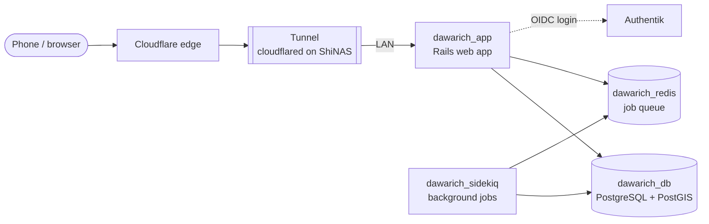

# Dawarich

> Self-hosted location history (Google Timeline replacement)

| | |
|---|---|
| **Host** | ShineoriServer |
| **Category** | Apps |
| **Status** | 🟢 running <!-- 🟡 in progress / 🔵 planned / ⚫ retired --> |
| **Exposed?** | Cloudflare Tunnel (no open ports) |
| **Version** | 1.15.3 (pinned) |
| **Login** | Authentik SSO (OIDC), plus local password login |

Compose file: [`stacks/dawarich/`](https://github.com/shineori/homelab/tree/main/stacks/dawarich)

> 🚚 **Moved from ShiNAS to ShineoriServer** in October 2026 to free up RAM on the NAS. Its database and files live in Docker named volumes, so this one needed a volume export and import, plus the laptop's IP added to `APPLICATION_HOSTS`. Full story: [Moving services off the NAS](../infrastructure/migration.md).

## Why I run it

I like having a timeline of where I've been, like Google Timeline, but a record of everywhere I go is about as personal as data gets. Dawarich gives me the map, the visits and the stats while the location history stays on my own server instead of someone else's.

## Architecture

Dawarich is four containers on a private Docker network. Only the web app has a published port.

| Container | Job |
|---|---|
| `dawarich_app` | The web interface and API that receives location points |
| `dawarich_sidekiq` | Background work: imports, reverse geocoding, stats |
| `dawarich_db` | PostgreSQL with **PostGIS**, an extension for storing and querying map coordinates |
| `dawarich_redis` | The queue that hands jobs from the app to Sidekiq |

**Where the data lives:** five Docker *named volumes* (`db_data`, `storage`, `public`, `watched`, `shared`), not the stack's folder. That matters when moving or backing it up (see the troubleshooting log).

## Security decisions

| Decision | Why |
|---|---|
| **Published through the Cloudflare Tunnel** | Location data can arrive from anywhere, with no open router ports |
| **Login through Authentik (OIDC)** | One passkey login instead of another password (see [Authentik](authentik.md)) |
| **`OIDC_AUTO_REGISTER: "false"`** | Signing in with Authentik can't create new Dawarich accounts, only log in to existing ones |
| **Database has no published port** | PostgreSQL is only reachable by the other containers on the private Docker network |
| **`APPLICATION_HOSTS` allow-list** | The app only answers to the hostnames and addresses on this list |
| **Secrets in a git-ignored `.env`** | `SECRET_KEY_BASE` and the OIDC client secret. The repo only has a blanked `.env.example`. |

## Setup notes

1. Put `SECRET_KEY_BASE` and `DAWARICH_OIDC_SECRET` in `.env`, plus `APPLICATION_HOSTS` with the public hostname and the server's LAN IP
2. `docker compose up -d` and wait until all four containers report **healthy**
3. Add a tunnel route: public hostname → `http://<LAN_IP>:3009`
4. **SSO:** create an OAuth2/OIDC provider in Authentik with Dawarich's redirect URI. Dawarich needs a **verified email claim**, so the provider uses a custom scope mapping (see the troubleshooting log).
5. Point the phone's location tracking at the public hostname
6. **Always start logins from the public hostname**, not the IP (see the troubleshooting log)

## Troubleshooting log

| Date | Problem | Root cause | Fix |
|---|---|---|---|
| — | SSO didn't work with Authentik's default scopes | Dawarich is strict about the email claim it receives | Built a custom email scope mapping in Authentik that marks the email as verified ([details](authentik.md)) |
| 2026-10-11 | Moving the stack folder alone would have produced an **empty** Dawarich | All the data lives in Docker named volumes, not in the folder | Exported each volume to a tarball with a throwaway container, created empty volumes on the new machine with `docker compose create`, then imported them. Checked `PG_VERSION` before starting. |
| 2026-10-11 | Needed the new machine's IP in `APPLICATION_HOSTS` | Rails rejects requests for hosts that aren't on the allow-list | Appended it to `.env` with a leading newline, so it couldn't get glued onto the end of `SECRET_KEY_BASE` |
| 2026-10-11 | *Sign in with Authentik* ended on a Cloudflare **502** | The tunnel route still pointed at the old machine. I'd also started the login on the LAN IP, but Authentik sends you back to the public hostname, so the login cookie wouldn't have matched anyway. | Repointed the tunnel route and started the login from the public hostname |

## What I'd harden next

- [ ] **Back it up.** Since the move it's on the laptop, and the nightly encrypted backup only covers the NAS. Location history is irreplaceable.
- [ ] Replace the stock database credentials from the upstream compose file
- [ ] Get version alerts on the laptop too (Diun only watches the NAS)

## What I learned

- **Named volumes vs bind mounts:** where a container keeps its data decides how you back it up and move it. `docker volume ls` first, always.
- **PostGIS:** a database can understand geography, not just numbers and text
- **Host allow-lists:** web frameworks like Rails refuse requests for hostnames they weren't told about, which blocks a class of attacks but needs updating when a server moves
- **OIDC flows are tied to addresses:** the redirect URI and the login cookie both depend on the hostname, so mixing an IP and a domain breaks the login
