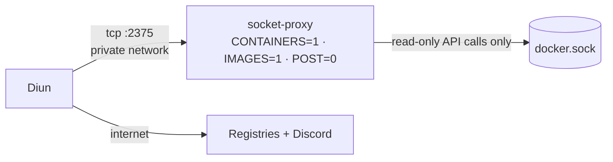

# Diun (update notifications)

> Watches every container image in the lab and pings Discord when a new stable version ships. It never installs anything by itself.

| | |
|---|---|
| **Host** | ShiNAS + ShineoriServer (one instance on each) |
| **Category** | Networking & monitoring |
| **Status** | 🟢 running |
| **Exposed?** | No. Outbound only (container registries + a Discord webhook) |
| **Version** | 4.33.0 (pinned) |

Compose file: [`stacks/diun/`](https://github.com/shineori/homelab/tree/main/stacks/diun)

## Why I run it

Most of my apps used to float on `:latest`, which meant any `docker compose pull` could silently upgrade them. That includes breaking changes, and makes "what changed?" hard to answer when something breaks. So I made a two-part change:

1. **Pin every image** to an exact version, so nothing changes until I decide.
2. **Run Diun**, so pinning doesn't mean missing updates. It tells me when a new version exists, and I upgrade on my own schedule.

```
🔔 Diun (awareness)                     📌 Pinned images (control)
every 6h: check registries for     ──▶  "immich-server v3.3.2 is out" → Discord
new stable version tags                  read release notes → bump the tag → update
never installs anything                  roll back = change the tag back
```

## How the pinning was done (safely)

Pinning can go wrong if you guess a version number and accidentally *change* what's running. So I made it a verify-first process:

1. **Inventory:** read the real version label from every running container (`org.opencontainers.image.version`)
2. **Verify:** pull each proposed tag and compare its image ID with the running container's image. **14 of 14 matched**, so every pin was byte-for-byte what was already running.
3. **Digest pins** for 3 images with no usable version (one reported `latest`, another `main`): `tag@sha256:<digest>`, where the digest is the source of truth
4. **Apply** with a script that backs up every file first, then **validate** every compose file (`docker compose config -q`)
5. **No restarts needed:** the images were identical, so pinning changed nothing today, and only stops surprise changes tomorrow

Databases (Postgres, PostGIS, Redis/Valkey) stay **locked to their major version**, which is the usual convention. Major upgrades are the dangerous ones for databases, and those are already blocked.

## Configuration choices

| Setting | Why |
|---|---|
| `WATCHREPO: true` + `NOTIFYON: new` | Pinned tags never change, so Diun has to look for **new tags** in each repository instead of watching the current one |
| Include `^v?\d+\.\d+\.\d+` | Only real version numbers, which skips the dozens of variant tags database images publish |
| Exclude `rc / beta / alpha / dev / nightly / pre` | Stable releases only |
| `FIRSTCHECKNOTIF: false` | The first scan quietly records what exists, instead of announcing every historical version |
| Every 6 hours, 30s jitter | Frequent enough to be useful, gentle on registry rate limits |
| `hostname: shinas` / `shineoriserver` | Each Discord notification says which server it's about, since Diun runs on both |
| A **separate Discord webhook and channel** | Update chatter stays out of my security-alerts channel, and either webhook can be revoked on its own |
| Webhook in a root-only `.env` | Entered with `read -s`, so it never touched the screen, my shell history, the compose file or git |

## Least privilege: the socket proxy

I first thought mounting the Docker socket `:ro` made it "look but don't touch". **That's wrong.** `:ro` only stops the socket *file* from being replaced. The Docker API behind it stays fully available, and the Docker engine runs as root, so **socket access means root on the host**.

The fix is a **socket proxy**: a tiny container that holds the real socket and only forwards the requests I allow.



| Design choice | Why |
|---|---|
| Proxy allows `CONTAINERS` + `IMAGES`, `POST=0` | Diun only needs to *read* which images are running. Every change (create, start, stop, delete) is denied. |
| Proxy sits on an `internal: true` network | No ports and no internet. Only Diun can reach it. |
| Diun has **no** socket mount at all | Even if Diun were compromised, the worst it could do is list containers |
| Proxy pinned by digest | Same rule as everything else: nothing changes by surprise |

**Proven, not assumed.** I tested it from a throwaway container on the proxy's network:

```
READ  (list containers):  200   ✅ allowed
WRITE (create container): 403   ✅ blocked
Diun has the socket?      0     ✅ not mounted
```

I also removed the socket from [Authentik's worker](authentik.md) entirely, since it never needed it. That means two apps no longer have root-equivalent access to the NAS.

## How I apply an update

Diun only tells me; I do the update by hand:

```
1. read     → the release notes (look for "breaking changes", and be extra careful with major versions)
2. check    → the version I'm actually running:
              docker inspect --format '{{index .Config.Labels "org.opencontainers.image.version"}}' <container>
3. backup   → make sure that night's backup ran, or run one now
4. bump     → change the tag in the compose file (keep a .bak copy of the old file)
5. apply    → docker compose pull && docker compose up -d
6. verify   → logs are clean, the app opens, the data is there
7. record   → update the stack and docs in this repo
```

Rolling back is putting the old tag back, **unless** the new version migrated the app's database. That's why step 3 comes before step 5.

**Gotchas I've hit:**

- **Version labels aren't always versions.** Homarr's label said `main` (a code branch). Comparing the image's build date with the release dates told me which version it really was.
- **Images on `:latest` update themselves** whenever their stack restarts. SearXNG was already on the version Diun announced, so I pinned it.
- **Some apps' data is tied to their version.** Meilisearch can't open data from a much older release, but it's only Karakeep's search index, so the plan is to rebuild the index rather than migrate it.

## Troubleshooting log

| Problem | Root cause | Fix |
|---|---|---|
| `403 Forbidden` listing tags for Karakeep's headless-Chrome image | That image lives on a Google registry that doesn't allow anonymous tag listing | Added the label `diun.enable=false` to that one service. It's pinned (`124`) and rarely updated. |
| Later, the same image **couldn't be downloaded at all** when I moved Karakeep to my second server | The Google registry project hosting it stopped serving downloads ("billing must be enabled"). It only kept working where it was already downloaded. | Switched to the same image on Docker Hub (`docker.io/zenika/alpine-chrome:124`). Lesson: an image that runs fine today can become impossible to download again. |

## What I'd harden next

- [x] **Put a docker-socket-proxy in front of the Docker socket** ✅ *Done (see below).*
- [x] **Added Diun to ShineoriServer** ✅ *Done:* the same compose file, downloaded straight from this repo, with `hostname: shineoriserver` so each Discord alert says which machine it's about. Same socket proxy, same #updates channel, and a test notification confirmed it works.
- [ ] A monthly "update day": work through the Discord notifications, read the release notes, and bump the pins

## What I learned

- **Pinning is configuration management:** the compose files now describe *exactly* what runs, so a rebuild reproduces it
- **Verify before you change:** comparing image IDs proved the pins were no-ops before I applied them
- **Tags vs digests:** a tag is a movable label, and a digest is the content's fingerprint
- **Read-only isn't always read-only:** `:ro` on a socket protects the file, not the API behind it. I caught my own wrong assumption while writing this page, fixed it with a socket proxy, and **proved** the fix with a 403.
