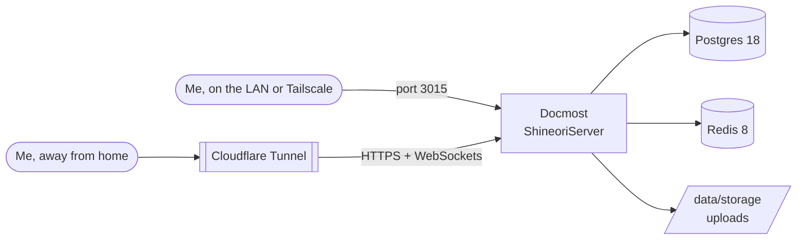

# Docmost

> A self-hosted wiki for my notes, guides and how-tos, with real-time editing like Notion or Confluence

| | |
|---|---|
| **Host** | ShineoriServer |
| **Category** | Apps |
| **Status** | 🟢 running |
| **Exposed?** | Through the tunnel on my homelab domain, plus LAN and Tailscale on port `3015` |
| **Version** | Docmost `0.96.0` (pinned by tag), Postgres `18`, Redis `8` |

Compose file: [`stacks/docmost/`](https://github.com/shineori/homelab/tree/main/stacks/docmost)
Upstream: [docmost/docmost](https://github.com/docmost/docmost)

## Why I run it

My notes about my homelab, school and projects are spread across a lot of places. I wanted one wiki I own, with pages I can nest into spaces, real-time editing, and the option to invite a friend to a page without handing my notes to a big platform. Docmost looked like the closest self-hosted match to Notion and Confluence, and it runs as a simple three-container stack.

## Architecture



| Piece | Job |
|---|---|
| `docmost` | Web app, API and the real-time editor (WebSockets) |
| `docmost-db` | Postgres: pages, spaces, users, permissions |
| `docmost-redis` | Queues and real-time collaboration state, with append-only persistence and no eviction |
| `data/storage` | Uploaded images and attachments (local storage, no S3) |

## Security decisions

| Decision | Why |
|---|---|
| Created the owner account right after first start, before adding the public route | The first visitor to a fresh install gets the setup page and becomes the owner, so that page had to be gone before the app was reachable from the internet |
| No open sign-up, invite-only | Docmost only adds people through invites, so putting it on the internet doesn't let strangers create accounts |
| Random `APP_SECRET` and database password from `openssl rand`, kept in a mode `600` `.env` | Nothing guessable, and the secrets never land in the compose file or this repo |
| Postgres and Redis have no published ports | Only Docmost talks to them, over the stack's private Docker network |
| Published through the Cloudflare Tunnel instead of a port forward | No open ports on my router, same as my other public apps |
| No Cloudflare Access in front (for now) | I may invite friends or share pages, and an Access gate would block them. Docmost's own login is the lock |
| Docmost pinned to an exact version | Upgrades happen when I choose, after reading release notes, and Diun tells me when a new one is out |

## Setup notes

1. Pick a free host port. `3000` was already taken on this server, so Docmost uses `3015`.
2. Create the `.env` with random secrets:
   ```bash
   cat > .env <<EOF
   APP_URL=https://<your-docmost-domain>
   APP_SECRET=$(openssl rand -hex 32)
   POSTGRES_PASSWORD=$(openssl rand -hex 24)
   EOF
   chmod 600 .env
   ```
3. `docker compose up -d`, then check `http://<LAN_IP>:3015/api/health`. It should report both the database and Redis as `up`.
4. Open the app and create the workspace and owner account straight away.
5. Add the tunnel route to `http://<LAN_IP>:3015`. Cloudflare passes WebSockets through by default, and the editor needs them.
6. `APP_URL` has to match the address I actually use. When I moved from the LAN address to the domain, I changed it and ran `docker compose up -d --force-recreate docmost`.

Backups: the nightly ShineoriServer restic job takes a `pg_dump` of the database while Docmost keeps running, checks that the dump is readable, then backs up the dump plus the stack folder (`.env` and uploaded files). The raw Postgres and Redis folders are skipped, because a live copy of database files isn't safe to restore and the dump replaces it. The `.env` matters: without the same `APP_SECRET`, a restored install can't use its old data properly.

Upgrades: read the release notes, back up the database, change the image tag, then `docker compose pull docmost && docker compose up -d docmost`.

## Troubleshooting log

| Symptom | Cause | Fix |
|---|---|---|
| The upstream example maps `3000:3000`, but that port was taken | Open WebUI already uses host port `3000` on this server | Mapped Docmost to `3015:3000` |
| A setup script piped from Windows over SSH ended with `$'\r': command not found` | The script had Windows line endings, and bash read the `\r` as a command | Harmless here because it was the last line. Strip `\r` before piping, or write scripts with LF endings |

## What I'd harden next

- [ ] Do a test restore of the Docmost dump into a throwaway Postgres container, so I know the backup actually comes back
- [ ] Add an Uptime Kuma monitor on `/api/health` and a Homepage tile
- [ ] Set up SMTP through my homelab mail sender so invites and password resets work
- [ ] Pin Postgres and Redis to exact versions like the rest of my stacks
- [ ] Add memory limits and `no-new-privileges` to all three containers
- [ ] Look into SSO with Authentik, if the self-hosted edition supports it
- [ ] Put Cloudflare Access in front if I end up being the only user

## What I learned

- Fresh web apps with a first-run setup page are a race: whoever opens it first owns it, so the account comes before the public route.
- `APP_URL` is more than a label. Apps use it to build links and decide how cookies work, so it has to match the address people actually use.
- Port conflicts are easiest to catch before deploying: `ss -tln` and `docker ps` show what's already taken.
- Windows line endings can break bash scripts sent from a Windows PC, so line endings matter when two systems share a script.
