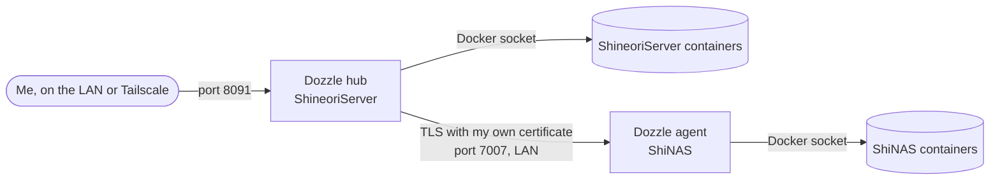

# Dozzle

> One page for live container logs from both of my servers, so I stop opening SSH sessions just to run `docker logs`

| | |
|---|---|
| **Host** | ShineoriServer (hub) + ShiNAS (agent) |
| **Category** | Infrastructure |
| **Status** | 🟢 running |
| **Exposed?** | LAN and Tailscale only, web UI on port `8091`. The agent listens on port `7007`, bound to the NAS's LAN IP. Not on any tunnel. |
| **Version** | Dozzle `v11.4.1`, pinned by tag on both servers |

Compose files: [`stacks/dozzle/`](https://github.com/shineori/homelab/tree/main/stacks/dozzle) and [`stacks/dozzle-agent/`](https://github.com/shineori/homelab/tree/main/stacks/dozzle-agent)
Upstream: [amir20/dozzle](https://github.com/amir20/dozzle)

## Why I run it

I run about 65 containers across two machines, and when something misbehaves the first question is always "what do the logs say?" Until now that meant working out which server the container lives on, opening SSH and running `docker logs`. Dozzle puts every container from both servers in one searchable page.

It only shows live logs and doesn't store them, so it's a quick look rather than long-term log history. That's all I need right now, and it stays small enough for my NAS, which is short on RAM.

## Architecture



| Piece | Job |
|---|---|
| `dozzle` | The web UI and login. Reads this server's containers and connects to the agent |
| `dozzle-agent` | Streams the NAS's container list and logs to the hub. It has no web UI |
| `certs/` | A certificate and key that only my hub and agent hold, generated with `dozzle generate-certs` |
| `data/` | The hub's users and settings |

## Security decisions

| Decision | Why |
|---|---|
| LAN and Tailscale only, not on Cloudflare | Logs can contain tokens and internal details, and I have no reason to read them from the public internet |
| Adding a login (in progress) | Until it's on, anyone on my home network or tailnet can read every log |
| Actions and shell disabled through environment variables | I want a log viewer, not a second way to control containers. Setting them as variables also locks the matching toggles in the UI |
| My own agent certificate | Dozzle's built-in certificate is the same in every install, so it encrypts traffic but doesn't prove who is connecting. Anyone who reaches the agent port with it could read logs and run commands in containers |
| Agent bound to the LAN IP | It doesn't need to listen on any other interface |
| Non-root, read-only root filesystem, all capabilities dropped, `no-new-privileges` | Cheap hardening. The Docker socket is still root-equivalent, so this limits the blast radius rather than removing the risk |
| Analytics and update checks off | Dozzle doesn't need to phone home, and Diun already tells me about new images |
| Memory limits (256 MB hub, 128 MB agent) | Keeps a log viewer from ever competing with real services on the NAS |

I tested the certificate decision: a throwaway hub using the built-in certificate couldn't connect to my agent and failed with a certificate error.

## Setup notes

1. Generate the shared pair on the hub, in `certs/`:
   ```bash
   docker run --rm --user 1000:100 -v "$PWD/certs":/out amir20/dozzle:v11.4.1 \
     generate-certs --cert-out /out/dozzle_cert.pem --key-out /out/dozzle_key.pem
   chmod 600 certs/*.pem
   ```
2. Copy both files to `certs/` on the NAS, and check that the checksums match.
3. Start the agent on the NAS, then the hub on ShineoriServer. The hub finds the agent through `DOZZLE_REMOTE_AGENT`.
4. Set the `group_add` value on each host to the group that owns its Docker socket: `stat -c %g /var/run/docker.sock`. It's different on my two servers.
5. Create the login, without `-t` so the prompt can't end up in the file:
   ```bash
   read -rs pw; printf '%s' "$pw" | docker run -i --rm amir20/dozzle:v11.4.1 generate myuser > data/users.yml; unset pw
   ```
   Then add `DOZZLE_AUTH_PROVIDER: simple` and recreate the container.

The hub and agent should stay on the same version, so I update them together.

Adding the hub's `data/` and `certs/` folders to the nightly ShineoriServer backup is still in progress. The agent only holds a copy of the certificate, so it doesn't need its own backup. Uptime Kuma watches the hub's `/healthcheck` page and the agent's port, and Homepage has a tile for it.

## Troubleshooting log

| Symptom | Cause | Fix |
|---|---|---|
| Agent crash-looped with `open /tmp/dozzle-agent.addr: permission denied` | The agent writes an address file to `/tmp`, and my non-root user couldn't write to the tmpfs | Mounted it as `/tmp:uid=1000,gid=100,mode=1770` |
| Hub logged `failed to save config: open ./data/notifications.yml: read-only file system` | The agent saves notification settings under `/data`, and its root filesystem is read-only | Gave the agent a small writable `./data:/data` folder |
| `users.yml` contained only the text `Password: ` | With `docker run -it`, the terminal merges the prompt into stdout, so `>` wrote it to the file | Used `-i` without `-t` and piped the password in |
| `scp` to the NAS failed with `No such file or directory` | SFTP paths on the NAS didn't match the real home folder | Piped the files through `ssh ... cat` instead |
| The container log API returned 404 while I was testing | In v11 the route is `/api/containers/logs/stream?container=<host>/<id>`, and the older path I tried is gone | Used the current route. The web UI wasn't affected |

## What I'd harden next

- [ ] Replace the local login with Authentik through OIDC, so Dozzle uses my existing identity provider
- [ ] Try a read-only socket proxy on the hub to see what still works. The docs say an agent can't sit behind one, so the NAS would need a remote host connection instead
- [ ] Rotate the agent certificate on a schedule (the current pair is valid for five years)
- [ ] Limit port `7007` on the NAS to the hub's IP with a firewall rule
- [ ] Add a place that keeps logs long term, since Dozzle only shows what Docker still has

## What I learned

- A read-only Docker socket mount doesn't make the Docker API read-only. `:ro` only protects the socket file, and API calls still go through.
- Encryption and authentication are different jobs. The built-in certificate gave me the first but not the second, which is why generating my own mattered.
- Read-only containers are a good way to discover what an app really writes, because every surprise shows up as a clear error.
- `-t` on `docker run` merges stdout and stderr, which matters as soon as you redirect the output to a file.
