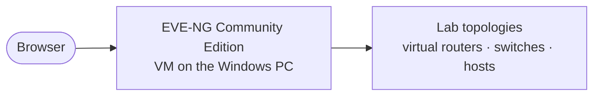

# EVE-NG

> Network emulation lab (Community Edition)

| | |
|---|---|
| **Host** | Windows PC |
| **Category** | Security labs |
| **Status** | 🟡 in progress |
| **Exposed?** | No. Lab networks only |

Not a Docker stack (see setup notes below).

## Why I run it

Networking is the area I'm least comfortable with, and the best way to learn it is to build networks and break them. EVE-NG lets me wire up virtual routers, switches and machines on one computer and practice topologies I couldn't afford to build with real hardware.

## Architecture

## Security decisions

| Decision | Why |
|---|---|
| **Lab networks stay inside EVE-NG** | Practice topologies never touch my real network |

## Setup notes

1. Run EVE-NG Community Edition as a virtual machine on the Windows PC
2. Add device images and build topologies in the web interface
3. Pairs with the [OPNsense lab](opnsense-lab.md) for practicing routing and firewalls

## Troubleshooting log

| Date | Problem | Root cause | Fix |
|---|---|---|---|
| — | Nothing logged yet | | |

## What I'd harden next

- [ ] Build a first topology (two subnets and a router) and write it up
- [ ] Practice VLANs and inter-VLAN routing before doing them on real gear

## What I learned

- *(In progress. This page grows as I complete labs.)*
