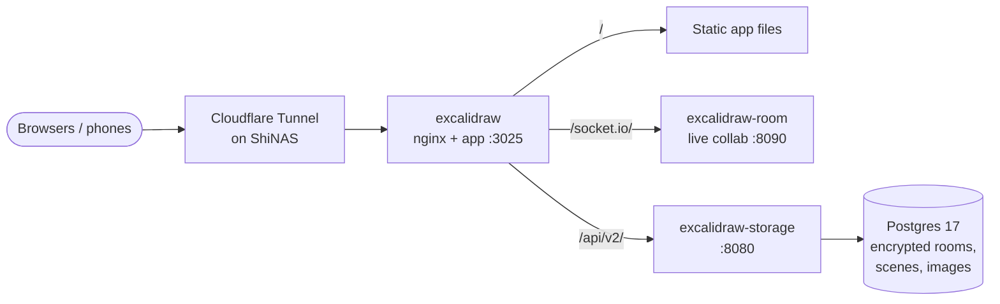

# Excalidraw (with live collaboration)

> A hand-drawn style whiteboard with real-time collaboration, fully self-hosted

| | |
|---|---|
| **Host** | ShineoriServer |
| **Category** | Apps |
| **Status** | 🟢 running <!-- 🟡 in progress / 🔵 planned / ⚫ retired --> |
| **Exposed?** | Through the ShiNAS Cloudflare Tunnel (one public hostname) |
| **Port** | 3025 (bound to the LAN IP only) |

Files: [`stacks/excalidraw/`](https://github.com/shineori/homelab/tree/main/stacks/excalidraw) (compose file, my Dockerfile, nginx config and build settings)

## Why I run it

I like sketching diagrams for my homelab and my video tutorials, and I wanted a whiteboard I could open from any device and share live with someone. The official Excalidraw site works, but live sessions go through Excalidraw's servers and Firebase. I wanted the whole thing on my own hardware: the app, the live sessions and the saved rooms.

## Architecture

| Container | Job |
|---|---|
| `excalidraw` | My own build of the [kitsteam fork](https://github.com/kitsteam/excalidraw), served by nginx. nginx also routes the collab and storage paths, so the whole app lives on **one hostname** |
| `excalidraw-room` | The socket.io server that passes drawing updates between people in a live session |
| `excalidraw-storage` | Saves rooms, shared scenes and images (replaces Firebase) |
| `excalidraw-db` | Postgres that holds that data |

**Why a fork?** The official image has its collab server address baked in at build time, so setting an environment variable on the running container does nothing. It also uses Firebase to save rooms. kitsteam's fork swaps Firebase for a small storage server, so I build that fork with my own addresses.

## Security decisions

| Decision | Why |
|---|---|
| **Everything self-hosted** | Live sessions, rooms and images never touch Excalidraw's or Google's servers |
| **End-to-end encryption stays on** | Drawings are encrypted in the browser and the key only lives in the share link, so the database only holds scrambled data |
| **One hostname, routed by nginx** | Only one public route to manage, and the room and storage containers have no published ports at all |
| **Port bound to the LAN IP** | Nothing listens on every interface; the tunnel is the only way in from outside |
| **Read-only frontend, `no-new-privileges` everywhere** | The web container can't write to its own files, and no container can gain extra permissions |
| **`CORS_ORIGIN` set to my hostname** | Other websites can't open sockets to my collab server |
| **Rooms expire after 90 days unused** | Old rooms clean themselves up, and opening a room resets its timer |
| **Pinned by digest** | The room, storage and Postgres images are pinned to exact versions; the frontend is pinned to the fork's `v0.28.0` tag |
| **Secrets in a git-ignored `.env`** | The repo only has a blanked `.env.example` |

## Setup notes

1. Clone the fork at a release tag into `src/`, copy my `shineori/` folder in, and add `!shineori/` to `src/.dockerignore` (the fork's ignore file is a whitelist)
2. Put the public URL in `shineori/env.production`. These values are baked into the app at build time, so a new domain means a rebuild
3. Fill `.env`: a random Postgres password (`openssl rand -hex 24`), the 90-day TTL, the LAN IP and the public URL
4. `docker compose build excalidraw && docker compose up -d` (the first build takes a few minutes)
5. Add one tunnel route pointing at port 3025. No second route is needed for the collab server
6. Test live collab over **HTTPS**, not the LAN IP: the browser's encryption API only works on a secure page

## Troubleshooting log

| Date | Problem | Root cause | Fix |
|---|---|---|---|
| 2026-11-16 | Writing the compose file over SSH from PowerShell broke the YAML (`found unknown escape character`, then `did not find expected key`) | PowerShell mangled the quotes and stripped the indentation from the heredoc | Sent the files base64-encoded and decoded them on the server |
| 2026-11-16 | The plain official image had no live collab or share links | Its collab server address is baked in at build time and it relies on Firebase | Switched to the kitsteam fork, built with my own URLs, plus their room and storage servers |
| 2026-11-16 | `/socket.io/` returned **502 Bad Gateway** | The room container runs as `nobody`, which can't bind port 80, and its own config expects 8090 | Set `PORT: 8090` and pointed nginx at 8090 |
| 2026-11-16 | My phone opened a German school landing page instead of the app | The fork routes `/` to its own landing page and puts the app at `/app` | Added a build step that routes `/` to the app. It fails the build if the fork ever changes that line |
| 2026-11-16 | A live session from my PC didn't show up for my phone | My PC's browser was still running the old official version from its cache, which used Excalidraw's public collab server | Hard refresh, then started a new session |

## What I'd harden next

- [ ] Add `data/postgres` to the laptop's nightly backup
- [ ] Put a Cloudflare Access app (with [Authentik](authentik.md)) in front, so only people I invite can use it
- [ ] Add it to Homepage and [Uptime Kuma](uptime-kuma.md)
- [ ] Watch the kitsteam fork for new releases, since Diun can't see a locally built image

## What I learned

- **Build-time vs runtime config:** Vite apps bake environment variables into the JavaScript, so an env var on a running container can't change them. You have to rebuild
- **One hostname can serve several containers:** nginx routes by path, so the app, the websocket server and the API all share one address and one tunnel route
- **Websockets need special proxy headers:** `Upgrade` and `Connection` have to be passed through or live connections fail
- **Non-root containers can't use low ports:** a container running as `nobody` can't bind port 80, which is why so many images use 8080 or 8090
- **Browsers cache old versions:** a service worker can keep serving an old copy of a web app after the server changes, so a hard refresh matters when testing
- **Read the fork before trusting it:** the fork worked, but it also brought its own landing page I didn't expect
