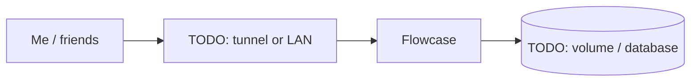

# Flowcase

> Browser-based isolated workspaces (Kasm-style), routed through ProtonVPN

| | |
|---|---|
| **Host** | ShiNAS |
| **Category** | Apps |
| **Status** | 🟢 running <!-- 🟡 in progress / 🔵 planned / ⚫ retired --> |
| **Exposed?** | TODO: LAN only / Cloudflare Tunnel / playit / Tailscale |

Compose file: [`stacks/flowcase/`](https://github.com/shineori/homelab/tree/main/stacks/flowcase)

## Why I run it

TODO: one or two sentences. What problem does this solve for you?

## Architecture

## Setup notes

- Migrated from a Windows PC to ShiNAS to reuse the existing Cloudflare Tunnel
- Goal: workspace traffic exits through ProtonVPN so the real IP is hidden

TODO: the steps you'd need to rebuild this from scratch.

## Troubleshooting log

| Date | Problem | Root cause | Fix |
|---|---|---|---|
| TODO | | | |

## What I learned

TODO: the skill this proves (great for interviews).
