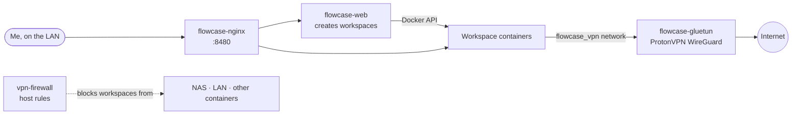

# Flowcase

> Browser-based isolated workspaces (Kasm-style), routed through ProtonVPN

| | |
|---|---|
| **Host** | ShiNAS |
| **Category** | Apps |
| **Status** | ⏸️ on demand (started only when I need it) |
| **Exposed?** | LAN only |
| **Port** | 8480 |

Compose file: [`stacks/flowcase/`](https://github.com/shineori/homelab/tree/main/stacks/flowcase)

## Why I run it

Sometimes I want a throwaway browser: to open a sketchy link, test something, or browse without my own IP showing. Flowcase spins up a disposable desktop or browser in a container, streams it to my browser, and deletes it afterwards. VPN workspaces send their traffic out through ProtonVPN, so sites see the VPN's IP, not my home's.

## Architecture

| Container | Job |
|---|---|
| `flowcase-web` | The app: logins, workspace templates, and starting and stopping workspace containers |
| `flowcase-nginx` | The front door. Routes each session to its workspace. On start it also deletes leftover routing configs for workspaces that no longer exist. |
| `flowcase-gluetun` | The VPN exit for workspaces on the isolated `flowcase_vpn` network |
| `vpn-firewall` | Host firewall rules so VPN workspaces can't reach the NAS, my LAN or other containers |

## Security decisions

| Decision | Why |
|---|---|
| **VPN workspaces on their own network** (`10.77.77.0/24`) | Their only way out is through gluetun |
| **Host firewall around that network** | A compromised workspace (that's the whole point of a throwaway browser) can't pivot to the NAS or my home network |
| **LAN only and on demand** | It was published through the tunnel at first; it doesn't need to be on the internet, so it isn't. It also only runs when I'm using it. |
| **Accepted risk: Docker socket** | `flowcase-web` mounts the Docker socket because it has to create containers. That's effectively root on the NAS, which is a big part of why Flowcase stays LAN only and off when unused. |
| **Accepted risk: privileged firewall container** | `vpn-firewall` needs `privileged` and the host network to load kernel modules and set firewall rules |

## Setup notes

1. Clone [Flowcase](https://github.com/flowcase/flowcase); my real configuration is the override files in this repo (`docker-compose.nas.yml`, plus the VPN pieces)
2. Put a ProtonVPN **WireGuard** private key in `vpn.env` (Proton account → Downloads → WireGuard configuration)
3. `docker compose -f docker-compose.nas.yml up -d`
4. Open `http://<LAN_IP>:8480`, create the admin account, add workspace templates, and attach VPN templates to the `flowcase_vpn` network
5. `docker compose stop` when finished

## Troubleshooting log

| Date | Problem | Root cause | Fix |
|---|---|---|---|
| — | nginx could fail to start after a restart | Leftover routing configs pointed at workspace containers that no longer existed, and nginx refuses to start when it can't resolve a host in its config | nginx's start command now deletes configs whose workspace container can't be found |

## What I'd harden next

- [ ] Put a docker-socket-proxy in front of `flowcase-web`, if Flowcase works with the limited API (it needs to create containers, so it may not)
- [ ] Pin the gluetun image like the other stacks

## What I learned

- **Network isolation in Docker:** separate networks, a dedicated VPN exit and host firewall rules for untrusted containers
- **Some features carry built-in risk:** an app that creates containers needs the Docker socket, so I document it and limit exposure
- **Migrating a stack between machines** (Windows PC to the NAS)
