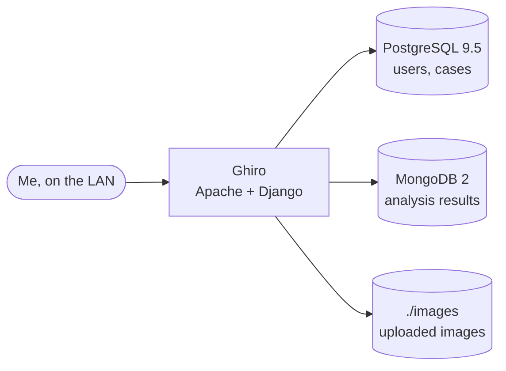

# Ghiro

> Image forensics web app

| | |
|---|---|
| **Host** | ShineoriServer |
| **Category** | Apps |
| **Status** | ⏸️ on demand (started only when I need it) |
| **Exposed?** | LAN only, started only when I need it |
| **Port** | 9991 |

Compose file: [`stacks/ghiro/`](https://github.com/shineori/homelab/tree/main/stacks/ghiro)

> 🚚 **Moved from ShiNAS to ShineoriServer** in October 2026 to free up RAM on the NAS. It was **reinstalled fresh** rather than moved: it held no data, and its old image on the NAS turned out to be damaged. Full story: [Moving services off the NAS](../infrastructure/migration.md).

## Why I run it

I'm studying cybersecurity, and digital forensics is part of that field. Ghiro analyzes images automatically: it pulls out metadata (camera, timestamps, GPS), looks for signs of editing, and computes hashes. That gives me a hands-on way to practice what an investigator looks at in a photo.

## Architecture

| Container | Job |
|---|---|
| `ghiro` | The web app, built locally from the [ghiro-docker](https://github.com/chriskd/ghiro-docker) Dockerfile |
| `ghiro-pg` | Users, cases and settings |
| `ghiro-mongo` | The analysis results for each image |

## Security decisions

Ghiro is **legacy software**: the image is built on Ubuntu 16.04 and Python 2, and it uses PostgreSQL 9.5 and MongoDB 2, all long past end of support. I can't patch that, so I contain it instead:

| Decision | Why |
|---|---|
| **LAN only, no tunnel route** | Old, unpatched software stays off the internet |
| **Off unless I'm using it** | `docker compose stop` when I'm done, so it isn't running unattended |
| **Removed the published MongoDB port** | The upstream compose published MongoDB (`27017`), which runs **without authentication**. Now only the Ghiro container can reach it. |
| **No databases exposed at all** | PostgreSQL's port stays commented out too |
| **Built on the laptop, not pulled** | The upstream image isn't maintained, so I build from the Dockerfile |

## Setup notes

1. Clone [chriskd/ghiro-docker](https://github.com/chriskd/ghiro-docker) and edit `docker-compose.yml`: publish only the web port (`9991:80`) and remove the MongoDB port mapping
2. `docker compose build` (a few minutes; it installs old Ubuntu and Python 2 packages)
3. `docker compose up -d` and open `http://<LAN_IP>:9991`
4. `docker compose stop` when finished

## Troubleshooting log

| Date | Problem | Root cause | Fix |
|---|---|---|---|
| — | MongoDB was reachable from my network | The upstream compose file publishes port `27017`, and MongoDB 2 runs with no authentication | Removed the port mapping |
| 2026-10-11 | `docker save` of the Ghiro image failed: a file missing inside an image layer | The locally built image on the NAS was damaged | It held no data, so I built a fresh copy on the laptop **first**, tested it, then removed everything from the NAS with `docker compose down -v --rmi all` |

## What I'd harden next

- [ ] Set my own admin and database passwords before storing any real evidence
- [ ] Keep it LAN only and off by default. If I ever use it seriously, look for a maintained forensics tool instead.

## What I learned

- **Image forensics basics:** EXIF metadata, GPS tags, hashing, and how edits can leave traces in a file
- **Contain what you can't patch:** for end-of-life software, the defense is isolation: no internet exposure, no exposed databases, and not running when unused
- **Read upstream compose files critically:** the stock file published an unauthenticated database to my whole network
- **Build first, delete second:** the fresh install was tested before anything on the NAS was removed
