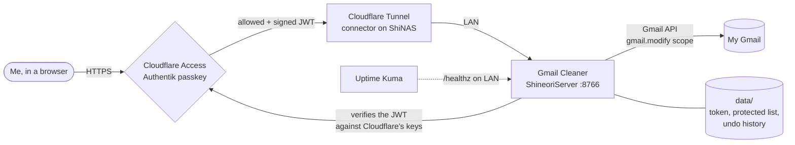

# Gmail Cleaner

> Bulk-clean my Gmail (unsubscribe, delete by sender, archive, mark read) from a self-hosted web app, with my own safety features added on top

| | |
|---|---|
| **Host** | ShineoriServer |
| **Category** | Apps |
| **Status** | 🟢 running |
| **Exposed?** | Web UI only through the Cloudflare Tunnel, behind **Cloudflare Access + Authentik**. The app also checks the Access login token itself, so going straight to the LAN port gets a `403`. The OAuth callback port is not published. |
| **Version** | My fork, pinned to commit `b3e662f` (built from source, no prebuilt image) |

Compose file: [`stacks/gmail-cleaner/`](https://github.com/shineori/homelab/tree/main/stacks/gmail-cleaner)
Code: [Shineori/gmail-cleaner](https://github.com/Shineori/gmail-cleaner) (fork of [Gururagavendra/gmail-cleaner](https://github.com/Gururagavendra/gmail-cleaner))

## Why I run it

My inbox is buried under years of newsletters and promotions. Gmail's own tools are fine for one sender at a time, but not for "show me who sends me the most mail and clear out the top 20."

Gmail Cleaner does that through the Gmail API with my own Google OAuth app, so my mail never goes through a third-party company. Before running it, I read through the upstream code to check what it actually does with that access. It was clean, but it had no login on its web page and nothing stopping me from deleting the wrong thing in bulk. So I forked it and added the safety features I wanted before trusting it with my real inbox.

## Architecture

| Piece | Job |
|---|---|
| `gmail-cleaner` container | FastAPI app + web UI. Built from my fork at a pinned commit. |
| `credentials.json` | My Google Cloud "Desktop app" OAuth client, mounted read-only |
| `data/token.json` | The Gmail sign-in token (treated like a password) |
| `data/protected_senders.json` | Senders the app must never touch |
| `data/history.json` | Last 50 actions with the exact message IDs, for undo |
| `data/unsubscribed.json` | Who I unsubscribed from and when, for the unsubscribe tracker |

**What my fork adds on top of upstream:**

| Feature | What it does |
|---|---|
| 🛡️ Protected senders | Addresses or domains (a domain covers its subdomains) that Delete, Archive, Mark as Read and Unsubscribe always skip, even if I select them |
| ↩ Undo + history | Every trash, archive or mark-read run is saved with its message IDs. One click puts them back (trash only within Gmail's 30-day window). |
| 👀 Preview | Before anything runs I see the exact count, a per-sender breakdown, which protected senders get skipped, and sample subject lines |
| 📭 Unsubscribe tracker | Remembers every unsubscribe and checks Gmail for mail that arrives afterwards. After a 14-day grace period each sender shows ✅ Worked or 🚨 Still sending, in the tracker and as badges in scan results. Right after unsubscribing it offers to trash that sender's old emails. |
| 🔐 Login gate | Verifies the Cloudflare Access token on every request. Cross-site POSTs are always blocked. |
| Remote sign-in | Google sign-in finishes by pasting the redirect address into the app, so it works on a server |

## Security decisions

| Decision | Why |
|---|---|
| **Read the upstream code before running it** | The app gets permission to read and trash my whole inbox. I checked every outbound network call first: it only talks to the Gmail API and the unsubscribe links in my mail. No telemetry. |
| **Build from my fork at a pinned commit, not the author's `:latest` image** | Upstream's compose pulled a prebuilt `:latest` image on every start, so I'd be running whatever got pushed next. Now the running code is exactly the code that was reviewed and tested. Updating is a deliberate hash change. |
| **Cloudflare Access with Authentik as the only login, policy allows only my email** | Same gate as my other admin pages. Strangers never reach the app. |
| **The app checks the Access token itself** | Defense in depth. If someone on my network (or a mistake in the tunnel config) reaches the port directly, they still get a `403` because there's no valid signed token. It checks the signature, expiry, issuer, the app's audience tag and my email. |
| **Cross-site request blocking** | A random website can't make my browser send "delete everything" to the app behind my back |
| **Protected senders enforced on the server, twice, and fail closed** | The list is excluded in the Gmail search, then every message's real sender is re-checked before it's changed. If the list file is ever unreadable, actions refuse to run instead of running with no protection. |
| **Sign-in errors shown on the page** | My first sign-in failed three different ways, and each one only showed up in `docker logs`. Now the page says what went wrong and how to fix it, which also means I'm less tempted to loosen permissions just to make an error go away. |
| **Previews and undo on every bulk action** | The scariest part of a bulk tool is one wrong click. Now I see what will happen first, and I can reverse it after. |
| **OAuth scope stays `gmail.modify`** | It can trash and relabel mail but can't permanently delete it or send email. Anything trashed is recoverable for 30 days. |
| **OAuth callback port not published** | On a server, Google's redirect can't reach the app anyway. I paste the address instead, and the paste only works for the sign-in that's currently waiting (CSRF state check, 5-minute window). |
| **Hardened container** | Runs as a normal user (uid 1000), all Linux capabilities dropped, `no-new-privileges`, no test tools in the image, healthcheck on |
| **No CDN scripts** | Upstream loaded its date picker from a CDN as `@latest`. A hijacked package would run inside a page that can delete mail, so my fork serves a pinned copy locally. |
| **`credentials.json` and `data/` never leave the server** | Both are `chmod 600` / owned by the container user and are not in this repo |

## Setup notes

1. **Google Cloud:** new project, OAuth consent screen (add myself as a test user), then Credentials → OAuth client ID → **Desktop app** → download the JSON.
2. **Fork and build:** my fork lives at `Shineori/gmail-cleaner`. The compose file builds straight from the git URL pinned to a commit hash, so the server doesn't need a clone.
3. **Server folder** `~/docker/gmail-cleaner`:
    - copy the Google JSON in as `credentials.json`
    - `mkdir data && sudo chown 1000:1000 data` (the container user has to own it)
    - `sudo chown 1000:1000 credentials.json` too: `chmod 600` alone locks the container out if the file belongs to another user
    - fill in `.env` from `.env.example`, then `chmod 600 .env credentials.json`
4. **Cloudflare Access:** Zero Trust → Access → Applications → Self-hosted. Login methods: only Authentik, instant auth on. Policy: **Allow**, include my email. Copy the app's **Application Audience (AUD) Tag** into `ACCESS_AUD`.
5. **Tunnel route:** my homelab subdomain → the server's LAN IP on port 8766. I put it on my homelab-projects domain, not my main one.
6. `docker compose up -d --build`, then `docker compose ps` should say **healthy**.
7. **Check the gate:** the LAN address returns `403`, and the public address in a private window sends me to the Authentik login.
8. **Enable the Gmail API** in the same Google Cloud project as the OAuth client (I missed this the first time, see the troubleshooting log).
9. **Sign in to Gmail:** click Sign in with Google → approve → Google sends me to a `localhost:8767` page that won't load (expected) → paste that address into the app.
10. **First thing after sign-in:** add my school, bank and other important senders on the **Safety & Undo** page.

## Troubleshooting log

| Date | Problem | Root cause | Fix |
|---|---|---|---|
| 2026-10-30 | First `docker compose up` failed: `bind source path does not exist: .../credentials.json` | I hadn't copied the Google OAuth JSON to the server yet. The compose file sets `create_host_path: false` on purpose, so Docker won't invent an empty file. | Copied the JSON over as `credentials.json`, `chmod 600`, created `data/` owned by uid 1000, ran `up -d` again. The image was already built, so it started instantly. |
| 2026-10-30 | Stuck on "Signing in..." with "Could not get the Google link" | I'd run `chmod 600 credentials.json`, but the file wasn't owned by uid 1000, the user the container runs as, so the app couldn't read it. The error only appeared in `docker logs` as `Permission denied`. | `sudo chown 1000:1000 credentials.json` (kept `600`). Then fixed the fork so sign-in errors show on the page with the fix. |
| 2026-10-30 | Stuck on "Code received, finishing sign-in..." (I was on a VPN and suspected that first) | Not the VPN: the code-for-token swap happens on the server. The token was saved fine, but every "am I signed in?" check failed with `Gmail API has not been used in project ... or it is disabled`. I'd never enabled the Gmail API in my Google Cloud project. | Enabled the Gmail API from the link in the log, waited a few minutes, reloaded: signed in. The fork now also reports failures after the paste step on the page. |
| 2026-10-30 | Senders I'd unsubscribed from came back after refreshing, and still showed in Gmail's Manage subscriptions | Working as designed, but confusing: unsubscribing only stops *future* mail, the scan has no memory, and Gmail's list is built from recent mail, not from whether I'm still subscribed | Added the unsubscribe tracker: it remembers each unsubscribe and checks Gmail after a 14-day grace period, so I can tell "worked" from "ignored me" |
| 2026-10-30 | Upstream's Docker sign-in said "check the Docker logs for the authorization URL" | Upstream's web mode expects your browser and the container on the same machine | Fork shows the Google link in the page and adds the "paste the redirect address" box |
| 2026-10-30 | A valid Cloudflare Access token was rejected in testing | Cloudflare sends the token's audience as a **list**, and the JWT library's built-in audience check only handles a single string | Check the audience myself after verifying the signature. Caught by a test before it ever ran on the server. |
| 2026-10-30 | Upstream's date picker stylesheet returned `404` | The CDN path for `@latest` had moved in the package | Fork serves a pinned 2.0.12 copy (JS + CSS) locally |
| 2026-10-30 | The page scrolled sideways on my phone | Upstream's header (email + avatar + Sign Out) and an action row were wider than the screen | Small CSS fix in the fork: hide the email and wrap the buttons on narrow screens |

## What I'd harden next

- [ ] **Require the Authentik login method** in the Access policy (Require → Login Methods), not just the email, so a one-time email PIN could never get in
- [ ] **Uptime Kuma monitor** on the LAN `/healthz` endpoint (it's open on purpose so monitoring doesn't need a login)
- [ ] **Add `data/` to the nightly ShineoriServer backup**, so the protected list and undo history survive a rebuild
- [ ] **Move the Google consent screen to Production** (unverified is fine for personal use) so I'm not signed out every 7 days
- [ ] **Block or filter "still sending" senders automatically:** right now the tracker flags them and I deal with them by hand
- [ ] **Diun can't watch this one:** it's built from source, so I need my own reminder to check upstream for fixes and rebase my fork
- [ ] **Revoke the token when I'm not using it** for a while (Google Account → third-party access), or stop the container between cleanups

## What I learned

- **Read before you trust:** an app asking for inbox access deserves a code review first. Grepping for every network call and dangerous function is a quick, practical first pass.
- **Pin what you run:** `:latest` plus auto-pull means trusting whatever the author ships next. Building from a pinned commit makes "what's running" a fact, not a guess.
- **A gate in front isn't the whole story:** Cloudflare Access stops strangers, but having the app verify the signed token itself means a mistake elsewhere doesn't leave it wide open
- **How Access tokens work:** Cloudflare signs a JWT on every request, and the app checks it against Cloudflare's public keys, its own audience tag and the expiry time. I'm still learning identity and SSO, and building this check made those pieces click.
- **How OAuth redirects work, and why "Desktop app" clients redirect to `localhost`.** That's also why pasting the address back is a legitimate way to finish sign-in on a server.
- **Tests catch real bugs:** the audience-as-a-list problem would have locked me out on the first real login. A test with a real signed token found it first.
- **Read the log, don't guess:** I blamed my VPN, but `docker logs` said exactly what was wrong (Gmail API disabled). Each failure looked the same on the page and had a completely different cause.
- **File permissions and containers:** a container running as uid 1000 can't read a `600` file owned by someone else, even on the same machine. Owner matters as much as mode.
- **Unsubscribe is a request, not a guarantee:** the sender has to honor it. Tracking what happens afterwards is the only way to actually know.
- **Safety features matter more than features:** protected senders, previews and undo are what made me comfortable pointing a bulk-delete tool at my real inbox
