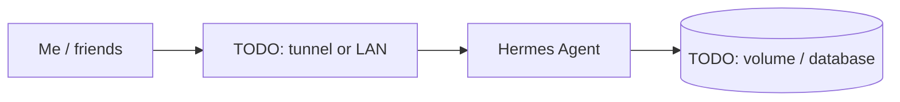

# Hermes Agent

> Local AI agent for diagnosing the PC (planned)

| | |
|---|---|
| **Host** | Windows PC |
| **Category** | AI |
| **Status** | 🔵 planned <!-- 🟡 in progress / 🔵 planned / ⚫ retired --> |
| **Exposed?** | TODO: LAN only / Cloudflare Tunnel / playit / Tailscale |

Not a Docker stack (see setup notes below).

## Why I run it

TODO: one or two sentences. What problem does this solve for you?

## Architecture

## Setup notes

- Status: planned

TODO: the steps you'd need to rebuild this from scratch.

## Troubleshooting log

| Date | Problem | Root cause | Fix |
|---|---|---|---|
| TODO | | | |

## What I learned

TODO: the skill this proves (great for interviews).
