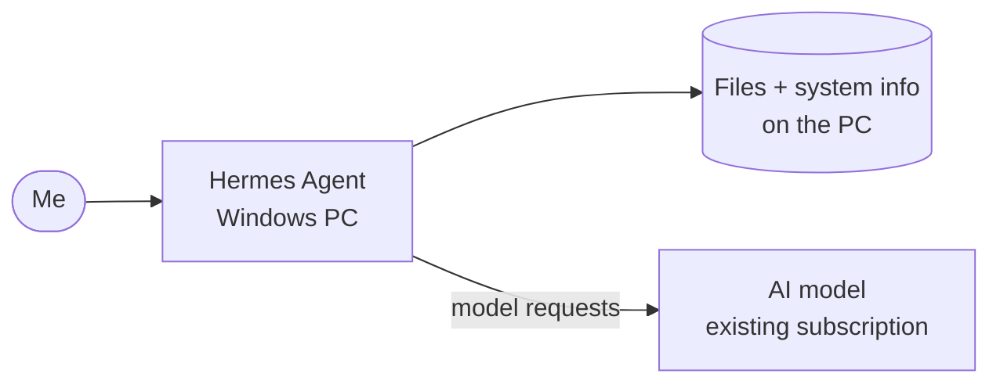

# Hermes Agent

> Local AI agent for diagnosing the PC (planned)

| | |
|---|---|
| **Host** | Windows PC |
| **Category** | AI |
| **Status** | 🔵 planned |
| **Exposed?** | No. It would run locally on the PC |

Not a Docker stack (see setup notes below).

## Why I want it

Nous Research's Hermes Agent is an AI agent that can work with files and diagnose problems on the machine it runs on. I want it on my Windows PC (not on a server), so it can help troubleshoot that computer directly, using the AI subscription I already have instead of a separate paid API key.

## Planned architecture

## Security considerations

| Consideration | Plan |
|---|---|
| **An agent that can act on my files** | Start with read-only diagnosis and approve any change it wants to make |
| **Scope** | Only this PC, never the servers |

## Setup notes

1. Install Hermes Agent on the Windows PC
2. Connect it to my existing AI subscription
3. Try it on a real problem and write up the result

## What I learned

- *(Planned. This page fills in once it's set up.)*
