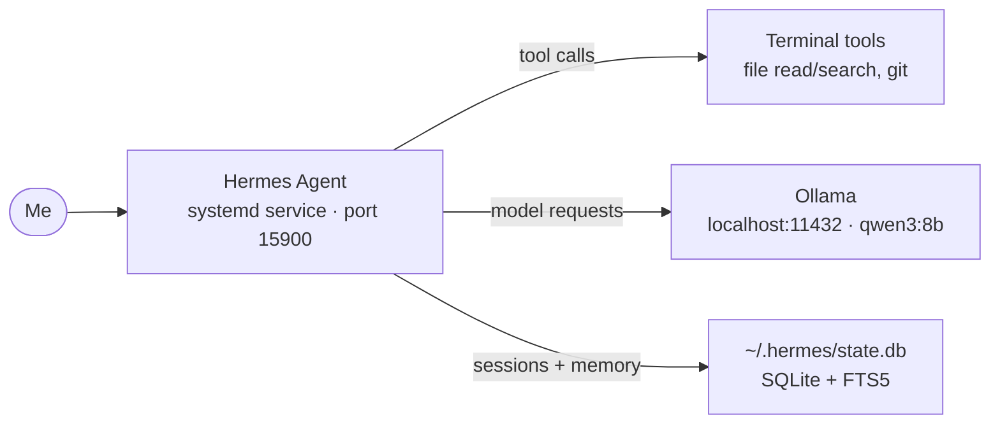

# Hermes Agent

> Open-source AI agent running locally on my laptop for diagnosing problems and automating tasks with a real terminal

|| | |
|---|---|---|
| **Host** | ShineoriServer |
| **Category** | AI |
| **Status** | 🟢 running |
| **Exposed?** | No. It runs natively on the machine and connects only to my local Ollama instance. |

Compose file: [no Docker compose](https://github.com/shineori/homelab/tree/main/stacks/hermes-agent)

## Why I run it

I want an AI agent that can work directly with files on the laptop and diagnose real problems in my environment, not just chat, but actually read logs, inspect configs, and run CLI commands. By running Hermes Agent locally (connected to a local Ollama model), the agent gets full terminal tool access without sending any prompts or file content to an external API provider. The Nous subscription I already have unlocks the agent framework features (persistent memory, skill loading, multi-surface gateways), while the inference costs stay at zero by using qwen3:8b on my own hardware.

## Architecture



|| Piece | Job |
|---|---|
| **Hermes Agent** | The agent core. Installed via the shell bootstrap (`curl` installer). Runs as a systemd service so it stays alive and responds to CLI or gateway requests. |
| **Ollama (local)** | The model server, shared with the [ollama-stack](ollama-stack.md) on port 11432. Hermes configures a custom model alias pointing to `localhost:11432` so all inference stays on-machine. |
| **Nous subscription** | Unlocks agent features (persistent memory, skill management, multi-surface gateways). The API key is stored in `~/.hermes/.env`, not committed to git. |

## Security decisions

|| Decision | Why |
|---|---|
| **Local-first inference** | Prompts, file contents, and diagnostic data never leave my hardware. The agent talks only to the local Ollama instance |
| **Agent tool scope limited to this laptop** | Hermes can read files and run commands, so I confine it to ShineoriServer. It has no reach into ShiNAS or other hosts on the network |
| **No public exposure** | I don't expose the dashboard or proxy to the internet; access is via LAN only |
| **Secrets in a git-ignored .env** | The Nous API key lives in `~/.hermes/.env`. That directory is listed in `.gitignore` at the homelab root |

## Setup notes

1. Install Hermes Agent natively with the shell installer:

   ```bash
   curl -fsSL https://hermes-agent.nousresearch.com/install.sh | bash
   ```

2. Initialize and pick model/provider:

   ```bash
   hermes setup          # run the interactive wizard
   hermes model          # or set the model directly with a picker dialog
   ```

3. Configure a custom model alias for the local Ollama instance (qwen3:8b running on port 11432):

   ```bash
   hermes config set model.aliases.local-ollama.base_url http://localhost:11432/v1
   hermes config set model.aliases.local-ollama.provider custom
   ```

   Then select it as the default for Hermes with `/model local-ollama` or `hermes model set local-ollama --global`.

4. Pull the model (if not already available from the ollama-stack setup):

   ```bash
   ollama pull qwen3:8b
   ```

5. Verify it works:

   ```bash
   hermes chat -q "Say hello"    # one-shot test; should respond using qwen3:8b locally
   hermes doctor                 # health check for the gateway, model, and tools
   ```

6. Add a systemd service so Hermes runs as a daemon on ShineoriServer (the unit file installs under `~/.config/systemd/user/`):

   ```bash
   export HERMES_SERVICE=true
   hermes install
   systemctl --user enable --now hermes-agent.service
   ```

## Troubleshooting log

|| Date | Problem | Root cause | Fix |
|---|---|---|---|
| 2026-10-* | *(TBD (will fill in once I encounter live issues).)* | | |

## What I'd harden next

- [ ] Pin the Hermes Agent version (track upgrades)
- [ ] Explore gateway security, add token/auth to the dashboard if I end up exposing it
- [ ] Evaluate MCP server scope: are any loaded tools too broad for unattended use?
- [ ] Add backup of `~/.hermes/` (sessions, memory, skills) to my existing backup routine

## What I learned

- **Installer bootstrap:** the curl installer bootstraps PM, Python, and Hermes in one pass, no manual pip or virtualenv setup needed.
- **Custom Ollama alias:** a local model is just three `config set` lines pointing at `localhost:11432/v1`. The same Ollama instance from the ollama-stack serves both Open WebUI queries and agent tool calls.
- **systemd service:** once configured (`HERMES_SERVICE=true; hermes install`), Hermes runs as a persistent user service with logs under `~/.hermes/logs/`.
