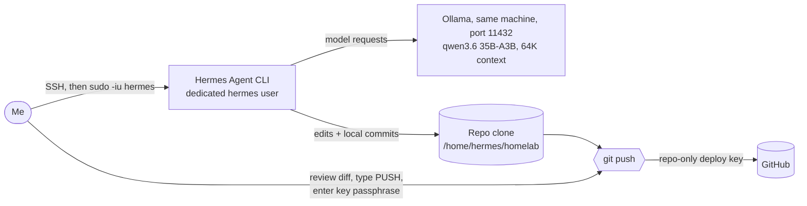

# Hermes Agent

> A local AI agent that helps me maintain this docs repo, running on my own hardware behind several layers of guardrails

| | |
|---|---|
| **Host** | ShineoriServer |
| **Category** | AI |
| **Status** | 🟢 running |
| **Exposed?** | No. It's a command-line tool I start myself over SSH, and its messaging gateway is turned off |

Not a Docker stack (see setup notes below).

## Why I run it

I was using a cloud AI assistant to keep this repo up to date, and it was eating through my usage limits. I wanted a local agent that could do the routine work (status updates, small page edits, commits) on my own hardware, for free.

Nous Research's Hermes Agent can read and edit files, run commands and use git. My first plan was to put it on my Windows PC, but I moved it to ShineoriServer because that's where my local model already runs, and Hermes needs a Unix environment.

The catch: an agent that can run commands on a server full of my services and secrets is a real risk, and it's about to write to a **public** repo. So most of this page is about the guardrails.

## Architecture



| Piece | Job |
|---|---|
| **Hermes Agent** | The agent. Installed with the official install script under its own `hermes` Linux user, run from the terminal when I need it |
| **Ollama** | The model server (systemd service on port 11432), shared with the [Ollama stack](ollama-stack.md) |
| **qwen3.6 35B-A3B** | The model. A custom Modelfile (`qwen3.6-hermes`) bakes in a 64K context window, which Hermes requires |
| **Repo clone** | Hermes works in its own clone. It can commit, but only I can push |

### Picking a model that fits

The laptop has a small GPU and 31 GB of RAM, so most of any big model runs on the CPU. That made the type of model matter more than the size:

| Model | Type | Speed on my hardware | Verdict |
|---|---|---|---|
| qwen3.8 27B | Dense (all 27B parameters work on every token) | ~3.3 tokens/s | Too slow for an agent that makes dozens of calls per task |
| qwen3.6 35B-A3B | Mixture of experts (only ~3B parameters active per token) | ~28 tokens/s | ✅ Picked. About 8x faster even though it's bigger on disk |

Ollama settings: 64K context, flash attention, a `q8_0` KV cache to save memory, and a 1 hour keep-alive so the model doesn't reload between tasks. The model ends up roughly 88% on CPU and 12% on GPU. To give Ollama the GPU, I moved [Immich's machine learning](immich.md) to the CPU.

## Security decisions

| Decision | Why |
|---|---|
| **Dedicated `hermes` Linux user** with no sudo and not in the docker group | The agent can't read my home folder, my `.env` secrets or SSH keys, can't touch my containers, and can't escalate. Least privilege |
| **My home folder set to 750** | Other users, including `hermes`, can't even list it |
| **Repo-only deploy key** | The key works for this one repo, not my whole GitHub account |
| **Passphrase on the deploy key**, no ssh-agent | `git push --no-verify` can skip hooks, but it can't skip SSH. Without me typing the passphrase, nothing reaches GitHub |
| **Pre-push hook** | Scans the repo for private info (domains, LAN IPs, emails and other terms I keep out of this repo), then asks a human to type `PUSH`. The agent's terminal has no keyboard, so it can't confirm |
| **Approval for dangerous commands** | Hermes stops and asks before risky commands. When I tested it, the agent tried `sudo` and the approval gate skipped it |
| **Protected file patterns** | Compose files, `.env` files, `.bashrc`, the hook and Hermes's own config always need my approval when the agent's file tool edits them |
| **Trimmed tool set** | Only terminal, files, skills, task planning, memory, session search and clarifying questions. No browser, scheduled jobs, sub-agents or desktop control |
| **Messaging gateway disabled, telemetry off** | Fewer doors in, nothing reported out |
| **Local inference only** | Prompts and file contents never leave my hardware |
| **Rules file kept out of the repo** | Hermes reads its repo rules from a local file listed in `.git/info/exclude`, so it never gets pushed |

## Setup notes

1. Create the user and lock my home folder:

   ```bash
   sudo adduser --disabled-password --gecos "" hermes
   sudo chmod 750 /home/<me>
   ```

2. Install Hermes as that user and run the wizard:

   ```bash
   sudo -iu hermes
   curl -fsSL https://hermes-agent.nousresearch.com/install.sh | bash
   hermes setup
   ```

   In the wizard: **Full setup** → **Custom endpoint** `http://<LAN_IP>:11432/v1` → **Chat Completions** → model `qwen3.6-hermes` → context `65536` → reasoning **low** → **Local** terminal → no messaging platforms → only the tools listed above.

3. Make the context size match everywhere (Ollama service, Modelfile and Hermes):

   ```bash
   hermes config set model.context_length 65536
   hermes config set model.ollama_num_ctx 65536
   ```

4. Add a `security:` block to `~/.hermes/config.yaml` with `protected_instruction_extra_patterns` for the files listed above.

5. Create a deploy key, add it on GitHub with write access, add a passphrase, and clone:

   ```bash
   ssh-keygen -t ed25519 -f ~/.ssh/homelab_deploy
   ssh-keygen -p -f ~/.ssh/homelab_deploy
   git clone git@github.com:Shineori/homelab.git ~/homelab
   ```

6. Install the pre-push hook in `.git/hooks/pre-push`, then test it twice: once as me (should prompt), once through Hermes (should block).

**My workflow:** pull → start a fresh Hermes session → give it one small, exact task → read `git show` myself → push.

## Troubleshooting log

| Problem | Cause | Fix |
|---|---|---|
| qwen3.8 wouldn't load: `cudaMalloc failed: out of memory` | Immich's ML container was holding almost all of the GPU's memory, so Ollama's memory check returned nothing and it tried to put the whole model on the GPU | Stopped Immich ML to test, and later moved it to the CPU for good |
| qwen3.8 took 3 minutes to write a 5-line script | A dense 27B model mostly on the CPU runs at ~3 tokens/s, and most of its output was "thinking" | Switched to qwen3.6 35B-A3B, a mixture-of-experts model (~28 tokens/s) |
| Answers cut off mid-sentence | Ollama's default context was only about 2K tokens. My prompt plus the answer added up to 2,047 | Set `OLLAMA_CONTEXT_LENGTH` in the Ollama service |
| Hermes refused to start: context below the 64,000 minimum | I had set 32K. Hermes's own instructions and tools take about 10K tokens before I type anything | Raised the context to 65,536 in Ollama, the Modelfile and Hermes |
| Still running at 32K after that | Hermes sends its own context size when it loads the model, and that setting was still unset | `hermes config set model.ollama_num_ctx 65536` |
| `OLLAMA_GPU_OVERHEAD` didn't free GPU memory for Immich | The setting didn't shrink Ollama's share on my setup | Capping GPU layers worked but halved the speed, so I moved Immich ML to the CPU instead |
| The agent edited a protected file through the shell without asking | The protected-file approval only covers the file tool, not terminal commands like `echo > file` | That's what pushed me to the dedicated Linux user, a real wall instead of a speed bump |
| The pre-push hook blocked me too, with no prompt | `read` prints its prompt to stderr, and my `2>/dev/null` hid it | Open the terminal separately (`exec 3</dev/tty`) and only silence that step |
| The privacy scan flagged harmless lines | My patterns were too loose (a GitHub URL, and a WireGuard service name that looked like an email address) | Tightened the patterns to match real usernames and real email domains only |

## What I'd harden next

- [ ] Limit the `hermes` user's network access (right now it can still reach other machines on my LAN)
- [ ] Try the Docker terminal backend so commands run in a container
- [ ] Move the legacy provider entry in Hermes's config to the newer format once updates support it
- [ ] Back up `/home/hermes/.hermes` (config, sessions, memory)
- [ ] A small helper so I can copy collected stack files into the agent's clone, since it can't read my Docker folder
- [ ] If I add the Discord gateway later, lock it to my user ID only

## What I learned

- **Least privilege, in layers:** speed bumps (approvals) are helpful, but walls (Linux users, file permissions, key passphrases) are what actually hold. I tested every layer by having the agent try to get around it
- **The agent will offer to tear down its own walls:** when it couldn't read my Docker folder, it suggested `chmod 755` and tried `sudo`. Saying no is my job
- **Trust the diff, not the summary:** the local model sometimes describes things it never checked or invents details. Reading `git show` before every push catches it
- **Dense vs mixture of experts:** on a small GPU, a model with fewer active parameters can be much faster than a smaller dense one
- **Context size has three knobs:** the Ollama service, the Modelfile and the agent's own request all need to agree, and the last one wins
- **Small, exact tasks work best:** giving the agent the exact before and after text got a clean 3-line commit, while open-ended tasks invited guesses
