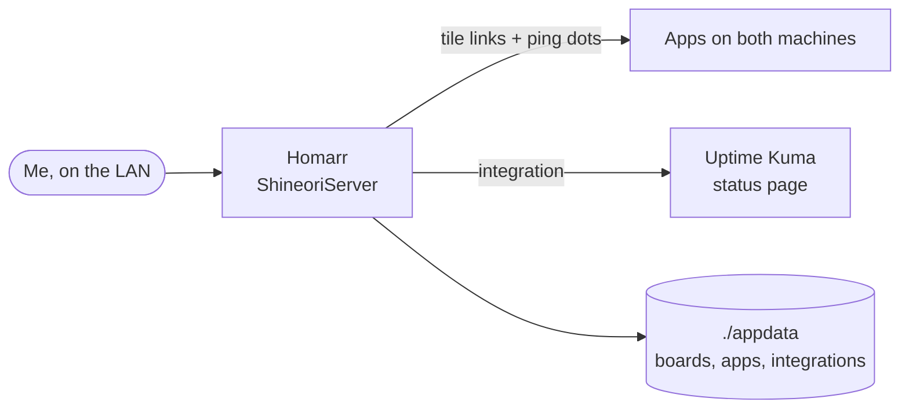

# Homarr

> Dashboard / home screen for every service

| | |
|---|---|
| **Host** | ShineoriServer |
| **Category** | Networking & monitoring |
| **Status** | ⚫ retired (removed from both servers on 2026-10-28) <!-- 🟡 in progress / 🔵 planned / ⚫ retired --> |
| **Exposed?** | LAN only |
| **Port** | 7575 |

Compose file: [`stacks/homarr/`](https://github.com/shineori/homelab/tree/main/stacks/homarr)

> ⚫ **Retired on 2026-10-28.** I removed Homarr completely from both machines; my dashboard is now [Homepage](https://gethomepage.dev). This page stays up as a record of how it was set up and what I learned.

> 🚚 **Moved from ShiNAS to ShineoriServer** in October 2026 to free up RAM on the NAS. Full story: [Moving services off the NAS](../infrastructure/migration.md).

## Why I run it

My lab has more than twenty services on two machines, each with its own address and port, and I couldn't keep them all in my head. Homarr is my home screen: every app is one click away, with a live up/down dot next to it.

## Architecture

Homarr keeps two separate kinds of records, which tripped me up once (see the troubleshooting log):

| Record | What it does |
|---|---|
| **App** | Where a tile **opens** when clicked, plus the address it pings for the status dot |
| **Integration** | A connection that lets **widgets read data** from another service, like Uptime Kuma's monitor status |

## Security decisions

| Decision | Why |
|---|---|
| **LAN only** | A dashboard is a map of my whole lab, so it stays off the internet |
| **`SECRET_ENCRYPTION_KEY` in a git-ignored `.env`** | Homarr encrypts the API keys and passwords saved in its integrations with this key. The repo only has a blanked `.env.example`. |
| **Pinned to a version** (`v2.7.0`) | Updates only happen when I change the tag. It used to be pinned by digest, which was safe but hid which version I was running: the image's version label just said `main`. |
| **Single sign-on through Authentik** | 🔵 Planned |

## Setup notes

1. Generate a random encryption key into `.env` as `SECRET_ENCRYPTION_KEY`
2. `docker compose up -d`, then open `http://<LAN_IP>:7575` and create the admin account
3. Add **apps** (name, icon, URL, ping URL), then place them on a board
4. Add **integrations** for widgets. For Uptime Kuma, choose *Status page slug* and enter the slug of a status page that exists.
5. **Moving it:** copy the whole folder **including `.env`**. Without the same key, every saved integration secret comes back unreadable.

## Troubleshooting log

| Date | Problem | Root cause | Fix |
|---|---|---|---|
| 2026-10-11 | Uptime Kuma integration: *unexpected 404* from `/api/status-page/default` | With "No secrets" selected, Homarr asks for a status page named `default`, which I didn't have | Created a status page in Uptime Kuma and switched the integration to *Status page slug* |
| 2026-10-11 | After the move, the Uptime Kuma tile still opened the old address and showed a red dot | I had updated the **integration**, but the tile uses the **app** record, which still had the old URL and ping URL | Edited the app's URL and ping URL. Linked the integration to the app so they stay together. |
| 2026-10-13 | Diun announced v2.5.x, but I couldn't tell which version I was on | The image was pinned by digest, and its version label only said `main` | Compared the image's build date (Oct 9) with the release dates: it was the release just before v2.5.0. Took a backup, then updated to `v2.5.2` with a real version tag. |

## What I'd harden next

- [ ] Log in through [Authentik](authentik.md) instead of a separate Homarr password
- [x] **Backed up** ✅ *Done while it ran:* `./appdata` and `.env` were in the laptop's nightly backup. Removed from the backup when Homarr was retired.

## What I learned

- **Separate "where it links" from "where it reads data":** the app/integration split makes sense once you've hit it, and it's a pattern other dashboards use too
- **Encryption keys travel with the data.** An app that encrypts secrets at rest is only portable if its key moves with it.
- **Plan for change:** a dashboard is only useful if it's accurate, so updating Homarr is now part of my checklist whenever a service moves
