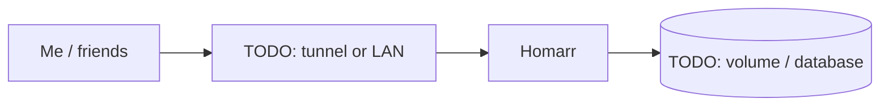

# Homarr

> Dashboard / home screen for every service

| | |
|---|---|
| **Host** | ShineoriServer |
| **Category** | Networking & monitoring |
| **Status** | 🟢 running <!-- 🟡 in progress / 🔵 planned / ⚫ retired --> |
| **Exposed?** | LAN only |

Compose file: [`stacks/homarr/`](https://github.com/shineori/homelab/tree/main/stacks/homarr)

> 🚚 **Moved from ShiNAS to ShineoriServer** in October 2026 to free up RAM on the NAS. Full story: [Moving services off the NAS](../infrastructure/migration.md).

## Why I run it

TODO: one or two sentences. What problem does this solve for you?

## Architecture

## Setup notes

- Port 7575
- Authentik SSO planned

TODO: the steps you'd need to rebuild this from scratch.

## Troubleshooting log

| Date | Problem | Root cause | Fix |
|---|---|---|---|
| TODO | | | |

## What I learned

TODO: the skill this proves (great for interviews).
