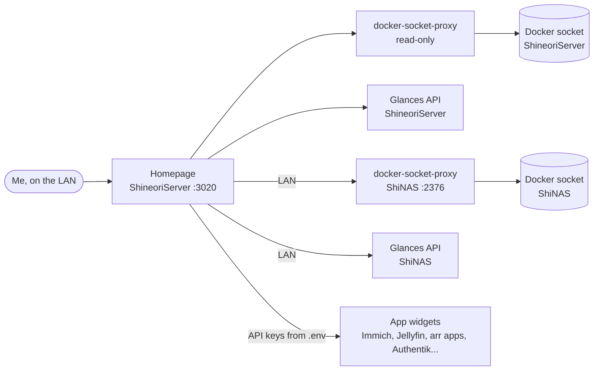

# Homepage

> My homelab command center: one dashboard with every service, both machines' stats and live container status

| | |
|---|---|
| **Host** | ShineoriServer (dashboard) + a small agent stack on ShiNAS |
| **Category** | Networking & monitoring |
| **Status** | 🟢 running <!-- 🟡 in progress / 🔵 planned / ⚫ retired --> |
| **Exposed?** | LAN only |
| **Port** | 3020 (dashboard), 61208 (Glances API on each machine), 2376 (NAS docker proxy) |

Compose files: [`stacks/homepage/`](https://github.com/shineori/homelab/tree/main/stacks/homepage) (dashboard, with its YAML config) and [`stacks/homepage-agent/`](https://github.com/shineori/homelab/tree/main/stacks/homepage-agent) (NAS agent)

> 🔁 **Replaced [Homarr](homarr.md)** on 2026-10-28. Homepage is configured with plain YAML files instead of a web editor, so the whole dashboard lives in this repo.

## Why I run it

The lab grew to two servers and 30+ containers, and I was losing track of what runs where. I wanted one page that shows every app, whether it's up, and how hard each machine is working, without opening five tabs. Homepage does that from a few YAML files, which also means my dashboard is version-controlled like everything else.

## Architecture

| Piece | Job |
|---|---|
| **homepage** | The dashboard itself. Reads `config/*.yaml` and swaps `{{HOMEPAGE_VAR_*}}` placeholders for values from `.env` |
| **homepage-dockerproxy** | Read-only window into Docker so each tile gets a status dot and CPU/RAM. One per machine. |
| **glances** | System stats (CPU, RAM, temps, disk) as an API only, no web UI. One per machine. |
| **homepage-agent** (ShiNAS) | Just the proxy and Glances, so the NAS shows up without running a second dashboard there |
| **`services.yaml`** | Tiles grouped by machine, with LAN links and app widgets |

## Security decisions

| Decision | Why |
|---|---|
| **Docker socket only through a proxy with `POST=0`** | The dashboard can list and inspect containers but can never start, stop or delete anything, even if Homepage itself were compromised |
| **The proxy on ShineoriServer has no published port** | Only Homepage can reach it, over the compose network |
| **NAS proxy and Glances bound to the NAS's LAN IP** | Nothing listens on every interface, and the NAS proxy uses port 2376 so it never collides with Diun's proxy |
| **API keys live in `.env`, never in the YAML** | The config files are safe to publish here; the keys are not |
| **`HOMEPAGE_ALLOWED_HOSTS` set to the exact LAN address** | Required since v1.0, and it blocks host-header tricks |
| **Every link is a LAN address** | No domains in the dashboard, so it doubles as a map of the lab that's safe to share |
| **Glances on the NAS capped at 256 MB** | The NAS is short on RAM; monitoring shouldn't be what tips it over |
| **Images pinned to exact versions** | Diun tells me when there's a new one; I update on purpose |

## Setup notes

1. On ShineoriServer: copy `stacks/homepage/` to `~/docker/homepage`, copy `.env.example` to `.env` and fill in each app's API key
2. Set `HOMEPAGE_ALLOWED_HOSTS` to the exact `IP:port` you open in the browser, or you get a "host validation failed" page
3. `docker compose up -d`, then open `http://<LAN_IP>:3020`
4. On ShiNAS: copy `stacks/homepage-agent/` to `~/docker/homepage-agent/shinas-agent` and `docker compose up -d`
5. In `config/docker.yaml`, point `shinas` at the NAS's LAN IP and port 2376
6. Edit `services.yaml` and refresh. Homepage picks up YAML changes without a restart.

## Troubleshooting log

| Date | Problem | Root cause | Fix |
|---|---|---|---|
| 2026-10-27 | "Host validation failed" on first load | Homepage v1+ refuses requests whose Host header isn't on its allow list | Set `HOMEPAGE_ALLOWED_HOSTS` to the LAN address and port |
| 2026-10-27 | Port clash when picking a port | 3001, 3003 and 3009 were already taken by Uptime Kuma, Immich ML and Dawarich | Used 3020 |
| 2026-10-28 | NAS tiles had no status dots | Homepage can't see another machine's containers on its own | Added the `homepage-agent` stack on the NAS (read-only proxy + Glances) |

## What I'd harden next

- [ ] Remove the leftover Homarr tile now that Homarr is gone
- [ ] Put the docker-socket-proxy on the NAS behind a firewall rule so only ShineoriServer can reach port 2376
- [ ] Add an Uptime Kuma widget so outages show on the dashboard, not just in Uptime Kuma
- [ ] Pin the qBittorrent tile to its real WebUI port (it was a best guess)

## What I learned

- **Config as code beats a web editor** for a homelab: the dashboard is now in git, diffable and easy to rebuild
- **A socket proxy is the safe way to give a tool Docker access.** Mounting the raw socket is effectively root on the host.
- **Agents beat duplicates:** one dashboard plus a tiny agent per machine is lighter than a dashboard on every server
- **Host-header allow lists** exist to stop DNS-rebinding attacks, which is why Homepage insists on one
