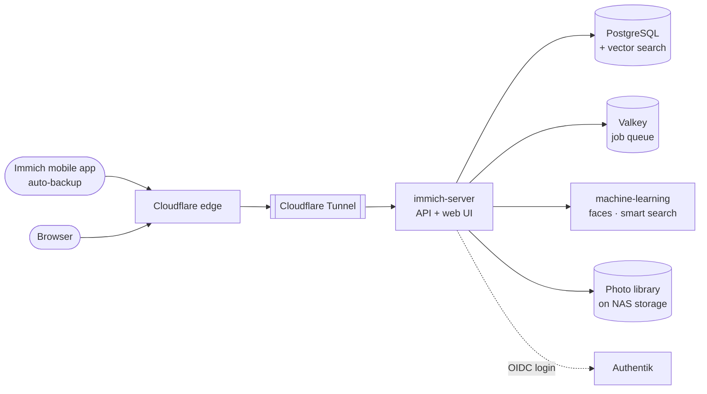

# Immich

> Self-hosted Google Photos replacement: phone backup, face recognition and smart search, with my photos on my own hardware

| | |
|---|---|
| **Host** | ShiNAS |
| **Category** | Media |
| **Status** | 🟢 running |
| **Exposed?** | Cloudflare Tunnel (no open ports) |
| **Version** | v3.3.1 |
| **Login** | Authentik SSO (OIDC), plus local password login as a fallback |

Compose file: [`stacks/immich/`](https://github.com/shineori/homelab/tree/main/stacks/immich)

## Why I run it

Photos are some of the most personal data anyone has. Immich gives me the Google Photos experience (automatic phone backup, a timeline, face grouping, "search for *dog on a beach*") while the originals stay on **my** NAS, with no subscription and no one else scanning my library.

## Architecture

Immich is a multi-container app, and each container has one job:

| Container | Job |
|---|---|
| `immich-server` | The API and web interface. Receives uploads and runs background jobs (thumbnails, video transcoding, metadata). |
| `immich-machine-learning` | Runs the models for **face recognition** and **smart search** (searching photos by describing them) |
| `database` | PostgreSQL with **vector search** extensions, which store the "meaning" of each photo as numbers so smart search can find matches |
| `redis` (Valkey) | Job queue that coordinates the background work |

**Storage is split on purpose:** the photo library and the database each have their own location (`UPLOAD_LOCATION` and `DB_DATA_LOCATION`). Immich warns that the database must not sit on a network share, so it stays on local disk.

## Security decisions

| Decision | Why |
|---|---|
| **Login through Authentik (OIDC)** | One identity with a passkey instead of a separate Immich password (see [Authentik](authentik.md)) |
| **Password login kept as a fallback** | If Authentik is ever down, I can still get to my photos |
| **Published through Cloudflare Tunnel** | Lets the phone app back up from anywhere, with no open router ports |
| **Not behind Cloudflare Access** | The mobile app syncs through the API and can't complete a browser login challenge |
| **Database image pinned by digest** | The Postgres and Valkey images are locked to exact versions (`@sha256:...`), so the database never changes underneath me by surprise |
| **Postgres data checksums on** | `--data-checksums` detects silent corruption in the database files |
| **Secrets in `.env`, never in git** | The repo only has a blanked `.env.example` |

## Setup notes

1. Download the release's `docker-compose.yml` and `.env` (Immich asks you to use the files from the current release, not the main branch)
2. Set `UPLOAD_LOCATION`, `DB_DATA_LOCATION`, `TZ`, and a random alphanumeric `DB_PASSWORD`
3. `docker compose up -d`, then create the admin account in the web UI
4. Publish it through the tunnel, and set the server URL in the mobile app
5. **SSO:** create an OAuth2/OpenID provider for Immich in Authentik, then enable OAuth under Immich → Administration → Settings → Authentication, using the client ID, client secret and issuer URL
6. Turn on auto-backup in the phone app

## What I'd harden next

- [x] **Pinned `IMMICH_VERSION`** ✅ *Done:* `v3.3.1` instead of a floating tag. I verified it was byte-identical to the running image first, so pinning changed nothing. [Diun](diun.md) now pings me in Discord when a new release ships, so upgrades happen on my schedule, after reading the release notes.
- [x] **Nightly encrypted backups** ✅ *Done:* the library plus Immich's own nightly database dumps (thumbnails excluded, since they're regenerable) go to an encrypted restic repository on a second disk. **The restore is tested:** the latest database dump came back intact. See [Backups](../infrastructure/backups.md).
- [ ] Finish 3-2-1: replicate to my second server, then an encrypted off-site copy
- [ ] Decide whether to turn off password login once SSO has proven reliable
- [ ] Hardware acceleration for transcoding and machine learning, if the NAS supports it

## What I learned

- **Multi-container architecture:** how an app splits into an API, a worker, a database, a queue and an ML service, and why each piece is separate
- **Vector search in practice:** smart search works by turning images and text into embeddings, then finding the closest matches
- **SSO in a real app:** connecting Immich to my own identity provider over OIDC, while keeping a fallback
- **Data stewardship:** for irreplaceable data, the hard part isn't running the app, it's backups, restores and controlled upgrades
