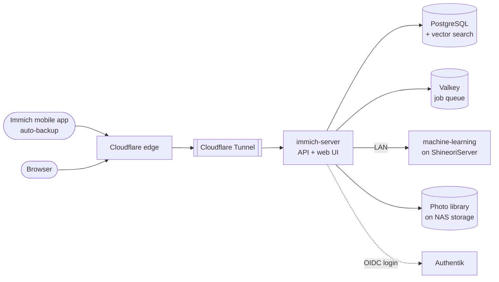

# Immich

> Self-hosted Google Photos replacement: phone backup, face recognition and smart search, with my photos on my own hardware

| | |
|---|---|
| **Host** | ShiNAS |
| **Category** | Media |
| **Status** | 🟢 running |
| **Exposed?** | Cloudflare Tunnel (no open ports) |
| **Version** | v3.3.1 |
| **Login** | Authentik SSO (OIDC), plus local password login as a fallback |

Compose file: [`stacks/immich/`](https://github.com/shineori/homelab/tree/main/stacks/immich)

## Why I run it

Photos are some of the most personal data anyone has. Immich gives me the Google Photos experience (automatic phone backup, a timeline, face grouping, "search for *dog on a beach*") while the originals stay on **my** NAS, with no subscription and no one else scanning my library.

## Architecture

Immich is a multi-container app, and each container has one job:



| Container | Job |
|---|---|
| `immich-server` | The API and web interface. Receives uploads and runs background jobs (thumbnails, video transcoding, metadata). |
| `immich-machine-learning` | Runs the models for **face recognition** and **smart search** (searching photos by describing them). Now runs on my second server, ShineoriServer (see below). |
| `database` | PostgreSQL with **vector search** extensions, which store the "meaning" of each photo as numbers so smart search can find matches |
| `redis` (Valkey) | Job queue that coordinates the background work |

**Storage is split on purpose:** the photo library and the database each have their own location (`UPLOAD_LOCATION` and `DB_DATA_LOCATION`). Immich warns that the database must not sit on a network share, so it stays on local disk.

## Security decisions

| Decision | Why |
|---|---|
| **Login through Authentik (OIDC)** | One identity with a passkey instead of a separate Immich password (see [Authentik](authentik.md)) |
| **Password login kept as a fallback** | If Authentik is ever down, I can still get to my photos |
| **Published through Cloudflare Tunnel** | Lets the phone app back up from anywhere, with no open router ports |
| **Not behind Cloudflare Access** | The mobile app syncs through the API and can't complete a browser login challenge |
| **Database image pinned by digest** | The Postgres and Valkey images are locked to exact versions (`@sha256:...`), so the database never changes underneath me by surprise |
| **Postgres data checksums on** | `--data-checksums` detects silent corruption in the database files |
| **Secrets in `.env`, never in git** | The repo only has a blanked `.env.example` |

## Resource limits

ShiNAS has 7.5 GB of RAM and runs most of my other apps too, so Immich's machine-learning container gets a hard ceiling:

```yaml
immich-machine-learning:
  mem_limit: 2g   # can never take more than 2 GB of RAM
  cpus: 1.5       # at most 1.5 CPU cores, leaving the rest for everything else
```

Inside Immich, **Administration → Settings → Job Settings** has the concurrency for **Smart Search, Face Detection, Video Conversion and Thumbnail Generation** set to **1**. The Docker limits are the seatbelt (a hard ceiling Immich can't break through), and the concurrency is the speed limit (Immich doesn't try to do everything at once in the first place).

The limits only slow Immich's background jobs down. Uploads, browsing and search keep working, and a big backlog just takes longer to finish instead of taking the whole NAS down with it (see the troubleshooting log).

### Update: machine learning moved to ShineoriServer

The limits stopped the overload, but on a 7.5 GB NAS even a capped ML container can still take 2 GB during big jobs. Immich lets the ML part run on **a different machine**, so it now runs on my laptop server, ShineoriServer (31 GB of RAM). The photos, the database and the Immich server all stay on the NAS:

```
Immich server (NAS) ──HTTP :3003 over LAN──▶ immich-machine-learning (ShineoriServer)
  photos + database stay here                  processes images, stores only model files
```

- **On ShineoriServer:** [`stacks/immich-ml/`](https://github.com/shineori/homelab/tree/main/stacks/immich-ml) runs the same version tag as the server (`v3.3.1`), bound to the server's LAN IP only; CPU-only, 3-core cap, `MACHINE_LEARNING_MODEL_TTL=300`
- **In Immich:** Administration → Settings → Machine Learning points at the ShineoriServer instance
- **On the NAS:** the ML service keeps its limits but sits behind `profiles: ["local-ml"]`, so it doesn't start unless I ask for it. Rolling back is one line.
- **CPU-only processing:** switched to the plain `v3.3.1` image (no CUDA build) so the GPU stays free for Ollama and Hermes. Processing is slower, but it works reliably.
- **Version lock:** when Diun reports a new Immich release, I bump the tag to `vX.Y.Z` on **both** machines (no `-cuda` suffix now)
- **If ShineoriServer is off,** smart search and face detection pause and catch up later. Uploads, browsing and backups keep working.

## Setup notes

1. Download the release's `docker-compose.yml` and `.env` (Immich asks you to use the files from the current release, not the main branch)
2. Set `UPLOAD_LOCATION`, `DB_DATA_LOCATION`, `TZ`, and a random alphanumeric `DB_PASSWORD`
3. `docker compose up -d`, then create the admin account in the web UI
4. Publish it through the tunnel, and set the server URL in the mobile app
5. **SSO:** create an OAuth2/OpenID provider for Immich in Authentik, then enable OAuth under Immich → Administration → Settings → Authentication, using the client ID, client secret and issuer URL
6. Turn on auto-backup in the phone app
7. Add the resource limits above, then `docker compose up -d` to recreate the ML container with them

## Troubleshooting log

| Problem | Root cause | Fix |
|---|---|---|
| **Uptime Kuma showed "Cannot connect to the socket server"**, and every app on the NAS was slow or timing out | The whole NAS was overloaded, not just Uptime Kuma: load average **36**, swap **5.1 of 5.7 GB** used, and up to **63% iowait** (the CPU waiting on the disk). `docker stats` showed `immich_server` at **183%** CPU and `immich_machine_learning` at **152%**, most likely from Immich reprocessing the library after my upgrade to v3. With no limits, the ML container grabbed RAM until the NAS was swapping to disk, and the disk became the bottleneck for every app. | **Confirmed the cause first:** stopping only the ML container dropped the load from 36 to 13 within minutes, and every app answered again. **Then fixed it for good:** added `mem_limit: 2g` and `cpus: 1.5` to the ML container. After the restart the load settled at **1.75**, with the ML container capped at 2 GiB. Also dropped the heavy jobs' concurrency to 1 in Immich's Job Settings. |
| After adding `profiles: ["local-ml"]`, the NAS's ML container kept running | `docker compose up -d --remove-orphans` doesn't remove containers of profile-disabled services, because they're still part of the project | Stopped and removed it by hand once (`docker stop` + `docker rm`). With the profile set, it doesn't come back. |
| Switching to the GPU image seemed to do nothing: the logs still said `CPUExecutionProvider` | The compose file was owned by root, so `cat > docker-compose.yml` failed with *Permission denied*. The old file stayed, and `up -d` just reported the container as running. | Wrote the file with `sudo tee` instead (`sudo` doesn't apply to a `>` redirect). The models load on the first request, so I sent a search to trigger them, then confirmed `CUDAExecutionProvider` in the logs and GPU memory use in `nvidia-smi`. |
| Immich ML jobs started failing with an ONNX "Failed to allocate memory" error while the laptop GPU was also running Ollama | Both workloads competed for the same small GPU. Ollama held most of the memory, so the ONNX inference runtime had nothing left. A memory-reservation setting on Ollama didn't prevent the conflict. | Moved Immich ML back to CPU with a 3-core cap so the GPU belongs to Ollama exclusively. |

```
            BEFORE (no limits)             AFTER (capped)
load avg    36                             1.75
swap        5.1 / 5.7 GB                   back to normal
iowait      up to 63%                      back to normal
ML memory   unbounded                      207 MiB / 2 GiB cap
```

## What I'd harden next

- [x] **Pinned `IMMICH_VERSION`** ✅ *Done:* `v3.3.1` instead of a floating tag. I verified it was byte-identical to the running image first, so pinning changed nothing. [Diun](diun.md) now pings me in Discord when a new release ships, so upgrades happen on my schedule, after reading the release notes.
- [x] **Nightly encrypted backups** ✅ *Done:* the library plus Immich's own nightly database dumps (thumbnails excluded, since they're regenerable) go to an encrypted restic repository on a second disk. **The restore is tested:** the latest database dump came back intact. See [Backups](../infrastructure/backups.md).
- [x] **Capped the machine-learning container** ✅ *Done:* `mem_limit: 2g` and `cpus: 1.5`, after it overloaded the whole NAS (see the troubleshooting log)
- [x] **Lowered job concurrency** ✅ *Done:* Smart Search, Face Detection, Video Conversion and Thumbnail Generation now run one at a time, so big backlogs move in one steady lane
- [ ] Get Uptime Kuma alerting on NAS load or swap, so I see the next overload coming instead of finding out from timeouts
- [ ] Finish 3-2-1: replicate to my second server, then an encrypted off-site copy
- [ ] Decide whether to turn off password login once SSO has proven reliable
- [x] **Moved machine learning off the NAS** ✅ *Done:* it runs on ShineoriServer now (see Resource limits)
- [x] **GPU acceleration for machine learning** ✅ *Done then reverted:* originally ran face detection, smart search and OCR through the `-cuda` image on the laptop's GPU. Moved back to CPU so the GPU stays free for Ollama and Hermes. See the updated [Resource limits](#resource-limits) section.
- [ ] CPU monitoring for ML processing time, so I see if face detection backlogs on the 3-core cap
- [ ] Hardware acceleration for video transcoding on the NAS, if it supports it

## What I learned

- **Multi-container architecture:** how an app splits into an API, a worker, a database, a queue and an ML service, and why each piece is separate
- **Vector search in practice:** smart search works by turning images and text into embeddings, then finding the closest matches
- **SSO in a real app:** connecting Immich to my own identity provider over OIDC, while keeping a fallback
- **Data stewardship:** for irreplaceable data, the hard part isn't running the app, it's backups, restores and controlled upgrades
- **Symptoms aren't causes:** the alert came from Uptime Kuma, but the problem was Immich. Load, swap, iowait and `docker stats` led from "one app is broken" to "one container is starving the whole NAS".
- **Prove the cause before the fix:** stopping just the suspected container and watching the load fall confirmed it, so the permanent fix was aimed at the right thing
- **Resource limits are a shared-host courtesy:** on a box with limited RAM, one unbounded container can turn into everyone's outage
- **One small GPU can't comfortably serve two AI workloads:** whoever loads first grabs the memory, and an Ollama memory-reservation setting didn't prevent the conflict. Separate them for reliability.
- **Run each piece where its resource is cheap:** machine learning needs RAM and CPU but no storage, while the photo server needs storage but little RAM. Splitting them across two machines fixed the problem for good.
