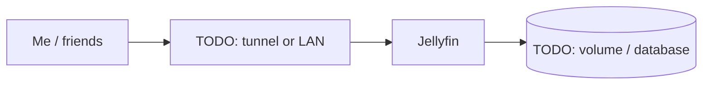

# Jellyfin

> Media server for movies and shows

| | |
|---|---|
| **Host** | ShiNAS |
| **Category** | Media |
| **Status** | 🟢 running <!-- 🟡 in progress / 🔵 planned / ⚫ retired --> |
| **Exposed?** | Cloudflare Tunnel (no open ports), app login |

Compose file: [`stacks/jellyfin/`](https://github.com/shineori/homelab/tree/main/stacks/jellyfin)

## Why I run it

TODO: one or two sentences. What problem does this solve for you?

## Architecture

## Setup notes

- Troubleshot and fixed restart loops

TODO: the steps you'd need to rebuild this from scratch.

## Troubleshooting log

| Date | Problem | Root cause | Fix |
|---|---|---|---|
| TODO | | | |

## What I learned

TODO: the skill this proves (great for interviews).
