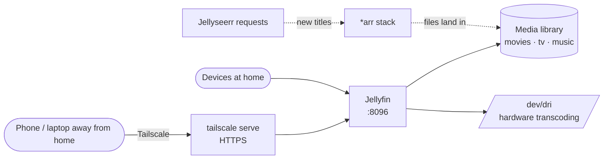

# Jellyfin

> Media server for movies and shows

| | |
|---|---|
| **Host** | ShiNAS |
| **Category** | Media |
| **Status** | 🟢 running |
| **Exposed?** | Tailscale and LAN only since 2026-11-04, app login. No public route |
| **Version** | `12.1ubu2604-ls51` (LinuxServer.io image, pinned) |

Compose file: [`stacks/jellyfin/`](https://github.com/shineori/homelab/tree/main/stacks/jellyfin)

## Why I run it

I want my movies, shows and music in one library I can stream to any device, without a subscription or an account on someone else's service. Jellyfin is fully open source, with no paid tier and no phoning home.

## Architecture

| Piece | Job |
|---|---|
| **Media folders** | Mounted from the NAS's data share: `movies`, `tv` and `music` |
| **`/dev/dri`** | Passes the NAS's GPU into the container, so video is transcoded in hardware instead of on the CPU. `group_add` gives the container the `render` group it needs to use it. |
| **`./.config` and `./cache`** | Settings, users, watch history and image cache |
| **[*arr stack](arr-stack.md)** | Finds and downloads new titles into the same library; Jellyseerr lets me request them |

## Security decisions

| Decision | Why |
|---|---|
| **Tailscale instead of a public route** | I'm the only user, it needs no open router ports, and Cloudflare's terms restrict streaming video through a public hostname |
| **Jellyfin's own login stays on** | Tailscale decides which devices can reach it, and the app still decides who can sign in |
| **Runs as PUID 1000 / PGID 100** | The same non-root user that owns the media files, so it can read them without running as root |
| **Pinned image** | Updates happen when I choose, after [Diun](diun.md) tells me about them |

## Setup notes

1. Point the volumes at the media folders on the NAS, and set `PUID`/`PGID` to the owner of those files
2. Pass `/dev/dri` and add the `render` group ID (`group_add`) for hardware transcoding
3. `docker compose up -d`, open `http://<LAN_IP>:8096`, create the admin account and add the libraries
4. Turn on hardware acceleration under Dashboard → Playback → Transcoding
5. For access away from home, add a [Tailscale](tailscale.md) address: `tailscale serve --bg --https=8444 http://127.0.0.1:8096`, then point the apps at it
6. The healthcheck has a 30-second `start_period`, so Jellyfin isn't marked unhealthy while it's still starting up

## Troubleshooting log

| Date | Problem | Root cause | Fix |
|---|---|---|---|
| — | The container kept restarting | Not written down at the time | Resolved. The current compose gives Jellyfin 30 seconds before health checks begin. |
| 2026-11-04 | Moved from Cloudflare to Tailscale | Video through a public hostname is restricted by Cloudflare's terms, and only I use it | Added the Tailscale address, tested it on my phone and PC, then deleted the route and DNS record |

## What I'd harden next

- [ ] Put an Uptime Kuma monitor's alert on it, since it's the app other people notice first when it's down
- [ ] Decide whether the unused HTTPS port (`8920`) needs publishing at all, since `tailscale serve` already provides HTTPS

## What I learned

- **Hardware transcoding in Docker:** a container only gets the GPU if you pass the device *and* the right group
- **File ownership matters:** matching `PUID`/`PGID` to the media's owner avoids both permission errors and running as root
- **Read the terms for what you're serving:** a tunnel that works fine technically can still be the wrong place for video
- **Health checks need a grace period:** a slow-starting app can be killed by its own health check
