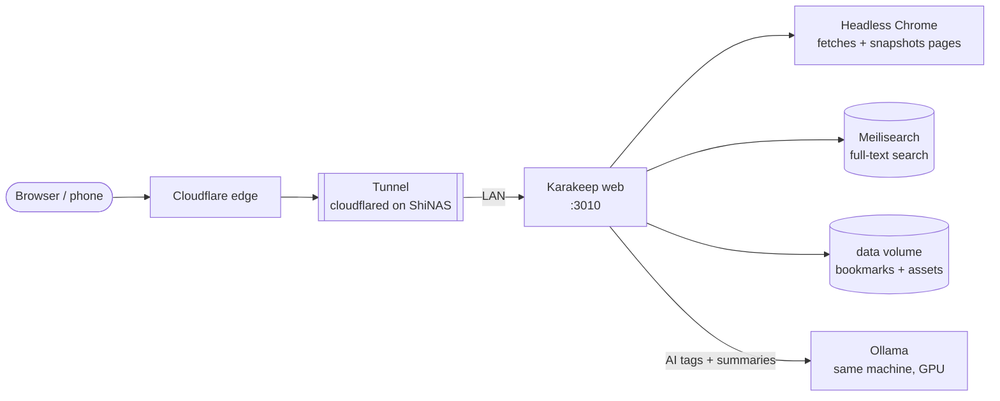

# Karakeep

> Self-hosted bookmark and read-it-later manager

| | |
|---|---|
| **Host** | ShineoriServer |
| **Category** | Apps |
| **Status** | 🟢 running <!-- 🟡 in progress / 🔵 planned / ⚫ retired --> |
| **Exposed?** | Cloudflare Tunnel (no open ports) |
| **Port** | 3010 |

Compose file: [`stacks/karakeep/`](https://github.com/shineori/homelab/tree/main/stacks/karakeep)

> 🚚 **Moved from ShiNAS to ShineoriServer** in October 2026 to free up RAM on the NAS. It now listens on port **3010**, because Open WebUI already uses 3000 on that machine. Full story: [Moving services off the NAS](../infrastructure/migration.md).

## Why I run it

I save a lot of links and used to lose them across browser bookmarks and open tabs. Karakeep keeps them in one searchable place, saves a copy of each page, and tags them automatically using **my own local AI** (Ollama on the same machine), so my reading list never goes to a cloud AI service.

## Architecture

| Container | Job |
|---|---|
| `web` | The app: UI, API and the background workers |
| `chrome` | A headless Chrome browser that opens each saved link to grab its content and a screenshot |
| `meilisearch` | The search engine that makes saved pages searchable |
| **Ollama** (outside the stack) | Runs the language models that suggest tags and summaries |

**Moving it to the laptop helped twice:** headless Chrome and Meilisearch are RAM-hungry, and the AI tagging now talks to Ollama on the **same machine** instead of across the network.

## Security decisions

| Decision | Why |
|---|---|
| **Published through the Cloudflare Tunnel** | Save links from my phone anywhere, with no open router ports |
| **Local AI only** | Tagging and summaries run on my own Ollama, so the pages I save never leave my lab |
| **Secrets in a git-ignored `.env`** | `NEXTAUTH_SECRET` and `MEILI_MASTER_KEY`. The repo only has a blanked `.env.example`. |
| **`NEXTAUTH_URL` = the public hostname** | The login system builds its links and redirects from this address |
| **Pinned versions** | The app by digest, Meilisearch `v1.41.0` (the version Karakeep recommends), Chrome `124` |

## Setup notes

1. Fill `.env`: `NEXTAUTH_SECRET`, `MEILI_MASTER_KEY`, `NEXTAUTH_URL` (the address I actually open it at), and the Ollama settings (`OLLAMA_BASE_URL`, text, image and embedding models)
2. Declare the named volumes (`data`, `meilisearch`) at the bottom of the compose file
3. `docker compose up -d`, then create the account
4. Tunnel route: public hostname → `http://<LAN_IP>:3010`

## Troubleshooting log

| Date | Problem | Root cause | Fix |
|---|---|---|---|
| — | Compose refused to start the stack | The services used named volumes that weren't declared in a top-level `volumes:` block | Added the `volumes:` block |
| 2026-10 | Diun got `403 Forbidden` listing tags for the Chrome image | It was on a Google registry that doesn't allow anonymous tag listing | Excluded that one image from Diun with the label `diun.enable=false` |
| 2026-10-11 | The Chrome image **couldn't be downloaded at all** on the new machine (*"billing must be enabled"*) | The Google registry project hosting it stopped serving downloads. It only worked on the NAS because it was downloaded long ago. | Switched to the same image on Docker Hub: `docker.io/zenika/alpine-chrome:124` |
| 2026-10-11 | Port 3000 was already taken on the new machine | Open WebUI uses 3000 there | Published Karakeep on **3010** instead (`3010:3000`) and updated the tunnel route |
| 2026-10-11 | `NEXTAUTH_URL` was `http://localhost:3000` | A wrong value from the original setup, found during the move | Set it to the public hostname |
| 2026-10-13 | Diun announced Meilisearch `v1.55.0`, but I was on `v1.13.3` | Meilisearch's data files are tied to its version, so a big jump can refuse to open the old index. And the newest release isn't necessarily one Karakeep supports. | Checked Karakeep's docs: they recommend **`v1.41.0`**. Followed their procedure: stopped Meilisearch, set the old `data.ms` aside, started `v1.41.0` empty, then ran **Admin → Background Jobs → Reindex All Bookmarks**. All bookmarks were re-indexed with no errors. |

## What I'd harden next

- [x] **Backed up** ✅ *Done:* the `data` volume and `.env` are in the laptop's nightly backup ([Backups](../infrastructure/backups.md#shineoriserver-backups-append-only))
- [ ] Log in through [Authentik](authentik.md)
- [ ] Re-enable Diun for the Chrome image now that it's on Docker Hub

## What I learned

- **Multi-container apps:** a "simple" bookmark app is really a web app, a headless browser, a search engine and an AI model working together
- **Images can disappear:** an image that ran fine for months became impossible to download, and I only found out when I moved the app
- **The newest version isn't always the right version:** for a dependency like Meilisearch, the app (Karakeep) decides which version to run, not the update notifier
- **Rebuildable vs irreplaceable data:** the search index can be thrown away and rebuilt from the bookmarks, which made a risky upgrade simple
- **Ports are a shared resource:** two apps on one machine can't both publish the same port, but the container can keep its internal port (`3010:3000`)
- **Keep AI local when the data is personal:** what I read says a lot about me, so the tagging runs on my own GPU
