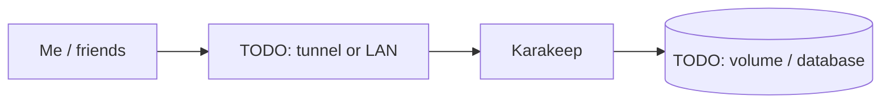

# Karakeep

> Self-hosted bookmark and read-it-later manager

| | |
|---|---|
| **Host** | ShineoriServer |
| **Category** | Apps |
| **Status** | 🟢 running <!-- 🟡 in progress / 🔵 planned / ⚫ retired --> |
| **Exposed?** | Cloudflare Tunnel (no open ports) |

Compose file: [`stacks/karakeep/`](https://github.com/shineori/homelab/tree/main/stacks/karakeep)

> 🚚 **Moved from ShiNAS to ShineoriServer** in October 2026 to free up RAM on the NAS. It now listens on port **3010**, because Open WebUI already uses 3000 on that machine. Full story: [Moving services off the NAS](../infrastructure/migration.md).

## Why I run it

TODO: one or two sentences. What problem does this solve for you?

## Architecture

## Setup notes

- TODO

TODO: the steps you'd need to rebuild this from scratch.

## Troubleshooting log

| Date | Problem | Root cause | Fix |
|---|---|---|---|
| TODO | | | |

## What I learned

TODO: the skill this proves (great for interviews).
