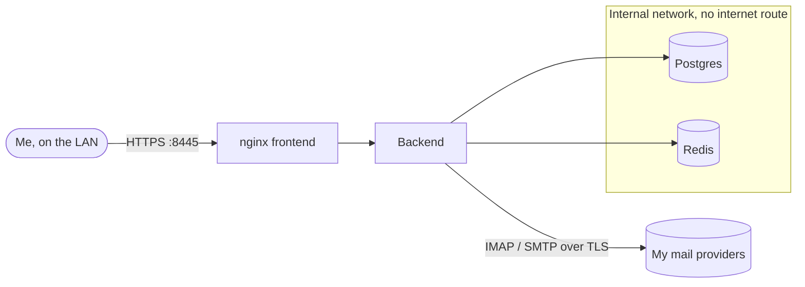

# MailFlow

> One self-hosted inbox for all of my email accounts, which I audited and locked down before trusting it with any real mail

| | |
|---|---|
| **Host** | ShineoriServer |
| **Category** | Apps |
| **Status** | 🟢 running |
| **Exposed?** | LAN only, HTTPS on port `8445` bound to the laptop's LAN IP. Plain HTTP isn't published. Not on any tunnel. |
| **Version** | MailFlow `4.3.0`, Postgres `16.15`, Redis `7.4.12`, all pinned by tag and digest |

Compose file: [`stacks/mailflow/`](https://github.com/shineori/homelab/tree/main/stacks/mailflow)
Upstream: [maathimself/mailflow](https://github.com/maathimself/mailflow)

## Why I run it

I have several email addresses and wanted one place to read them, with rules, categories, snooze and unsubscribe, without giving another company access to all of it. MailFlow connects to each account over IMAP and SMTP from my own server.

An inbox is about the most sensitive thing I could self-host, so I treated this one differently: audit first, harden second, and only then add real accounts.

## Architecture

| Piece | Job |
|---|---|
| `mailflow-frontend` | nginx: serves the web app and terminates HTTPS with a self-signed certificate |
| `mailflow-backend` | Syncs and sends mail, stores mail account credentials encrypted |
| `mailflow-postgres` | Accounts, settings and synced mail |
| `mailflow-redis` | Sessions and job queues, password protected |

## Security decisions

**The audit (v4.1.2):**

- Compared the running images with the release source. Backend, dependency and frontend files all matched by hash. Base images weren't rebuilt.
- Did a targeted code review, not a line-by-line one. I found no backdoor, telemetry or hidden outbound calls.
- Tested the real modules: credential encryption and tamper rejection passed, 18 hostile email payloads produced no working script, and blocked tracking pixels left no remote references.
- Read the project's release history. It's young and has shipped a lot of security fixes, which is honest but also a reason to keep it off the internet.

**The hardening:**

- Every container has a read-only root filesystem, `no-new-privileges`, all capabilities dropped (nginx gets back only the four it needs), memory and process limits, and log rotation.
- Backend, Postgres and Redis run as non-root.
- Postgres and Redis sit on an internal Docker network with no internet route, and Redis now needs a password.
- Images are pinned by digest, because tags can be moved after release.
- Two-factor login is required, trusted devices are off, and logins are limited to 5 attempts per 15 minutes.
- Unused features are off: the bundled Caddy service, the Microsoft OAuth app and the update check (Diun already tells me about new versions).
- Secrets were rotated after the audit, because another app of mine could read the old ones.

**Risks I'm accepting for now:**

- Mail bodies are stored as plain text in Postgres, and the laptop's disk isn't fully encrypted.
- The encryption key sits on the same disk as the data it protects.
- The self-signed certificate shows a browser warning until each device trusts it.

## Setup notes

1. Copy `.env.example` to `.env`, `chmod 600 .env`, and generate each secret, for example with `openssl rand -hex 32`.
2. Put a certificate and key in `certs/` as `cert.pem` and `key.pem`.
3. `docker compose up -d`
4. Register straight away. The first account becomes admin, and registration stays open to the LAN until then.
5. Set up two-factor, then test with a low-value mailbox before adding real ones.

**Back up `.env` along with the database.** Without `ENCRYPTION_KEY`, the stored mail credentials can't be read, even from a good database backup.

## Troubleshooting log

| Problem | Cause | Fix |
|---|---|---|
| Plain HTTP reachable on the LAN | The default install published an HTTP port too | Stopped publishing it |
| Another app could read MailFlow's `.env` | NextExplorer mounted the whole Docker folder, and both run as the same user | Hid the folder from it with a `tmpfs` mount, then rotated the secrets |
| That fix quietly disappeared | I later replaced NextExplorer's compose file with a copy that didn't include it | Put it back, then rotated the secrets and TLS certificate again, since no mail accounts depended on them yet |

## What I'd harden next

- Add `.env` and a database dump to the nightly backup, stored outside the app's own folder.
- Block the backend from reaching other devices on my LAN with firewall rules.
- Encrypt the laptop's disk.

## What I learned

- Audit before you trust. Checking the images against the source took real effort, but it means I know what's actually running.
- Containers sharing a user ID can read each other's files through a bind mount. Docker doesn't isolate that for you.
- A read-only container needs exact `tmpfs` paths, and finding them shows you what the app really writes.
- A security fix should live somewhere it can't be silently overwritten, and it's worth checking again after later edits.
