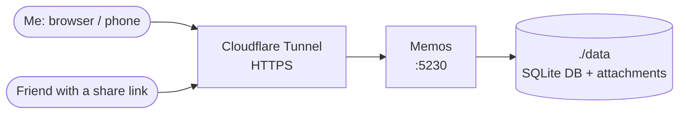

# Memos

> Lightweight self-hosted notes app, with share links that can expire

| | |
|---|---|
| **Host** | ShineoriServer |
| **Category** | Apps |
| **Status** | 🟢 running <!-- 🟡 in progress / 🔵 planned / ⚫ retired --> |
| **Exposed?** | Public through the [Cloudflare Tunnel](cloudflared.md), so share links work for people outside my network |
| **Port** | 5230 |

Compose file: [`stacks/memos/`](https://github.com/shineori/homelab/tree/main/stacks/memos)

## Why I run it

I wanted one quick place to jot things down that isn't a big wiki or a bookmark manager. Memos is a timeline of short Markdown notes, like a private Twitter feed for myself. The feature that sold me: I can share **one** memo with a link that **expires** (never, or after 1, 7 or 30 days), and the person opening it doesn't need an account. Everything else stays private.

## Architecture

| Piece | Job |
|---|---|
| `memos` | The whole app in one container: web UI, API and the database driver |
| `./data` (bind mount) | Holds the SQLite database and uploaded attachments. This folder **is** the app's state. |
| Cloudflare Tunnel (outside the stack) | Gives it an HTTPS address without opening any ports |

One container and one folder is about as simple as a self-hosted app gets, which is a nice change after multi-container stacks like [Karakeep](karakeep.md) and [Immich](immich.md).

## Security decisions

| Decision | Why |
|---|---|
| **Public route instead of Tailscale only** | Share links are the point, and a friend can't open a link to a Tailscale-only address. The app still needs a login for everything that isn't shared. |
| **Memos are private by default** | New memos start private. I share single memos on purpose instead of making anything public. |
| **Share links with an expiry** | A link works for anyone who has it, so I pick the shortest expiry that works (usually 1 day) and revoke links when I'm done |
| **`MEMOS_INSTANCE_URL` set to the public address** | Since 0.30, Memos runs in private mode without it, and share links are built from this address. If it pointed at the LAN address, links would be useless outside my network. |
| **First account = admin, created right away** | The first person to sign up becomes the admin, so I created my account before telling anyone the address |
| **SQLite, no extra database container** | It's a single-user notes app. Fewer containers means fewer things to patch and back up. |
| **Pinned version** | `neosmemo/memos:0.31.0` instead of `:stable`, so updates only happen when I choose (same as the rest of the lab) |

## Setup notes

1. `mkdir -p ~/docker/memos && cd ~/docker/memos`
2. Write `docker-compose.yaml` with the image pinned to `0.31.0`, port `5230:5230`, `./data:/var/opt/memos`, `MEMOS_DRIVER: sqlite` and `MEMOS_INSTANCE_URL` set to the public address
3. `docker compose up -d`, then `docker compose logs -f` until it's listening on 5230
4. Open it and create my account straight away (first account becomes admin)
5. Add a public hostname to the laptop's [Cloudflare Tunnel](cloudflared.md) pointing at port 5230
6. Test a share link from a phone that isn't on my network or Tailscale

**Updating:** change the pinned tag, back up `./data`, then `docker compose pull && docker compose up -d`. Memos releases often include database migrations, so the backup comes first every time.

## Troubleshooting log

| Date | Problem | Root cause | Fix |
|---|---|---|---|
| 2026-11-16 | No problems during setup | | |

## What I'd harden next

- [ ] **Add it to the laptop's nightly backup** ([Backups](../infrastructure/backups.md#shineoriserver-backups-append-only)): the `./data` folder plus the compose file. Right now it isn't backed up at all.
- [ ] Turn off new user sign-ups in the admin settings, since I'm the only user
- [ ] Look into putting [Cloudflare Access](cloudflared.md) in front of the login while leaving share links open
- [ ] Log in through [Authentik](authentik.md) (Memos supports SSO)
- [ ] Read the release notes before the next upgrade: Memos is switching to calendar versions (`26.10` style) and changing its API paths

## What I learned

- **Access mode depends on one setting:** without an instance URL, newer Memos versions lock themselves into private mode. The URL also decides what address the share links contain.
- **Tailscale vs public is a real tradeoff:** Tailscale is safer, but some features (sharing with people outside my network) only work with a public address
- **A share link is a bearer token:** anyone holding it can read the memo until it expires or I revoke it, so expiry and revoking are my main controls
- **Simple stacks are easy to back up:** the whole app lives in one folder, so a backup is just that folder (once I actually add it)
