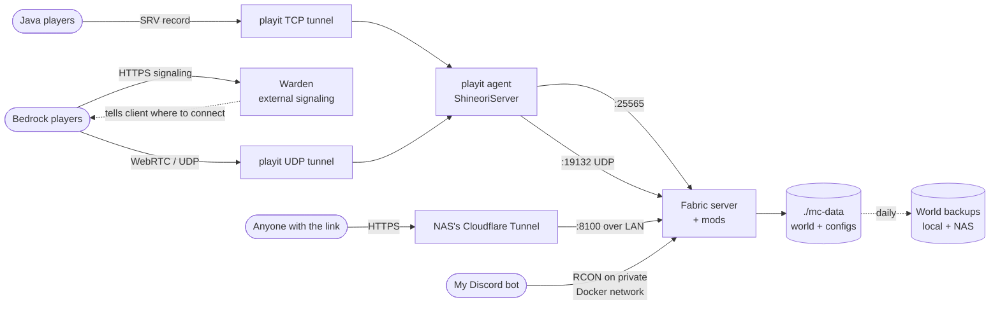

# Minecraft + playit

> Java + Bedrock Minecraft server on Fabric, with playit.gg tunnels, NetherNet support and a browser-viewable world map

| | |
|---|---|
| **Host** | ShineoriServer |
| **Category** | Game servers |
| **Status** | 🟢 running |
| **Exposed?** | playit.gg tunnels (no open ports, home IP hidden) + Warden signaling for Bedrock. Web map is public (read-only) through the NAS's Cloudflare Tunnel |
| **Server** | Fabric, Minecraft 26.3 (pinned), 6 GB RAM, whitelist on, Java + Bedrock |
| **Backups** | Daily, change-aware, archived to the NAS ([details](../infrastructure/minecraft-backups.md)) |

Compose file: [`stacks/minecraft/`](https://github.com/shineori/homelab/tree/main/stacks/minecraft)

## Why I run it

A private server for me and my friends, on my own hardware, with no monthly hosting bill. Friends join through playit.gg, so my home IP is never exposed and no router ports are open. Some friends play on Bedrock (phone/console), so Geyser lets everyone play in the same world, and one address works for both editions.

I started on **Paper** (plugins), then switched to **Fabric** (mods) in October 2026. Fabric opens up the things I want for a small friends server: a browser-viewable world map now, and proximity voice chat and a minimap later.

## Architecture

| Piece | Job |
|---|---|
| **Fabric server** | `itzg/minecraft-server` with `TYPE: FABRIC`, pinned to Minecraft 26.3. The container downloads the mods from Modrinth on every start |
| **Fabric API** | The shared library almost every Fabric mod depends on |
| **Polymer + Polydecorations** | Polymer lets server-side mods add new blocks and items that **unmodded** clients can still see. Polydecorations adds decoration blocks on top of it, so friends don't have to install anything |
| **Geyser + Floodgate (Fabric)** | Geyser translates Bedrock to Java. Floodgate lets Bedrock players join without a Java account |
| **BlueMap** | Renders the world into a 3D map you can open in a browser, served on port 8100 |
| **Chunky** | Pre-generates the world ahead of time, so exploring doesn't lag the server and the map has terrain to show |
| **Performance mods** | Lithium (game logic), FerriteCore (RAM), Krypton (networking), ScalableLux (lighting), C2ME (chunk loading and generation), plus spark to profile lag. None of them change gameplay |
| **Open Parties and Claims** | Friends can claim land and form parties, so builds are protected from griefing and accidents. Works for vanilla clients through commands, and shows claims on the minimap for friends using the client pack |
| **Gameplay helpers** | NetherPortalFix (portals link back to the one you came from), JEI (sends the server's real recipes to friends' recipe viewer), AppleSkin and Jade (send food and block info to friends who have them installed), Terralith (new terrain generation for chunks that haven't been explored yet) |
| **Client pack** | An optional `.mrpack` for Java friends: Sodium, Xaero's Minimap and World Map, JEI, Jade, AppleSkin and the claims UI. Vanilla clients and Bedrock players can still join without it |
| **playit agent** | Runs as a container next to the server. Dials out to playit.gg, which relays traffic back in. One TCP tunnel for Java, one plain UDP tunnel for Bedrock gameplay |
| **Warden** | Free external signaling service for NetherNet (Bedrock's new networking). Bedrock clients ask Warden over HTTPS how to connect, then connect straight to my UDP tunnel. Warden never carries game traffic |
| **`mc-bridge` network** | A private Docker network shared with my Discord bot, so the bot can run RCON commands without RCON ever being published |
| **DNS** | One hostname for everyone: an SRV record sends Java to the playit tunnel, and a CNAME on the same name sends Bedrock to Warden |
| **`./mc-data`** | The world, mod configs, and all server settings |

## Security decisions

| Decision | Why |
|---|---|
| **playit.gg instead of port forwarding** | No open router ports, and players never see my home IP |
| **`ONLINE_MODE: TRUE`** | Only real, authenticated Minecraft accounts can join |
| **Whitelist on** (Java `whitelist`, Bedrock `fwhitelist`) | Only friends I've added can join, even if someone finds the address |
| **Mods pulled by the container from Modrinth** | The mod list lives in the compose file, so it's versioned and reviewable instead of random jars dropped in a folder |
| **Server-side-only mods** (Polymer) | Friends never have to download and run mod files from me, which keeps their computers out of my trust boundary |
| **Minecraft version pinned to 26.3** | The world is on 26.3, and an update can't move it to a version the mods don't support yet |
| **Beta builds allowed only because Geyser needs them** | Geyser and Floodgate publish only beta builds on Modrinth. I accepted that for the whole mod list, so I check each new mod's build before adding it |
| **Two alpha mods pinned to exact builds** | ScalableLux and C2ME only have alpha builds for 26.3. I pinned those two by version ID instead of loosening the release channel for the whole list |
| **Client pack is optional, not required** | Nothing on the server forces a client mod, so friends who don't want to run extra jars can still play vanilla. The pack only points at files hosted on Modrinth, each one checked by hash |
| **Land claims on** | Open Parties and Claims protects builds from griefing or accidents, a second layer on top of the whitelist |
| **RCON never published** | Port 25575 isn't in `ports:`. Only containers on the private `mc-bridge` network can reach it |
| **RCON password in a `chmod 600` env file** | Shared between the server and my bot, never in the compose file or this repo |
| **Web map public on purpose, through the tunnel** | It's a read-only view of the world, so anyone can look at it without a login. It goes out through the NAS's Cloudflare Tunnel, so no ports are open and my home IP stays hidden. The trade-off: anyone with the link can see where our builds are |
| **Warden for Bedrock signaling** | Avoids needing a public TCP port for NetherNet, and gives players HTTPS so they don't get a "trust on first use" prompt |
| **playit agent secret in `.env`** | The tunnel key stays out of the compose file and out of this repo |
| **Op kept to me** (`OPS` in the compose file) | Friends play as normal players. Only my account can run admin commands |
| **Removed an old dynamic-DNS container** | It was set up to publish my home IP in DNS. It had been failing for a long time, but I removed it and its credential anyway ([audit](cloudflared.md#security-audit)) |

## Setup notes

1. **Back up the world first.** Version changes rewrite the world format and can't be undone. The [daily backup](../infrastructure/minecraft-backups.md) covers this now, but run it by hand before any upgrade: `sudo /usr/local/bin/mc-backup.sh`
2. Create the private network once: `sudo docker network create mc-bridge`, and put `RCON_PASSWORD=...` in `rcon.env` (`chmod 600`)
3. `docker compose up -d`. The container downloads Fabric and every mod in `MODRINTH_PROJECTS` on each start
4. playit: one **TCP** tunnel to `:25565` (Java) and one plain **UDP** tunnel to `:19132` (Bedrock). Point both at the server's LAN IP, not `127.0.0.1`, unless the port is bound to localhost
5. Geyser config (`mc-data/config/Geyser-Fabric/config.yml`):
    - `bedrock.transport: nethernet`
    - `bedrock.signaling.mode: nxs` (Warden)
    - `bedrock.signaling.nxs.advertise-addresses: ["<playit UDP tunnel IP:port>"]`
    - `java.auth-type: floodgate`
6. Claim the instance in the Warden panel (link is printed in the Geyser log), add a custom domain, and create the CNAME it asks for in Cloudflare (DNS only, grey cloud)
7. DNS: SRV `_minecraft._tcp.<name>` to the playit Java tunnel, CNAME `<name>` to Warden. Java players type the name, Bedrock players type the name with port `443`
8. Web map: on the NAS's tunnel, add a public hostname route to `http://<server LAN IP>:8100`. To lock it down later, put a Cloudflare Access application with an email allow-list in front of it
9. Pre-generate: `docker exec shineori-mc rcon-cli chunky start` (check with `chunky progress`, pause with `chunky pause`)
10. Whitelist: `docker exec -i shineori-mc rcon-cli whitelist add <name>` (Java) or `... fwhitelist add <gamertag>` (Bedrock)
11. Settings set in the compose file win. The image rewrites `server.properties` from its environment variables on startup, so change those there, not in `server.properties`
12. Adding a mod: check it has a Fabric build for the pinned version first (`https://api.modrinth.com/v2/project/<slug>/version?loaders=["fabric"]&game_versions=["26.3"]`), and add its **required** dependencies to the list too. If only an alpha exists, pin it as `<slug>:<version-id>`. Never put `#` comments inside the `MODRINTH_PROJECTS` block
13. Client pack: a `.mrpack` built from `modrinth.index.json` (Modrinth download links plus SHA-1/SHA-512 hashes, `minecraft` and `fabric-loader` versions matching the server) and an `overrides/servers.dat` that pre-adds the server. Friends import it in the Modrinth App or Prism Launcher. Rebuild it whenever the Minecraft version changes

## Troubleshooting log

| Date | Problem | Root cause | Fix |
|---|---|---|---|
| 2026-10 | A DNS record for an old setup pointed straight at my home IP | Leftover from when friends joined through a port forward | Deleted it, checked against Cloudflare's authoritative nameservers, and removed the dynamic-DNS container ([details](cloudflared.md#security-audit)) |
| 2026-10 | *(Paper)* Container stuck in a restart loop after adding plugins | `spark` has no Paper build on Modrinth for the chosen version, and the image exits when a listed project can't be resolved | Removed it from the list. Paper already ships spark built in |
| 2026-10 | *(Paper)* Upgrade crashed with "Refusing to overwrite existing migrated file" for the Nether | The world folder held a second, unused vanilla Nether and End from its previous life. The new world layout migration tried to move both into the same place | Compared timestamps (the real one was played last night, the ghost was a year old), moved the ghost dimensions aside, restarted. Migration finished cleanly |
| 2026-10 | `Connection reset` when joining through playit | playit was forwarding to the server's LAN IP while I had bound the port to `127.0.0.1` only | Bound the port normally again. The playit agent logs (`Connection refused` to the LAN IP) pointed right at it |
| 2026-10 | *(Paper)* Old `[Warp]` signs said "You do not have permission to use that warp" | EssentialsX reads line 3 of a warp sign as a required group and line 4 as a cost | Re-placed signs with lines 3-4 blank and recreated warps. Not relevant after the switch to Fabric |
| 2026-10 | Geyser warned NetherNet was off. Bedrock drops RakNet on Oct 27 | NetherNet is off by default in Geyser, and playit's "Minecraft Bedrock" tunnel type only speaks RakNet | Switched to a plain UDP tunnel + Warden signaling (`transport: nethernet`, `mode: nxs`) |
| 2026-10 | Fabric: the server picked a Minecraft version the Bedrock mods couldn't load on | Letting the image auto-resolve the version didn't line up with the Geyser and Floodgate builds | Pinned `VERSION: "26.3"` to match the world |
| 2026-10 | Fabric: Geyser and Floodgate wouldn't download | They only publish **beta** builds on Modrinth, and the image only accepts releases by default | `MODRINTH_ALLOWED_VERSION_TYPE: "beta"` |
| 2026-10 | The server had problems and the world had to start over | | Kept the old world aside as `Brrr.broken-2026-10-18` instead of deleting it, and started fresh |
| 2026-10 | Wanted Sodium on the server for performance | Sodium is a rendering mod. A server doesn't render anything, so it does nothing there | Put Sodium in the client pack instead, and used Lithium, FerriteCore, Krypton, ScalableLux and C2ME on the server |
| 2026-10 | ScalableLux and C2ME wouldn't resolve under the beta channel | Their only 26.3 builds are alphas | Pinned both by Modrinth version ID instead of allowing alphas for every mod |
| 2026-10 | Comments I added next to mods in the list would have broken the download | Inside a YAML `\|` block, `#` is plain text, so the comment becomes part of the mod name | Moved the comments outside the block, then parsed the file with Python to confirm the list was clean |
| 2026-10 | JEI warned on join: "This fabric server does not have JEI installed" and showed default recipes | I only put JEI in the client pack. Newer Minecraft versions don't send every recipe to the client, so JEI needs a server-side copy to read the real ones | Added `jei` and its required library `mezzconfig` to the server's mod list |
| 2026-10 | Several new mods need libraries I didn't list | Open Parties and Claims, NetherPortalFix and Terralith each have a required dependency | Looked up each mod's required dependencies on Modrinth and added Forge Config API Port, Balm and Lithostitched |

## What I'd harden next

- [x] Automated daily backups of the world ✅ *Done:* skips quiet days, keeps 5 locally, archives older ones to the NAS ([details](../infrastructure/minecraft-backups.md))
- [x] Pin the Minecraft version ✅ *Done:* `VERSION: "26.3"`
- [ ] Pin the server and playit **images** instead of `:latest`
- [ ] Pin Geyser/Floodgate to known-good builds, so a bad beta can't break Bedrock on restart
- [ ] Put the web map behind Cloudflare Access (email allow-list) if showing build locations publicly ever becomes a problem
- [x] Add a minimap ✅ *Done:* Xaero's Minimap and World Map in the optional client pack, with land claims shown on the map
- [x] Server performance mods ✅ *Done:* Lithium, FerriteCore, Krypton, ScalableLux, C2ME, spark
- [ ] Add proximity voice chat (the other reason I moved to Fabric)
- [ ] Run a spark profile during normal play to see what the performance mods actually changed
- [ ] Swap the two pinned alphas (ScalableLux, C2ME) for releases once they exist for 26.3
- [ ] Keep the client pack's build script in this repo, with the server address passed in when it runs instead of saved in the file
- [ ] Bind `:25565` and `:8100` to the LAN IP only, so other devices can't reach them on unexpected interfaces
- [ ] Get real player IPs in the logs (playit Proxy Protocol plus a Fabric mod that understands it)
- [ ] Get the old compose file backups and `.env` owned by my user instead of root, so edits don't need sudo

## What I learned

- **Plugins vs mods:** Paper runs Bukkit plugins, Fabric runs mods. They aren't interchangeable, so switching meant rebuilding the whole add-on list
- **Server-side mods can still add content:** Polymer lets the server add blocks that vanilla clients see, so friends don't install anything
- **Release channels matter:** a mod that only ships betas needs the server to explicitly accept betas
- **Pin what the world depends on:** the world format follows the Minecraft version, so the version is pinned and upgraded on purpose
- **Tunnels for non-web traffic:** game traffic is raw TCP/UDP, so it needs a different tool than the Cloudflare Tunnel, while the web map can use Cloudflare
- **SRV vs CNAME:** Java follows SRV records, Bedrock ignores them, so one name can serve both editions with two different record types
- **NetherNet:** Bedrock's new networking uses an HTTPS "signaling" step before WebRTC gameplay, which is why a UDP-only tunnel stopped being enough
- **Layered access control:** authentication (online mode) plus authorization (whitelists) plus least privilege (op only for me, RCON on a private network)
- **Client vs server mods:** some mods only matter where the game is drawn (Sodium), some only where it runs (Lithium, C2ME), and some work best on both (Jade, AppleSkin). Modrinth lists this for every project
- **Dependencies aren't automatic in a plain list:** each mod's required libraries have to be on the list too, or the server won't start
- **YAML block strings are literal:** a `#` inside a `|` block is text, not a comment
- **A modpack is mostly a manifest:** a `.mrpack` is a zip with links and hashes, so the launcher downloads the real files from Modrinth and checks them, instead of me handing out jars
- **Keep the broken copy:** moving a damaged world aside instead of deleting it keeps the option to recover things later
