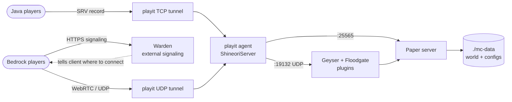

# Minecraft + playit

> Java + Bedrock Minecraft server with playit.gg tunnels and NetherNet support

| | |
|---|---|
| **Host** | ShineoriServer |
| **Category** | Game servers |
| **Status** | 🟢 running |
| **Exposed?** | playit.gg tunnels (no open ports, home IP hidden) + Warden signaling for Bedrock |
| **Server** | Paper (auto-picked, currently 26.1.2), 6 GB RAM, whitelist on, Java + Bedrock |

Compose file: [`stacks/minecraft/`](https://github.com/shineori/homelab/tree/main/stacks/minecraft)

## Why I run it

A private server for me and my friends, on my own hardware, with no monthly hosting bill. Friends join through playit.gg, so my home IP is never exposed and no router ports are open. Some friends play on Bedrock (phone/console), so I added Geyser so everyone can play in the same world, and one address works for both editions.

## Architecture

| Piece | Job |
|---|---|
| **Paper server** | `itzg/minecraft-server` running **Paper**, a faster, vanilla-compatible server that runs Bukkit/Spigot plugins |
| **Plugins** | LuckPerms (permissions), EssentialsX (homes, warps, tpa), CoreProtect (block logging + rollback), GriefPrevention (land claims), Chunky (pre-generation), ViaVersion + ViaBackwards (lets newer/older clients join) |
| **Geyser + Floodgate** | Geyser translates Bedrock to Java. Floodgate lets Bedrock players join without a Java account |
| **playit agent** | Runs as a container next to the server. Dials out to playit.gg, which relays traffic back in. One TCP tunnel for Java, one plain UDP tunnel for Bedrock gameplay |
| **Warden** | Free external signaling service for NetherNet (Bedrock's new networking). Bedrock clients ask Warden over HTTPS how to connect, then connect straight to my UDP tunnel. Warden never carries game traffic |
| **DNS** | One hostname for everyone: an SRV record sends Java to the playit tunnel, and a CNAME on the same name sends Bedrock to Warden |
| **`./mc-data`** | The world, plugin data, and all server settings |

## Security decisions

| Decision | Why |
|---|---|
| **playit.gg instead of port forwarding** | No open router ports, and players never see my home IP |
| **`ONLINE_MODE: TRUE`** | Only real, authenticated Minecraft accounts can join |
| **Whitelist on** (Java `whitelist`, Bedrock `fwhitelist`) | Only friends I've added can join, even if someone finds the address |
| **Plugins pulled by the container from Modrinth/GeyserMC** | The plugin list lives in the compose file, so it's versioned and reviewable instead of random jars dropped in a folder |
| **`VERSION_FROM_MODRINTH_PROJECTS`** | The server only upgrades to a Minecraft version every plugin supports, so an update can't silently break a plugin |
| **Warden for Bedrock signaling** | Avoids needing a public TCP port for NetherNet, and gives players HTTPS so they don't get a "trust on first use" prompt |
| **playit agent secret in `.env`** | The tunnel key stays out of the compose file and out of this repo |
| **Permissions through LuckPerms groups, not op** | Friends get only what they need (warp signs, homes). Op is kept to me |
| **Removed an old dynamic-DNS container** | It was set up to publish my home IP in DNS. It had been failing for a long time, but I removed it and its credential anyway ([audit](cloudflared.md#security-audit)). |

## Setup notes

1. **Back up the world first.** Upgrades rewrite the world format and can't be undone: `sudo tar -czf ~/mc-backup-$(date +%F).tar.gz mc-data`
2. `docker compose up -d`. The container downloads Paper, the Modrinth plugins, and Geyser/Floodgate on every start
3. playit: one **TCP** tunnel to `:25565` (Java) and one plain **UDP** tunnel to `:19132` (Bedrock). Point both at the server's LAN IP, not `127.0.0.1`, unless the port is bound to localhost
4. Geyser config (`mc-data/plugins/Geyser-Spigot/config.yml`):
    - `bedrock.transport: nethernet`
    - `bedrock.signaling.mode: nxs` (Warden)
    - `bedrock.signaling.nxs.advertise-addresses: ["<playit UDP tunnel IP:port>"]`
    - `java.auth-type: floodgate`
5. Claim the instance in the Warden panel (link is printed in the Geyser log), add a custom domain, and create the CNAME it asks for in Cloudflare (DNS only, grey cloud)
6. DNS: SRV `_minecraft._tcp.<name>` to the playit Java tunnel, CNAME `<name>` to Warden. Java players type the name, Bedrock players type the name with port `443`
7. Whitelist: `docker exec -i shineori-mc rcon-cli whitelist add <name>` (Java) or `... fwhitelist add <gamertag>` (Bedrock)
8. EssentialsX warp signs: enable `warp` under `enabledSigns` in `plugins/Essentials/config.yml`, give the default LuckPerms group `essentials.signs.use.warp` and `essentials.warp`, then `/setwarp <name>` at each spot

## Troubleshooting log

| Date | Problem | Root cause | Fix |
|---|---|---|---|
| 2026-10 | A DNS record for an old setup pointed straight at my home IP | Leftover from when friends joined through a port forward | Deleted it, checked against Cloudflare's authoritative nameservers, and removed the dynamic-DNS container ([details](cloudflared.md#security-audit)) |
| 2026-10 | Container stuck in a restart loop after adding plugins | `spark` has no Paper build on Modrinth for the chosen version, and the image exits when a listed project can't be resolved | Removed it from the list. Paper already ships spark built in |
| 2026-10 | Upgrade crashed with "Refusing to overwrite existing migrated file" for the Nether | The world folder held a second, unused vanilla Nether and End from its previous life. The new world layout migration tried to move both into the same place | Compared timestamps (the real one was played last night, the ghost was a year old), moved the ghost dimensions aside, restarted. Migration finished cleanly |
| 2026-10 | `Connection reset` when joining through playit | playit was forwarding to the server's LAN IP while I had bound the port to `127.0.0.1` only | Bound the port normally again. The playit agent logs (`Connection refused` to the LAN IP) pointed right at it |
| 2026-10 | Old `[Warp]` signs said "You do not have permission to use that warp" | EssentialsX reads line 3 of a warp sign as a required group and line 4 as a cost. The signs had descriptions there. The warp data itself was also never on this server | Re-placed signs with lines 3-4 blank, put descriptions on the back, recreated warps with `/setwarp` |
| 2026-10 | Couldn't break protected signs | I was never actually op on this server (the `OPS` line was commented out) | `rcon-cli op`, then set `OPS` in the compose file so it sticks |
| 2026-10 | Geyser warned NetherNet was off. Bedrock drops RakNet on Oct 27 | NetherNet is off by default in Geyser, and playit's "Minecraft Bedrock" tunnel type only speaks RakNet | Switched to a plain UDP tunnel + Warden signaling (`transport: nethernet`, `mode: nxs`) |

## What I'd harden next

- [x] Automated daily backups of the world ✅ *Done:* skips quiet days, keeps 5 locally, archives older ones to the NAS ([details](../infrastructure/minecraft-backups.md))
- [ ] Pin the server and playit images instead of `:latest`
- [ ] Pin Geyser/Floodgate to known-good builds instead of `latest`
- [ ] Move to 26.3 once every plugin supports it (automatic on restart thanks to `VERSION_FROM_MODRINTH_PROJECTS`)
- [ ] Bind `:25565` to the LAN IP only, so other devices can't reach it on unexpected interfaces
- [ ] Enable playit Proxy Protocol + Paper's `proxy-protocol` so logs and CoreProtect see real player IPs
- [ ] Add Vault so LuckPerms prefixes/groups work in EssentialsX
- [ ] Get the compose file and `.env` owned by my user instead of root, so edits don't need sudo

## What I learned

- **Tunnels for non-web traffic:** game traffic is raw TCP/UDP, so it needs a different tool than the Cloudflare Tunnel
- **Read the logs before guessing:** the restart loop, the migration crash, and the connection reset were each explained in one log line
- **Back up before upgrades:** a world format migration is one-way, and I only had a safety net because I made one halfway through
- **SRV vs CNAME:** Java follows SRV records, Bedrock ignores them, so one name can serve both editions with two different record types
- **NetherNet:** Bedrock's new networking uses an HTTPS "signaling" step before WebRTC gameplay, which is why a UDP-only tunnel stopped being enough
- **Layered access control:** authentication (online mode) plus authorization (whitelists) plus least privilege (LuckPerms instead of op)
- **Old setups leave traces:** a DNS record, an unused container, and even a ghost Nether from the world's past all stuck around until something forced me to look
