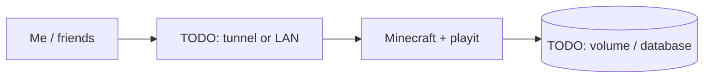

# Minecraft + playit

> Minecraft server with playit.gg tunnel

| | |
|---|---|
| **Host** | ShineoriServer |
| **Category** | Game servers |
| **Status** | 🟢 running <!-- 🟡 in progress / 🔵 planned / ⚫ retired --> |
| **Exposed?** | playit.gg tunnel (no open ports, home IP hidden) |

Compose file: [`stacks/minecraft/`](https://github.com/shineori/homelab/tree/main/stacks/minecraft)

## Why I run it

TODO: one or two sentences. What problem does this solve for you?

## Architecture

## Setup notes

- Moved from ShiNAS to ShineoriServer so all Minecraft pieces live together

TODO: the steps you'd need to rebuild this from scratch.

## Troubleshooting log

| Date | Problem | Root cause | Fix |
|---|---|---|---|
| TODO | | | |

## What I learned

TODO: the skill this proves (great for interviews).
