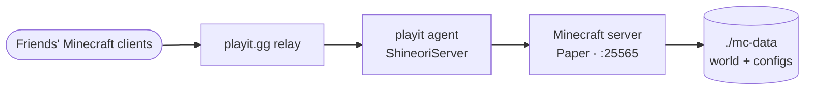

# Minecraft + playit

> Minecraft server with playit.gg tunnel

| | |
|---|---|
| **Host** | ShineoriServer |
| **Category** | Game servers |
| **Status** | 🟢 running |
| **Exposed?** | playit.gg tunnel (no open ports, home IP hidden) |
| **Server** | Paper 1.21.5, 2 GB RAM, whitelist on |

Compose file: [`stacks/minecraft/`](https://github.com/shineori/homelab/tree/main/stacks/minecraft)

## Why I run it

A private server for me and my friends, on my own hardware, with no monthly hosting bill. Friends join through a playit.gg address, so my home IP is never exposed and no router ports are open.

## Architecture

| Piece | Job |
|---|---|
| **Minecraft server** | `itzg/minecraft-server` running **Paper**, a faster, vanilla-compatible server |
| **playit agent** | Dials out to playit.gg, which relays players' game traffic back in, the same idea as the Cloudflare Tunnel but for raw game traffic |
| **`./mc-data`** | The world and all server settings |

## Security decisions

| Decision | Why |
|---|---|
| **playit.gg instead of port forwarding** | No open router ports, and players never see my home IP |
| **`ONLINE_MODE: TRUE`** | Only real, authenticated Minecraft accounts can join |
| **Whitelist on** | Only friends I've added can join, even if someone finds the address |
| **Removed an old dynamic-DNS container** | It was set up to publish my home IP in DNS. It had been failing for a long time, but I removed it and its credential anyway ([audit](cloudflared.md#security-audit)). |

## Setup notes

1. `docker compose up -d` (accepting the EULA through `EULA: "TRUE"`)
2. Set up the playit agent and create a Minecraft (Java) tunnel to port 25565
3. Add friends to the whitelist: `docker exec -it shineori-mc rcon-cli whitelist add <name>`
4. Moved from ShiNAS to ShineoriServer so all the Minecraft pieces live on one machine with more RAM

## Troubleshooting log

| Date | Problem | Root cause | Fix |
|---|---|---|---|
| 2026-10 | A DNS record for an old setup pointed straight at my home IP | Leftover from when friends joined through a port forward | Deleted it, checked against Cloudflare's authoritative nameservers, and removed the dynamic-DNS container ([details](cloudflared.md#security-audit)) |

## What I'd harden next

- [ ] Update the compose file's header comments, which still describe the old port-forward and dynamic-DNS setup
- [ ] Pin the server image instead of `:latest`
- [ ] Back up `./mc-data` (the world is the part that would hurt to lose)

## What I learned

- **Tunnels for non-web traffic:** game traffic is raw TCP, so it needs a different tool than the Cloudflare Tunnel
- **Layered access control:** authentication (online mode) plus authorization (whitelist)
- **Old setups leave traces:** a DNS record and an unused container both kept pointing at my home IP until an audit caught them
