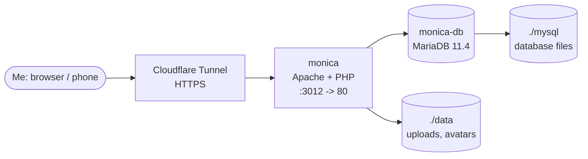

# Monica

> Self-hosted personal CRM: a private place to remember the people in my life

| | |
|---|---|
| **Host** | ShineoriServer |
| **Category** | Apps |
| **Status** | 🟢 running <!-- 🟡 in progress / 🔵 planned / ⚫ retired --> |
| **Exposed?** | Public through the NAS's [Cloudflare Tunnel](cloudflared.md), login required |
| **Port** | 3012 |

Compose file: [`stacks/monica/`](https://github.com/shineori/homelab/tree/main/stacks/monica)

## Why I run it

I'm bad at remembering birthdays, what someone told me last time we talked, or that a friend wanted a certain gift. Monica is a "personal relationship manager": contacts plus notes, important dates, reminders and a log of conversations. Since it's literally a database about my friends and family, I didn't want it on someone else's cloud, so I self-host it. Later I want an agent ([Hermes](hermes-agent.md)) to read it and remind me about upcoming dates.

## Architecture

| Piece | Job |
|---|---|
| `monica` (`monica:4.1.2-apache`) | The app plus its own Apache web server. Serves plain HTTP only. |
| `monica-db` (`mariadb:11.4`) | The database. Monica only supports MySQL/MariaDB. |
| `./data` (bind mount) | Monica's `storage` folder: uploaded photos, documents, avatars |
| `./mysql` (bind mount) | The MariaDB data files |
| Cloudflare Tunnel (outside the stack) | Does the HTTPS part. The official docs say this setup has no SSL and is meant to run behind a proxy, and the tunnel is that proxy. |

## Security decisions

| Decision | Why |
|---|---|
| **Stable 4.x, not the 5.0 beta** | 5.0 is still a beta. This app holds personal info about real people, so I'd rather run the boring stable version. |
| **Pinned image tags** | `monica:4.1.2-apache` and `mariadb:11.4` instead of `latest`, so updates only happen when I choose (same as the rest of the lab) |
| **Port bound to the laptop's LAN IP** | Not `0.0.0.0`, so only the LAN (and the tunnel) can reach it |
| **Secrets in `.env`, not the compose file** | `APP_KEY` and the DB password stay out of the repo. The DB root password is random and I never need it. |
| **`APP_ENV=production` + `APP_TRUSTED_PROXIES`** | Production mode forces HTTPS. Trusting the proxy lets Monica see that Cloudflare already did HTTPS, so it doesn't loop on redirects or build `http://` links. |
| **Bind mounts instead of named volumes** | The official example uses globally named volumes (`data`, `mysql`) that could clash with other stacks. Folders next to the compose file are also easier to back up. |
| **Public route over Tailscale-only** | Best guess, edit me: I wanted to reach it from any browser, and phone contact sync (CardDAV) wants HTTPS |

## Setup notes

1. `mkdir -p ~/docker/monica/{data,mysql} && cd ~/docker/monica`
2. Generate the app key: `echo -n 'base64:'; openssl rand -base64 32`, and a DB password: `openssl rand -base64 24 | tr -d '/+='`
3. Write `.env` (`APP_KEY`, `DB_*`, `APP_URL` set to the public address, `APP_ENV=production`, `APP_TRUSTED_PROXIES=*`) and `docker-compose.yaml`
4. `sudo chown -R 33:33 data` (Apache runs as `www-data`, uid 33)
5. `docker compose up -d`, then `docker compose logs -f app` until the database migrations finish
6. Add a public hostname on the tunnel pointing at the laptop's port 3012
7. Create my account, then run `docker compose exec app php artisan setup:production` once
8. Set `APP_DISABLE_SIGNUP=true` and `docker compose up -d` again

**Updating:** change the pinned tag, back up first (including a database dump), then `docker compose pull && docker compose up -d` and watch the migrations in the logs.

## Troubleshooting log

| Date | Problem | Root cause | Fix |
|---|---|---|---|
| 2026-11-20 | Confused by "no ssl encryption, intended to run behind a proxy" in the official docs | The container only speaks HTTP and expects something else to add HTTPS | Cloudflare Tunnel counts as the proxy, so nothing extra was needed |
| 2026-11-20 | No other problems during setup | | |

## What I'd harden next

- [ ] Turn sign-ups off (`APP_DISABLE_SIGNUP=true`) now that my account exists
- [ ] Put [Cloudflare Access](cloudflared.md) (with [Authentik](authentik.md)) in front of the login
- [ ] Add `~/docker/monica` plus a nightly `mariadb-dump` to the laptop's [backups](../infrastructure/backups.md)
- [ ] Wire up email (homelab Gmail sender) and the scheduler so reminders actually send
- [ ] Sync contacts and birthdays to my phone over CardDAV/CalDAV
- [ ] Uptime Kuma check and a Homepage tile
- [ ] Give [Hermes](hermes-agent.md) a read-only API token for reminder pings

## What I learned

- **"Behind a proxy" just means "bring your own HTTPS":** a lot of self-hosted apps ship HTTP-only and expect a reverse proxy or tunnel in front
- **Named volumes can be global:** giving a volume a fixed `name:` drops the project prefix, so two stacks could end up sharing one by accident
- **Laravel apps need an `APP_KEY`:** it encrypts sessions and some stored data, so losing it is bad. It lives in `.env` and needs to be in the backup.
- **Bind mount ownership matters:** the container's web server user (uid 33) needs to own `./data`, or uploads fail
- **Storing data doesn't mean sending reminders:** Monica needs SMTP and a scheduler running before birthday reminders go anywhere
