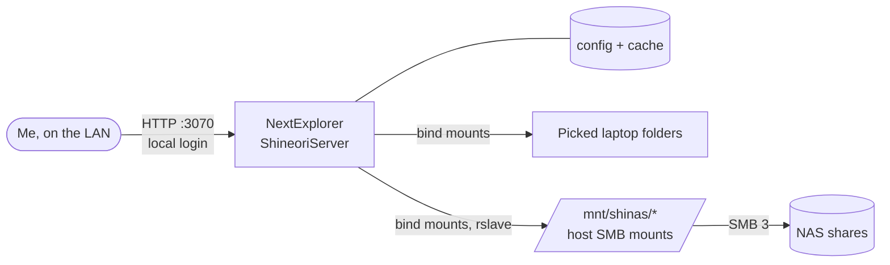

# NextExplorer

> One web file explorer for both of my servers, so I can browse, preview and move files on the laptop and the NAS from a single page

| | |
|---|---|
| **Host** | ShineoriServer |
| **Category** | Apps |
| **Status** | Running |
| **Exposed?** | LAN only, port `3070` bound to the laptop's LAN IP. Not on any tunnel. |
| **Version** | `nxzai/explorer:v4.0.1` (pinned) |

Compose file: [`stacks/nextexplorer/`](https://github.com/shineori/homelab/tree/main/stacks/nextexplorer)

## Why I run it

My files are spread across two machines, and getting to them meant SSH or a mapped Windows drive. That falls apart on my phone or on a computer that isn't set up. NextExplorer gives me one page with previews, search, a text editor, a trash and file versions, and it runs as a single container.

## Architecture

| Sidebar volume | Source | Access |
|---|---|---|
| `Server-Files` | `~/Files` on the laptop | Read + write |
| `Server-Docker` | `~/docker` on the laptop | Read only |
| `Server-Backups` | `~/backups` on the laptop | Read only |
| `NAS-Home` | My NAS home folder | Read + write |
| `NAS-HardcoreSSD` | NAS share | Read + write |
| `NAS-Share` | NAS share | Read + write |
| `NAS-ISOs` | NAS share | Read + write |
| `NAS-Docker` | NAS share | Read only |

## Security decisions

- **LAN only.** A login page in front of this much data shouldn't be public. If I ever publish it, it goes behind my identity provider first.
- **Picked folders, not my whole laptop home.** `~/.ssh` and other credential folders never enter the container, so a bug in the app can't reach them.
- **Admin terminal off** (`TERMINAL_ENABLED=false`). I don't need a browser shell in a container that can see all of my files.
- **Read-only where edits could do damage.** Docker stack folders on the laptop can be viewed but not changed from here.
- **Pinned image from the project's own namespace.** Its docs show a different registry in some examples, so I checked the release and tag publisher before picking `nxzai/explorer`.
- **I read the entrypoint before starting it.** It only changes ownership on `/config` and `/cache`, so it won't rewrite permissions on my data.
- **SMB password in a root-only file** (`/etc/shinas-smb.cred`, mode 600), not in the compose file, where `docker inspect` could show it.
- **Immutable mountpoints** (`chattr +i`). If the NAS is down, the empty folder can't be written to, so nothing lands on the laptop's disk by mistake.
- **Activity log on,** so there's a record of sign-ins, downloads, deletes and shares.

## Setup notes

1. Run `setup-shinas-mount.sh` with sudo. It installs `cifs-utils`, asks for the NAS password, tests the login on one share, mounts the shares and writes a marked block to `/etc/fstab`.
2. `docker compose up -d`
3. Open the page right away and create the admin account, because the setup screen is open to the LAN until someone does.
4. Turn on two-factor in **Settings → Two-factor**.

Back up `config/` (accounts, shares, settings). `cache/` can be rebuilt.

## Troubleshooting log

| Problem | Cause | Fix |
|---|---|---|
| Port conflict on the default `3000` | Open WebUI already uses it | Published on `3070` instead |
| `mount error(2): No such file or directory` for `data` | My media folder isn't an SMB share, so there's nothing to mount | The script skips it and keeps going. It needs a shared folder on the NAS first. |

## What I'd harden next

- Add single sign-on through my identity provider.
- Swap my main NAS account for a limited NAS user, so the password on the laptop can't administer the NAS.
- Hide the stacks folder inside `NAS-Home`, because it holds app secrets and is writable there.

## What I learned

- SMB fit better than NFS here. The NAS already enforces per-user permissions on those shares, and new files get the right owner without matching user IDs across machines.
- A plain bind mount misses a network share that mounts after the container starts. Mount propagation (`rslave`) passes it through.
- Mounting a whole home folder is the easy option, but listing folders one by one keeps secrets out of the container entirely, not just out of the UI.
