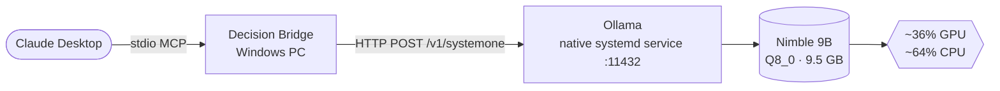

# Nimble decision model + Decision Bridge

> A local "System One" model that gives Claude fast, typed yes/no, choice and score answers with probabilities

| | |
|---|---|
| **Host** | ShineoriServer (model) + Windows PC (bridge) |
| **Category** | AI |
| **Status** | 🟢 running |
| **Exposed?** | No. LAN only, through the existing Ollama service |
| **GPU** | RTX 2060 (partly; see Architecture) |

No compose file: Nimble runs inside the native [Ollama](ollama-stack.md) service, and Decision Bridge is a Python tool installed on the PC.

## Why I run it

Chat models are great at explaining things but slow and wordy when all I need is a judgment call, like "is this container update risky?" Decision models (also called System One models) skip the writing. You give them some text and a typed question, and they return a probability for every answer in one pass.

TypeSafe's Jev made this category popular, but it's closed and only available as a paid API. Nimble (by Bespoke Labs, Apache 2.0) is an open model built for the same job, and Ollama serves it through the same style of API. I run it so Claude can hand off quick decisions to a model on my own hardware.

## Architecture



| Piece | Job |
|---|---|
| **Nimble** | A 9B decision model (Qwen3.5 base plus a LoRA from Bespoke Labs). Answers three question types: `choice` (pick a label), `noul` (probability of yes) and `score` (rate on an ordered scale). |
| **Ollama** | The same native install from the [Ollama stack](ollama-stack.md). Decision support needs Ollama 0.40.4 or newer for Nimble. |
| **Decision Bridge** | A small open-source MCP server (MIT, Python) that Claude Desktop launches over stdio. It validates every request and response and only ever talks to the Ollama URL I configure. |

The default `nimble` build is 9.5 GB, which is bigger than the GPU's 6 GB of VRAM, so Ollama splits it between GPU and CPU. That's fine for my use because I mostly run Nimble on its own instead of next to a chat model.

## Security decisions

| Decision | Why |
|---|---|
| **Self-hosted instead of the hosted Jev API** | The text I ask about (release notes, logs, configs) stays on my network |
| **Read the bridge's source before installing** | It's a pre-release from a small project. I checked that it only uses `httpx` to reach Ollama, with no `subprocess`, `eval` or other network calls, and has three standard dependencies |
| **Remote Ollama allowed explicitly** | The bridge refuses non-localhost servers by default. I turned that on with `DECISION_BRIDGE_ALLOW_REMOTE=true` because Ollama lives on another machine on my LAN |
| **No exposure outside the LAN** | Ollama has no authentication, so it stays off the Cloudflare Tunnel |
| **Decisions are advisory only** | The bridge returns answers but never acts on them. Claude (or I) decide what happens next |

## Setup notes

1. Upgrade Ollama to 0.40.4+ on ShineoriServer: `curl -fsSL https://ollama.com/install.sh | sh` (my port and keep-alive settings live in `override.conf`, which the installer leaves alone)
2. Pull the model: `OLLAMA_HOST=<SERVER_LAN_IP>:11432 ollama pull nimble`
3. On the PC, clone [decision-bridge-nimble-mcp](https://github.com/poacosta/decision-bridge-nimble-mcp) and run `uv tool install .`
4. Check it: `decision-bridge doctor --smoke-test` with `DECISION_BRIDGE_OLLAMA_URL` and `DECISION_BRIDGE_ALLOW_REMOTE` set
5. Add it to `claude_desktop_config.json`:

```json
"decision-bridge": {
  "command": "C:\\Users\\<me>\\.local\\bin\\decision-bridge.exe",
  "args": ["serve"],
  "env": {
    "DECISION_BRIDGE_OLLAMA_URL": "http://<SERVER_LAN_IP>:11432",
    "DECISION_BRIDGE_ALLOW_REMOTE": "true",
    "DECISION_BRIDGE_REQUEST_TIMEOUT_SECONDS": "180"
  }
}
```

6. Restart Claude Desktop. It exposes two tools: `decide` and `bridge_status`

**First test:** fed it Immich release notes with a breaking database migration. It answered `risky` (99.4%), backup needed (99.99%) and effort "Major" (1.98 out of 2), in about 1.7 seconds once warm.

## Troubleshooting log

| Date | Problem | Root cause | Fix |
|---|---|---|---|
| 2026-10-27 | `ollama pull nimble` failed | Nimble requires Ollama 0.40.4+ and the server had 0.40.3 | Upgraded Ollama with the official install script (now 0.40.11) |
| 2026-10-27 | The first decision request timed out after 55 seconds | Cold start: loading a 9.5 GB model that only partly fits in VRAM | Waited for it to finish loading. Warm requests take about 2 to 3 seconds. Raised the bridge timeout to 180 seconds |
| 2026-10-27 | Couldn't find `claude_desktop_config.json` in `%APPDATA%\Claude` | Claude Desktop is the Microsoft Store (MSIX) version, which keeps its files under `%LOCALAPPDATA%\Packages\Claude_*\LocalCache\Roaming\Claude` | Edited the file there, after making a backup |
| 2026-10-27 | Risk of a broken config after editing it with PowerShell | Windows PowerShell's `Set-Content -Encoding utf8` adds a hidden BOM byte that some JSON parsers reject | Rewrote the file as UTF-8 without a BOM and confirmed it starts with `{` |

## What I'd harden next

- [ ] Try a smaller quantized build of Nimble that fits fully in the 6 GB of VRAM, and compare speed and accuracy
- [ ] Pin the bridge to a specific commit instead of whatever `main` was when I cloned it
- [ ] Bind Ollama to the LAN interface only instead of `0.0.0.0`
- [ ] Build a small test set of my own (past update notes I already judged) to pick confidence thresholds, since the model's confidence isn't a guarantee
- [ ] Hook it into my weekly update check so every container gets a 🟢/🟡/🔴 verdict from Nimble

## What I learned

- **System One vs System Two models:** decision models return numbers in one pass, while chat models write text token by token. Each is the right tool for different jobs
- **Quantization and VRAM:** a 9B model at Q8_0 is about 9.5 GB, so it won't fit in 6 GB and gets split across CPU and GPU
- **MCP over stdio:** Claude Desktop starts the bridge as a local program and talks to it through standard input and output, so there's no extra port to open
- **Reading code before running it:** a quick search for network calls and shell commands is a cheap check before trusting a small project