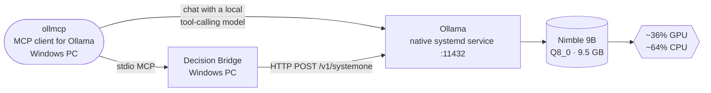

# Nimble decision model + Decision Bridge

> A local "System One" model that gives local AI fast, typed yes/no, choice and score answers with probabilities

| | |
|---|---|
| **Host** | ShineoriServer (model) + Windows PC (bridge) |
| **Category** | AI |
| **Status** | 🟢 running |
| **Exposed?** | No. LAN only, through the existing Ollama service |
| **GPU** | RTX 2060 (partly; see Architecture) |

No compose file: Nimble runs inside the native [Ollama](ollama-stack.md) service, and Decision Bridge is a Python tool installed on the PC.

## Why I run it

Chat models are great at explaining things but slow and wordy when all I need is a judgment call, like "is this container update risky?" Decision models (also called System One models) skip the writing. You give them some text and a typed question, and they return a probability for every answer in one pass.

TypeSafe's Jev made this category popular, but it's closed and only available as a paid API. Nimble (by Bespoke Labs, Apache 2.0) is an open model built for the same job, and Ollama serves it through the same style of API. I run it so my local AI can hand off quick decisions to a model on my own hardware.

## Architecture



| Piece | Job |
|---|---|
| **Nimble** | A 9B decision model (Qwen3.5 base plus a LoRA from Bespoke Labs). Answers three question types: `choice` (pick a label), `noul` (probability of yes) and `score` (rate on an ordered scale). |
| **Ollama** | The same native install from the [Ollama stack](ollama-stack.md). Decision support needs Ollama 0.40.4 or newer for Nimble. |
| **Decision Bridge** | A small open-source MCP server (MIT, Python) that my MCP client launches over stdio. It validates every request and response and only ever talks to the Ollama URL I configure. |
| **ollmcp** | [MCP Client for Ollama](https://github.com/jonigl/mcp-client-for-ollama): a terminal chat app that runs a local tool-calling model on Ollama and gives it MCP tools. It's what launches the bridge, since Ollama can't run MCP servers on its own. |

The default `nimble` build is 9.5 GB, which is bigger than the GPU's 6 GB of VRAM, so Ollama splits it between GPU and CPU. That's fine for my use because I mostly run Nimble on its own instead of next to a chat model.

## Security decisions

| Decision | Why |
|---|---|
| **Self-hosted instead of the hosted Jev API** | The text I ask about (release notes, logs, configs) stays on my network |
| **Read the bridge's source before installing** | It's a pre-release from a small project. I checked that it only uses `httpx` to reach Ollama, with no `subprocess`, `eval` or other network calls, and has three standard dependencies |
| **Remote Ollama allowed explicitly** | The bridge refuses non-localhost servers by default. I turned that on with `DECISION_BRIDGE_ALLOW_REMOTE=true` because Ollama lives on another machine on my LAN |
| **No exposure outside the LAN** | Ollama has no authentication, so it stays off the Cloudflare Tunnel |
| **Decisions are advisory only** | The bridge returns answers but never acts on them. The local chat model (or I) decide what happens next |

## Setup notes

1. Upgrade Ollama to 0.40.4+ on ShineoriServer: `curl -fsSL https://ollama.com/install.sh | sh` (my port and keep-alive settings live in `override.conf`, which the installer leaves alone)
2. Pull the model: `OLLAMA_HOST=<SERVER_LAN_IP>:11432 ollama pull nimble`
3. On the PC, install [decision-bridge-nimble-mcp](https://github.com/poacosta/decision-bridge-nimble-mcp) pinned to a commit: `uv tool install --python 3.13 "git+https://github.com/poacosta/decision-bridge-nimble-mcp@<commit>"`
4. Check it: `decision-bridge doctor --smoke-test` with `DECISION_BRIDGE_OLLAMA_URL` and `DECISION_BRIDGE_ALLOW_REMOTE` set
5. Install the MCP client for Ollama: `uv tool install --python 3.13 ollmcp`
6. Add the bridge to a `servers.json` file (same `mcpServers` format other MCP clients use):

```json
{
  "mcpServers": {
    "decision-bridge": {
      "command": "C:\\Users\\<me>\\.local\\bin\\decision-bridge.exe",
      "args": ["serve"],
      "env": {
        "DECISION_BRIDGE_OLLAMA_URL": "http://<SERVER_LAN_IP>:11432",
        "DECISION_BRIDGE_ALLOW_REMOTE": "true",
        "DECISION_BRIDGE_REQUEST_TIMEOUT_SECONDS": "180"
      }
    }
  }
}
```

7. Start a chat with a local tool-calling model (Nimble itself only answers decisions, so it can't be the chat model):

```powershell
ollmcp --host http://<SERVER_LAN_IP>:11432 --model <tool-calling-model> --servers-json servers.json
```

   The chat model then sees two tools: `decide` and `bridge_status`. I use `gemma4:e2b-it-qat` as the chat model: it's small enough to swap in and out next to Nimble on a 6 GB GPU.
8. Give the chat model a system prompt with one full example of a `decide` call (each question needs `"type"`, `"instructions"` and `"criteria"`). Small models need it; without it they send plain strings and the bridge rejects them

**ollmcp test (2026-11-16):** Gemma 4 2B read the same kind of Immich breaking-migration notes, called `decide`, got Nimble's answer `risky` (99.76%) back in about 18 seconds (including loading Nimble), and explained it in plain words. The whole round trip took about 50 seconds because Ollama swaps the two models on the GPU.

**First test:** fed it Immich release notes with a breaking database migration. It answered `risky` (99.4%), backup needed (99.99%) and effort "Major" (1.98 out of 2), in about 1.7 seconds once warm.

## Troubleshooting log

| Date | Problem | Root cause | Fix |
|---|---|---|---|
| 2026-10-27 | `ollama pull nimble` failed | Nimble requires Ollama 0.40.4+ and the server had 0.40.3 | Upgraded Ollama with the official install script (now 0.40.11) |
| 2026-10-27 | The first decision request timed out after 55 seconds | Cold start: loading a 9.5 GB model that only partly fits in VRAM | Waited for it to finish loading. Warm requests take about 2 to 3 seconds. Raised the bridge timeout to 180 seconds |
| 2026-11-16 | `ollmcp` crashed with `NoConsoleScreenBufferError` | It's a full-screen terminal app and needs a real Windows console; my remote shell wasn't one | Run it in Windows Terminal. For scripted tests I used ollmcp's own Python libraries instead |
| 2026-11-16 | Tools I installed "disappeared" from my normal terminal | The remote shell I used runs inside a Microsoft Store (MSIX) app's sandbox, so anything written to AppData was redirected into that app's private folder | Set `UV_TOOL_DIR`, `UV_TOOL_BIN_DIR`, `UV_PYTHON_INSTALL_DIR` and `UV_CACHE_DIR` to folders under `C:\Users\<me>\.local` and `.cache`, then reinstalled |
| 2026-11-16 | `uv` couldn't set up Python 3.15 (`Missing expected target directory for Python minor version link`) | A half-finished Python install in the redirected folder | Pinned the tools to Python 3.13 |
| 2026-11-16 | The chat model's `decide` calls were rejected (`Input should be a valid dictionary`, then `Unable to extract tag using discriminator 'type'`) | The tool's input is nested and a 2B model doesn't follow it from the schema alone | Added a system prompt with a full example call; it then got Nimble's answer on its second try |
| 2026-11-16 | Gemma 4 12B took over 15 minutes and kept running after I cancelled | About 4 tokens a second on the laptop with long "thinking"; Ollama kept generating for the closed request | Restarted Ollama (`sudo systemctl restart ollama`) and stuck with the 2B model |
| 2026-10-27 | Risk of a broken `servers.json` after editing it with PowerShell | Windows PowerShell's `Set-Content -Encoding utf8` adds a hidden BOM byte that some JSON parsers reject | Rewrote the file as UTF-8 without a BOM and confirmed it starts with `{` |

## What I'd harden next

- [ ] Try a smaller quantized build of Nimble that fits fully in the 6 GB of VRAM, and compare speed and accuracy
- [x] **Pinned the bridge to a specific commit** ✅ *Done 2026-11-16:* installed from `git+...@<commit>` instead of whatever `main` was
- [ ] Find a local chat model that follows the `decide` format on the first try, so it doesn't need a retry
- [ ] Bind Ollama to the LAN interface only instead of `0.0.0.0`
- [ ] Build a small test set of my own (past update notes I already judged) to pick confidence thresholds, since the model's confidence isn't a guarantee
- [ ] Hook it into my weekly update check so every container gets a 🟢/🟡/🔴 verdict from Nimble

## What I learned

- **System One vs System Two models:** decision models return numbers in one pass, while chat models write text token by token. Each is the right tool for different jobs
- **Quantization and VRAM:** a 9B model at Q8_0 is about 9.5 GB, so it won't fit in 6 GB and gets split across CPU and GPU
- **MCP over stdio:** the MCP client (ollmcp) starts the bridge as a local program and talks to it through standard input and output, so there's no extra port to open
- **Ollama doesn't run MCP servers itself:** a client like ollmcp sits in between, chatting with a model on Ollama and launching the tools for it
- **Small models need examples, not just schemas:** the 2B model only built a correct nested tool call after seeing one, and the bridge's strict validation stopped its bad attempts before they reached Nimble
- **Sandboxed apps redirect AppData:** a Microsoft Store app's child processes write AppData into the app's own folder, so installs made there are invisible to the rest of Windows
- **Reading code before running it:** a quick search for network calls and shell commands is a cheap check before trusting a small project