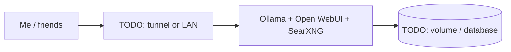

# Ollama + Open WebUI + SearXNG

> Local LLM stack with private web search

| | |
|---|---|
| **Host** | ShineoriServer |
| **Category** | AI |
| **Status** | 🟢 running <!-- 🟡 in progress / 🔵 planned / ⚫ retired --> |
| **Exposed?** | Open WebUI through Cloudflare Tunnel (usually spun down); SearXNG LAN only, with its traffic leaving through ProtonVPN |

Compose file: [`stacks/ollama-stack/`](https://github.com/shineori/homelab/tree/main/stacks/ollama-stack)

## Why I run it

TODO: one or two sentences. What problem does this solve for you?

## Architecture

## Setup notes

- Open WebUI spun down most of the time, so SSO intentionally skipped

TODO: the steps you'd need to rebuild this from scratch.

## Troubleshooting log

| Date | Problem | Root cause | Fix |
|---|---|---|---|
| TODO | | | |

## What I learned

TODO: the skill this proves (great for interviews).
